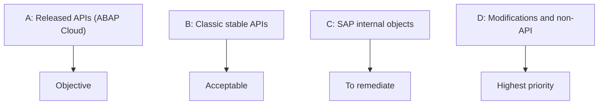
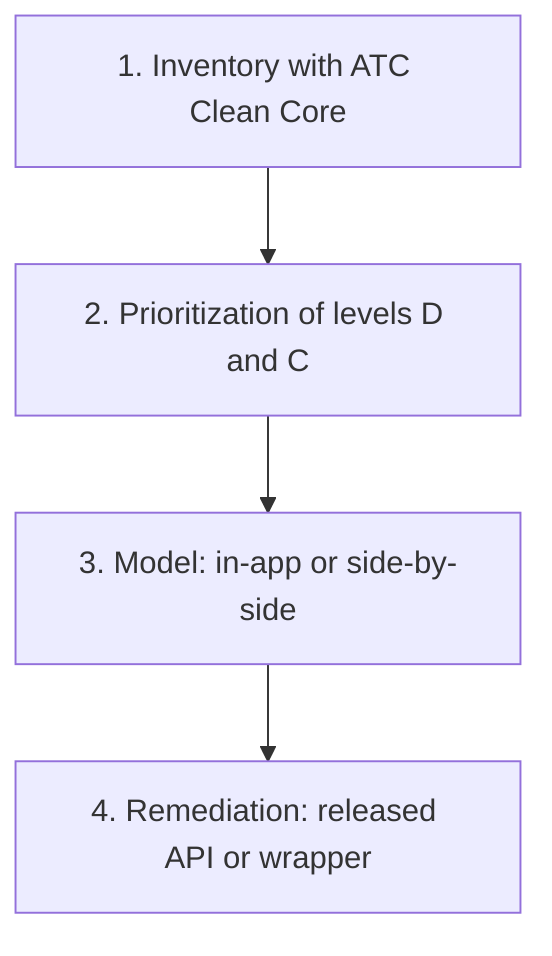

Years of modifications, user exits and implicit enhancements have a well-known effect: every SAP S/4HANA upgrade becomes slow, expensive and risky. The underlying need is to keep adapting SAP to the business without losing the ability to upgrade it.

Clean Core responds to that need: keeping the standard core free of modifications and concentrating adaptations in extensions that use only stable interfaces. This article proposes a method to get there from a system with existing custom code: classify it by levels, prioritize and remediate. For the general concept, see [Clean Core without the hot air](/en/blog/clean-core-no-nonsense/).

## The four Clean Core levels

The first step is to sort out the starting point. Custom code is classified according to the type of SAP interface it uses:

| Level | What it means | Example |
|---|---|---|
| **A** | Released APIs only, with a stability contract | Extension with ABAP Cloud |
| **B** | Classic APIs, stable but not released; they are considered Clean Core | IDoc or ALV Grid |
| **C** | SAP internal objects: neither released nor prohibited, and SAP may change or remove them | Direct read of a standard table |
| **D** | Modifications of the standard and nonAPI objects, which are not Clean Core | Modification of standard code |

The reading is simple: level A is the destination, B is tolerable, and levels C and D are the ones that put the upgrade at risk. This concept of levels replaces the previous three-layer model (3-tier) and relies on the object classification of SAP's Cloudification Repository, which ATC uses when analyzing the code.

## The four-step method

### 1. Inventory and classification

The Clean Core ATC checks are run on the custom code, and the findings are grouped by level. This shows what percentage of the code lives at each level before anything is touched. To configure the check variants, see [ATC and preparation for ABAP Cloud](/en/blog/atc-readiness-abap-cloud/).

### 2. Prioritization

Start with levels C and D, the ones with the highest risk for upgrades, and leave what is already stable for later. Classifying before migrating avoids working on what does not matter.

### 3. Choosing the extensibility model

For each business need, decide between two paths:

- **Extension within S/4HANA** (ABAP Cloud, in-app), when the logic lives alongside the core data.
- **Side-by-side application on SAP BTP**, when decoupling it is preferable.

Choosing well here saves rework. The decision criteria are detailed in [the three levels of extensibility in ABAP Cloud](/en/blog/abap-cloud-tres-niveles-extensibilidad/).

### 4. Remediation

Non-released accesses are replaced with released APIs. When no alternative exists, the object is encapsulated in a wrapper to isolate the risk at a single point. The pattern is explained in [wrappers for legacy code](/en/blog/abap-cloud-wrappers-legacy/).

## Lessons from the method

- Classify before migrating to avoid working on what does not matter.
- Not everything is solved the same way: choosing well between in-app and side-by-side saves rework.
- A well-designed wrapper is a pragmatic way out when there is no released API.

## Keeping the core clean

Classification is not a one-time exercise. Regular ATC checks keep the core clean and allow every new extension to be created at the right level from the start. If your organization needs support to classify its code and plan remediation, see our [consulting services](/consulting/).
