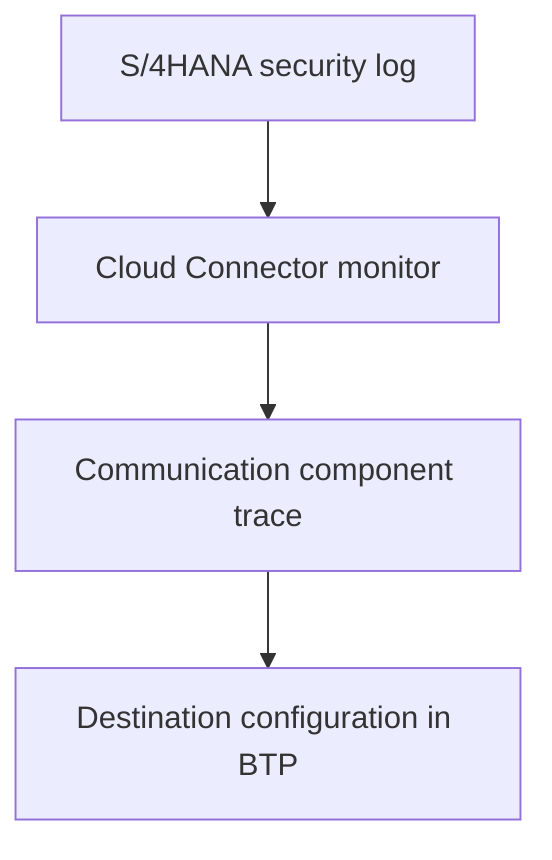

When an SAP BTP application must read and execute actions in SAP S/4HANA with the user's own identity, and not with a technical user, the Cloud Connector stops being just a tunnel. It is the point where it is decided whether the identity travels to the system or is lost along the way.

This article gathers the Cloud Connector side configuration as it was left in a productive environment, and the failures that appeared when validating identity propagation in a quality environment. To review what the tunnel is and how a destination is typed, it is worth reading first [Destinations and Cloud Connector: connecting BTP without opening the firewall](/en/blog/btp-admin-destinations-conectividad/).

## Role of the Cloud Connector in identity propagation

Identity propagation (*principal propagation*) works with an X.509 certificate that the Cloud Connector generates for the user and forwards to S/4HANA. The system must accept that certificate and translate it into an SAP user. Each piece has its side:

| Side | What is configured |
|---|---|
| SAP BTP | A destination with OnPremise proxy and PrincipalPropagation authentication |
| Cloud Connector | Subaccount, mapping with HTTPS and X.509 principal, resources and trust |
| S/4HANA | Import of the system certificate, email mapping rule and profile parameters |

This article covers the first two rows. The S/4HANA side appears only in the failures, because that is where almost all of them manifest.

## Step 1: add the subaccount without touching the existing ones

A productive Cloud Connector usually serves other integrations in operation. Adding a new subaccount only adds: there is no need to modify or delete the ones already connected, and it is best to do it within an agreed maintenance window.

On the **Connector** screen, the **Add Subaccount** button opens the wizard. On a connector that still has no subaccounts, such as the one in the screenshot, the screen is called **Define Subaccount** and the button is in the same place.

The wizard steps are:

1. Select **Configure using authentication data**.
2. Leave the **Managed** checkbox unchecked.
3. Upload the `authentication.data` file for the subaccount, which is downloaded from the SAP BTP cockpit and is for single use only.

Before you click **Finish**, the wizard shows the data read from the file. Two fields deserve attention:

- **Location ID.** If the Cloud Connector already serves other subaccounts, the location identifier used must also be specified in the SAP BTP destination. Leave it empty only if none has been agreed.
- **Auto Renewal.** With automatic renewal OFF, the subaccount certificate expires without warning. You must note its expiry date and who is responsible for renewing it.

The following screenshot shows that last step of the wizard with the Location ID filled in and Auto Renewal OFF.

## Step 2: mapping with HTTPS and X.509 principal

The mapping translates the virtual host that SAP BTP sees into the internal S/4HANA host. It is created in **Cloud to On-Premises**, **Access Control** tab, with these values:

| Field | Value |
|---|---|
| Back-end Type | ABAP System |
| Protocol | HTTPS |
| Principal Type | X.509 Certificate |
| Internal and virtual host | Those agreed with the network team, with the system's HTTPS port |

Two of these values allow no alternative:

- **The protocol must be HTTPS.** With HTTP without TLS, identity propagation does not even appear as an option in the principal type dropdown: it only offers none or Kerberos.
- **The principal type must be X.509 Certificate**, which is what enables forwarding of the user identity to S/4HANA.

In the quality test, the incorrectly set principal type was detected by analyzing the Cloud Connector log, after seeing access denied in the authorization handler. Checking in the dropdown that the option exists before saving avoids that diagnosis.

The correct mapping appears with green status, the result **Reachable**, the HTTPS protocol and the ABAP System type:

## Step 3: publish only the necessary routes

The resource indicates which S/4HANA routes are reachable through the mapping. Only the routes that the application consumes are published, not the entire system:

- **Access Policy:** `Path and All Sub-Paths` for the OData service routes.
- **Upgrade Allowed:** unchecked.
- **Description:** it is advisable to indicate which service each route corresponds to.

The previous screenshot shows a provisional resource with the root path and the `Path Only` policy. On its own, it does not grant access to any service. Once the definitive resources have been created, it is best to deactivate or delete it, so as not to leave more exposed surface than necessary.

## Automatic trust synchronization

In **Cloud to On-Premises**, the **Principal Propagation** tab has the **Automatic Trust Synchronization** switch. It must be set to ON: if SAP BTP renews its JWT signing keys, the Cloud Connector picks them up without manual intervention.

The check is twofold: the notice at the top shows the date of the last trust update, and the **Trust Configuration** table lists the subaccount keys with the Trusted status.

## The destination in SAP BTP

The destination is created in the cockpit, under **Connectivity > Destinations**, not in the Cloud Connector. It is the name with which the application calls S/4HANA through the mapping:

| Field | Value |
|---|---|
| Type | HTTP |
| Proxy Type | OnPremise |
| Authentication | PrincipalPropagation |
| URL | The virtual host and port of the mapping, not the internal host |
| Location ID | Empty, unless one was agreed when adding the subaccount |

Two details prevent confusion. The destination carries the virtual host, not the internal one. And the `http` protocol in the URL is the one for the segment up to the Cloud Connector: encryption toward S/4HANA is provided by the HTTPS mapping.

Under **Additional Properties**, the destination properties are added: `sap-client`, `WebIDEUsage`, `product.name` and `HTML5.DynamicDestination`.

## What Check Connection does not prove

After saving the destination, **Check Connection** returns that the backend is reachable from the Cloud Connector. The Reachable result of the mapping indicates the same. Both checks confirm the network and the tunnel, and nothing more. **They do not test authentication.**

Configuration confirmation is also done from the cockpit, in **Connectivity > Cloud Connectors** of the subaccount: the active connection, high availability with its connected shadow instance and, in the exposed systems, the resources in Available status. This does not validate identity either: authentication is verified with a real call, executed with different users.

The screenshot shows the **Cloud Connectors** view in the cockpit, with the connector connected and the details of the master instance.

## Two silent failures when validating propagation

During quality validation, the tunnel and the destination returned correct results and the identity was not arriving. Two different causes, neither with an error message in the application. Add to these the mapping without HTTPS or with the wrong principal type, described in step 2:

1. **Duplicate email between users.** The S/4HANA certificate rule resolves the user by email. With two SAP users sharing the same email, the system rejects access for security reasons instead of choosing one. The symptom is a blank screen or a fallback to manual login, even though the communications component trace shows the certificate accepted and forwarded. Only the security log reveals it (reason 35 in `SM20`: ambiguous assignment of the X.509 certificate to SAP accounts). It is prevented with a query to the user master that detects repeated emails among the users in scope.
2. **SAML ahead of the certificate.** On a service node, the list of login procedures had SAML before the certificate: the system tried SAML with the certificate already accepted and the external identity provider blocked the login. It was resolved by restoring the standard procedure on that node, which was not the first one reviewed.

## Diagnostic order when the identity does not arrive

The efficient order is the one that starts where the answer usually is, and which in quality validation was the last place anyone looked:

1. **S/4HANA security log** (`SM20`): failed accesses with the certificate method within the time window of the attempt. It gives the direct answer in most cases.
2. **Cloud Connector monitor:** confirms that the request arrived, with which user and with what result.
3. **Communication component trace:** confirms that the certificate is accepted and forwarded.
4. **Destination configuration in BTP:** only if the previous three are clean.

A note on traces: in the quality test, four were captured without collecting anything useful, because the capture window did not match the actual time of the attempt. A time offset between the server and the person running the test had been assumed that did not exist. Before analyzing a trace, it is worth confirming the time difference.

## Scope and limits

- Validation of identity propagation with real users was done in a quality environment. In the productive environment, the Cloud Connector configuration, the identity propagation and the destination are done, and the role of the Cloud Connector ends there.
- The S/4HANA part (import of the system certificate, the `CERTRULE` rule by email, profile parameters and ICM restart) is mentioned here only as context for the failures.
- The steps correspond to the Cloud Connector administration console and the SAP BTP cockpit as used in the project. Labels may vary between versions.
