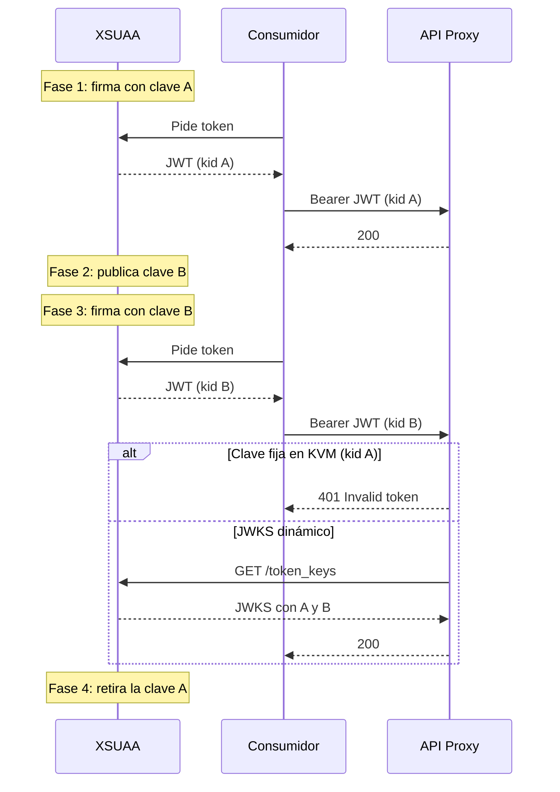
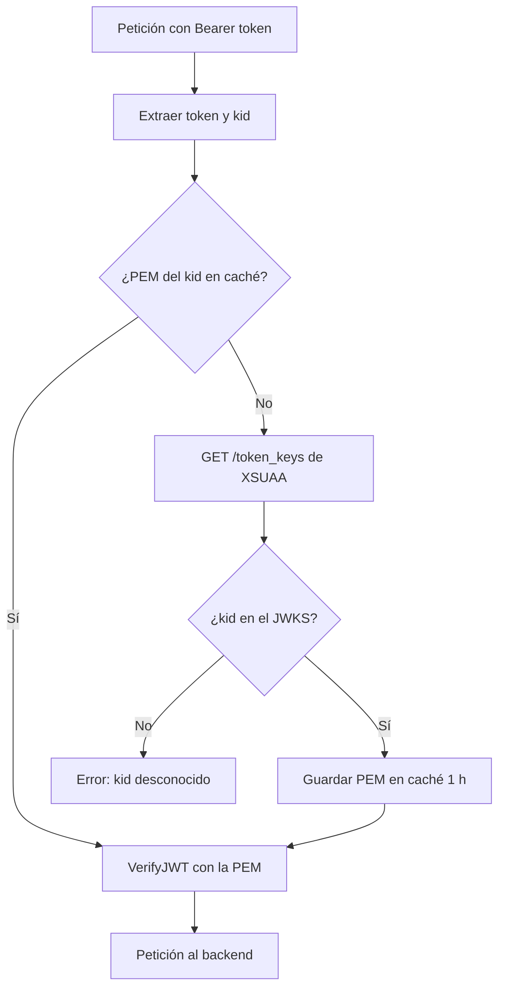

One fine day, without anyone having deployed anything, all your SAP API Management API Proxies start rejecting requests with a 401. The token is obtained without any problem, the client certificate is valid, the scope is correct... and even so:

```json
{
  "fault": {
    "faultstring": "Invalid token: policy(JWT_VerifyToken)",
    "detail": {
      "errorcode": "steps.jwt.InvalidToken"
    }
  }
}
```


It happened to me on a real project with four proxies (SOAP and OData) protected with XSUAA JWT. All four went down at once. In this article I explain what was behind it, how to diagnose it in five minutes and how to redesign the validation so that the next key rotation does not affect you. It is the third part of the series on SAP API Management, after [TLS ciphers](/en/blog/sap-api-management-tls-ciphers-changing/) and [enabling the API Management runtime](/en/blog/sap-integration-suite-enabling-api-management-runtime/).

## Before we start: what is XSUAA

**XSUAA** (Extended Services for User Account and Authentication) is the OAuth 2.0 authorization server of SAP BTP in the Cloud Foundry environment. In the BTP Cockpit it appears as the **Authorization and Trust Management** service.

Its role is to issue and back the tokens that protect the applications and APIs of a subaccount:

- **It issues JWT tokens.** When an application or an external system authenticates (with a user through an Identity Provider, or without a user via client credentials), XSUAA returns an access token in JWT format.
- **It signs those tokens** with an RSA private key (RS256 algorithm). Whoever receives the token validates it with the corresponding public key.
- **It defines what each consumer can do.** The scopes, role templates and authorities are declared in the security descriptor (`xs-security.json`). The token includes the granted scopes, and the API checks them.
- **It delivers the credentials to each client** through service keys: `clientid` and `clientsecret`, or an x509 certificate if mTLS is used.
- **It publishes its public keys** at the `/token_keys` endpoint (a JWKS), so that anyone can verify the signature of its tokens.

Each subaccount has its own identity zone, with URLs of the type `https://<subdominio>.authentication.<región>.hana.ondemand.com`. From there come the token endpoint (`/oauth/token`), the JWKS (`/token_keys`) and the `issuer` that appears inside each JWT. If you want to see XSUAA from an application's side, [this article on authentication in CAP](/en/blog/cap-auth-xsuaa/) explains how it is configured.

In short: **XSUAA issues and signs the token, and your API Proxy has to verify that signature.** To verify it, it needs the correct public key, and that is where the problem covered in this article begins.

## The scenario

The pattern is very common when an external system consumes APIs published on SAP BTP:

1. The consumer obtains an **XSUAA** token via client credentials (in my case with an x509 certificate and mTLS).
2. It calls the **API Management** API Proxy with `Authorization: Bearer <token>`.
3. The proxy validates the JWT with the **VerifyJWT** policy: signature, issuer and audience.
4. If it is valid, the proxy forwards the request to the backend (in my case, a Cloud Integration iFlow).

Everything depends on which public key the proxy uses to validate the token signature. In the original implementation, the public key was stored in a **Key Value Map** and the policy read it from there:

```xml
<!-- KVM_ReadXSUAAConfig -->
<KeyValueMapOperations mapIdentifier="XSUAA_Blog" async="false" continueOnError="false" enabled="true" xmlns="http://www.sap.com/apimgmt">
    <Get assignTo="private.xsuaa.issuer" index="1">
        <Key><Parameter>issuer</Parameter></Key>
    </Get>
    <Get assignTo="private.xsuaa.audience" index="1">
        <Key><Parameter>audience</Parameter></Key>
    </Get>
    <Get assignTo="private.xsuaa.publickey" index="1">
        <Key><Parameter>publickey</Parameter></Key>
    </Get>
    <Scope>environment</Scope>
</KeyValueMapOperations>
```

```xml
<!-- JWT_VerifyToken -->
<VerifyJWT async="false" continueOnError="false" enabled="true" xmlns="http://www.sap.com/apimgmt">
    <Algorithm>RS256</Algorithm>
    <Source>jwt_token</Source>
    <PublicKey>
        <Value ref="private.xsuaa.publickey"/>
    </PublicKey>
    <Issuer ref="private.xsuaa.issuer"/>
    <Audience ref="private.xsuaa.audience"/>
</VerifyJWT>
```

It works perfectly... until the day XSUAA changes its key.

## The cause: XSUAA rotates its signing keys

XSUAA does not always sign tokens with the same key. Periodically it introduces a new key and, for a while, **both keys coexist**: the new one starts being used and the old one remains published until it expires. This is good security practice and SAP manages it: you do not trigger it and you are not notified.

In my case the sequence was this (relative dates):

| Point in time | What happened |
|---|---|
| Day 0 | XSUAA publishes a new key. The previous one remains valid for a few more weeks |
| Between day 0 and day 21 | At some point XSUAA starts signing only with the new key |
| Day 21 | The proxies start returning 401 for all new tokens |

The KVM still held the **old** key. Every new token came signed with the **new** key. **VerifyJWT** compared the signature against the wrong key and rejected it. No deployment or configuration change on our side: the world had simply changed underneath the proxy.

The key validity dates I observed match that pattern: each key had a lifetime of about four months, with roughly one month of overlap with the next one. Do not take this as a documented rule; take it as a sign that **it is going to happen again**.

## What a rotation looks like, phase by phase

The rotation is executed by SAP in XSUAA: I found no option in the subaccount to trigger it or delay it. What you can do is **observe it** at the `/token_keys` endpoint and know which phase you are in. These are the four phases I saw, and what the JWKS shows in each one:

| Phase | What XSUAA does | What `/token_keys` shows | Fixed key in the KVM | Dynamic JWKS |
|---|---|---|---|---|
| 1. Stable | Signs with key A | One key (kid A) | Works | Works |
| 2. Publication | Publishes key B, but keeps signing with A | Two keys (kid A and kid B) | Works, but this is already the warning | Works |
| 3. Signing switch | Starts signing with B. A is still published | Two keys (kid A and kid B) | 401 on all new tokens | Downloads the JWKS with the first token with kid B and resolves it on its own |
| 4. Withdrawal | Stops publishing A | One key (kid B) | 401 until the KVM is updated | Works. Key A expires on its own in the cache |



Two practical consequences:

- **Phase 2 is your warning window.** If you see two keys in `/token_keys`, the signing switch is near. With a fixed key, that is the moment to update the KVM without rushing.
- **Tokens already issued remain valid** until they expire (usually about 12 hours), even if XSUAA is already signing with the new key. That is why the cutover is not always instantaneous: consumers that reuse their token take a little longer to fail.

## Five-minute diagnosis

### 1. Look at the token's kid

A JWT header is not encrypted: it is JSON in base64url. Decode the first segment of the token and look at the `kid` field (key ID):

```json
{
  "alg": "RS256",
  "jku": "https://<subdominio>.authentication.<región>.hana.ondemand.com/token_keys",
  "kid": "default-jwt-key-<nuevo>",
  "typ": "JWT"
}
```

The `kid` tells you which key XSUAA used to sign that token, and the `jku` field tells you where to look up the keys. Decode it locally, with a script or in the terminal: do not paste real tokens into third-party websites. A minimal decoder in PowerShell:

```text
$token = "<pega aquí el token>"
$h = $token.Split('.')[0].Replace('-', '+').Replace('_', '/')
while ($h.Length % 4) { $h += '=' }
[Text.Encoding]::UTF8.GetString([Convert]::FromBase64String($h))
```

### 2. Query the XSUAA JWKS

The `/token_keys` endpoint is public (it does not require authentication) and lists all the keys active at that moment:

```bash
curl https://<subdominio>.authentication.<región>.hana.ondemand.com/token_keys
```

If you see **two** keys, you are in the middle of a rotation. Check that your token's `kid` is in the list: that is the right key. While I was preparing this article, on October 29, 2026, the JWKS of my test subaccount showed exactly two keys:


A useful detail: in the XSUAA JWKS, each key includes a `value` field with the public key already in PEM format (with its `BEGIN PUBLIC KEY` and `END PUBLIC KEY` headers). There is no need to rebuild it from the modulus and the exponent.

### 3. Compare it with what you have in the KVM

If the KVM's public key does not match the token's `kid`, you have found the problem.

### The trap: the verificationkey in the service key

My first instinct was to go to the XSUAA service key and copy the `verificationkey` field. Mistake: that value **reflects the key at the time the service key was created** and is not updated with rotations. In my case it was still showing the old key. **The only source of truth is `/token_keys`.**


## Quick fix: update the KVM, step by step

This is the complete manual procedure, to restore the service in minutes if your proxies still store the fixed key.

**Step 1. Confirm that it is a rotation.** Request a new token, decode its header and note the `kid` (see the previous diagnosis). If the `kid` does not match the key you have stored, it is a rotation. If it matches, the problem is something else (issuer, audience, expired token).

**Step 2. Download the JWKS.** Open `https://<subdominio>.authentication.<región>.hana.ondemand.com/token_keys` in the browser or with curl. It does not require authentication.

**Step 3. Locate the new key.** Look in the `keys` array for the element whose `kid` is the one in the token. Copy its full `value` field, from `-----BEGIN PUBLIC KEY-----` to `-----END PUBLIC KEY-----`, with no spaces added at the beginning or at the end.

**Step 4. Save the old key.** Before touching anything, copy the current value of `publickey` from the KVM to a local file. It is your way back if you pick the wrong key.

**Step 5. Edit the KVM.** In Integration Suite: **Configure > APIs > Key Value Maps**, open the KVM (in my case `XSUAA_Blog`), edit the `publickey` entry and paste the new PEM. If the KVM is encrypted, the value is not displayed after saving: this is normal.


**Step 6. Save.** There is no need to redeploy the proxies: the **KeyValueMapOperations** policy reads the value at runtime on every request. It may take a few seconds to propagate.

**Step 7. Test with a new token.** Request a freshly issued token (do not reuse the previous one) and call the proxy. It should return 200, or whatever code the backend returns, but no longer `steps.jwt.InvalidToken`.

**Step 8. Test all the proxies.** If several proxies share the KVM, test each one. If any of them is still failing, check that it reads the same KVM and the same entry.

**Step 9. Keep a record.** Note the date, the old and new `kid`, and the expiry date of the new key if you know it. It will help you anticipate the next rotation.

This resolves the incident, but it is **manual and reactive**. In a few months it will happen again, probably at the worst possible moment (in my project, the next expiry coincided with an end-user training phase).

## Definitive solution: resolve the key dynamically from the JWKS

The idea is simple: instead of storing **a** fixed key, the proxy reads the `kid` from the token, looks up that key in the XSUAA JWKS and caches it.

> **Note:** many gateways let you specify a JWKS URL directly in the verification policy. In the tenant I worked with, **VerifyJWT** only accepted the public key by reference (`Value ref`), so the dynamic resolution had to be built with policies. Check what your version supports before replicating this design.

### The new ProxyEndpoint PreFlow

| # | Policy | Runs |
|---|---|---|
| 1 | **KVM_ReadXSUAAConfig** (issuer, audience, jwks_uri) | Always |
| 2 | **JS_ExtractToken** (token and kid) | Always |
| 3 | **LookupCache_JWKS** (looks up the PEM by kid) | Always |
| 4 | **ServiceCallout_FetchJWKS** (GET /token_keys) | Only if not cached |
| 5 | **JS_ResolvePublicKey** (selects the key by kid) | Only if not cached |
| 6 | **PopulateCache_JWKS** (stores the PEM, TTL 1 h) | Only if not cached |
| 7 | **JWT_VerifyToken** | Always |



### 1. KVM: store jwks_uri instead of the key

```xml
<KeyValueMapOperations mapIdentifier="XSUAA_Blog" async="false" continueOnError="false" enabled="true" xmlns="http://www.sap.com/apimgmt">
    <Get assignTo="private.xsuaa.issuer" index="1">
        <Key><Parameter>issuer</Parameter></Key>
    </Get>
    <Get assignTo="private.xsuaa.jwks_uri" index="1">
        <Key><Parameter>jwks_uri</Parameter></Key>
    </Get>
    <Get assignTo="private.xsuaa.audience" index="1">
        <Key><Parameter>audience</Parameter></Key>
    </Get>
    <Scope>environment</Scope>
</KeyValueMapOperations>
```

Where `jwks_uri` is `https://<subdominio>.authentication.<región>.hana.ondemand.com/token_keys`.

### 2. Extract the token and the kid

```javascript
// JS_ExtractToken.js
var authHeader = context.getVariable('request.header.authorization');
if (!authHeader || authHeader.indexOf('Bearer ') !== 0) {
    throw new Error('Authorization header ausente o no es Bearer');
}
var token = authHeader.substring(7);
context.setVariable('jwt_token', token);

// The JWT header is the first segment, in base64url
var parts = token.split('.');
if (parts.length < 2) {
    throw new Error('JWT malformado');
}
var headerB64 = parts[0].replace(/-/g, '+').replace(/_/g, '/');
while (headerB64.length % 4) { headerB64 += '='; }
var header = JSON.parse(CryptoJS.enc.Base64.parse(headerB64).toString(CryptoJS.enc.Utf8));
if (!header.kid) {
    throw new Error('JWT sin kid');
}
context.setVariable('jwt_kid', header.kid);
```

### 3. Look up in the cache by kid

```xml
<LookupCache async="false" continueOnError="false" enabled="true" xmlns="http://www.sap.com/apimgmt">
    <CacheKey>
        <Prefix>xsuaa_jwks</Prefix>
        <KeyFragment ref="jwt_kid"/>
    </CacheKey>
    <Scope>Global</Scope>
    <AssignTo>private.xsuaa.publickey.pem</AssignTo>
</LookupCache>
```

> **Watch the order of the elements.** API Management validates cache policies against a strict XML schema: in LookupCache the order is `CacheKey`, `Scope`, `AssignTo`; in PopulateCache, `CacheKey`, `Scope`, `ExpirySettings`, `Source`. If you move them around, the import fails with **Invalid policy content**. In my tenant, `CacheLookupTimeoutInSeconds` and the `Environment` scope were not supported either: use `Global`.

The next three steps carry this condition in the flow:

```text
lookupcache.LookupCache_JWKS.cachehit == false OR lookupcache.LookupCache_JWKS.cachehit == "false"
```

### 4. Download the JWKS (only if there is no cache)

```xml
<ServiceCallout async="false" continueOnError="false" enabled="true" xmlns="http://www.sap.com/apimgmt">
    <Request clearPayload="true" variable="jwks_request">
        <Set>
            <Verb>GET</Verb>
        </Set>
    </Request>
    <Response>jwks_response</Response>
    <HTTPTargetConnection>
        <URL>https://(subdominio).authentication.(región).hana.ondemand.com/token_keys</URL>
    </HTTPTargetConnection>
</ServiceCallout>
```

The ServiceCallout URL goes in as literal text: that is the form the tenant accepts without problems on import. The `jwks_uri` from the KVM remains as a configuration reference, useful for the operations checklist.

### 5. Select the right key

```javascript
// JS_ResolvePublicKey.js
var content = context.getVariable('jwks_response.content');
if (!content) {
    throw new Error('Respuesta JWKS vacía');
}
var jwks = JSON.parse(content);
var kid = context.getVariable('jwt_kid');
var keys = jwks.keys || [];
var match = null;
for (var i = 0; i < keys.length; i++) {
    if (keys[i].kid === kid) { match = keys[i]; break; }
}
if (!match || !match.value) {
    throw new Error('Clave kid=' + kid + ' no encontrada en el JWKS');
}
// In XSUAA, "value" already contains the full PEM
context.setVariable('private.xsuaa.publickey.pem', match.value);
```

### 6. Store in the cache

```xml
<PopulateCache async="false" continueOnError="false" enabled="true" xmlns="http://www.sap.com/apimgmt">
    <CacheKey>
        <Prefix>xsuaa_jwks</Prefix>
        <KeyFragment ref="jwt_kid"/>
    </CacheKey>
    <Scope>Global</Scope>
    <ExpirySettings>
        <TimeoutInSec>3600</TimeoutInSec>
    </ExpirySettings>
    <Source>private.xsuaa.publickey.pem</Source>
</PopulateCache>
```

### 7. Verify the JWT

The verification policy barely changes: the variable is now populated dynamically.

```xml
<VerifyJWT async="false" continueOnError="false" enabled="true" xmlns="http://www.sap.com/apimgmt">
    <Algorithm>RS256</Algorithm>
    <Source>jwt_token</Source>
    <PublicKey>
        <Value ref="private.xsuaa.publickey.pem"/>
    </PublicKey>
    <Issuer ref="private.xsuaa.issuer"/>
    <Audience ref="private.xsuaa.audience"/>
</VerifyJWT>
```

## Why it works

| Situation | What the proxy does | Cost |
|---|---|---|
| Normal case (the kid's key is already cached) | Verifies directly | Practically zero |
| First request or expired cache | Downloads the JWKS, stores the key and verifies | One HTTP call to XSUAA per hour at most |
| XSUAA rotates the key | The first token with the new kid is not in the cache: the JWKS is downloaded and it resolves on its own | Transparent to the consumer |
| Token with a made-up kid | The kid is not in the JWKS: the JavaScript cuts the request | Immediate rejection (500, see note) |

The clearest proof: the **same token** that the proxy with a fixed key rejects with 401 is accepted by the proxy with dynamic JWKS, without touching any configuration.


Some design decisions:

- **The cache is indexed by kid, not by "the current key".** This way, during rotation both keys coexist without conflict: each token uses its own.
- **Cache and not KVM for the key.** The KVM is for configuration; the cache is intended for data with an expiry and does not add writes on every rotation.
- **Global scope.** The cache is shared across all proxies: if you have several proxies validating tokens from the same XSUAA, only one pays for downloading the JWKS.
- **The old key in the cache is not a problem.** New tokens arrive with a different kid and do not use it; it ends up expiring on its own.

One limitation worth knowing: since the cache is indexed by kid, a token with a made-up kid is never in the cache, so **every fake token triggers a call to `/token_keys`**. If the proxy is exposed to uncontrolled traffic, the result of an unknown kid can also be cached for a few minutes.

## How to test it

1. **Cache miss:** first request with a valid token. In the proxy debug you should see `cachehit = false`, the ServiceCallout executed with 200 and **VerifyJWT** without error.
2. **Cache hit:** repeat the request. `cachehit = true` and the ServiceCallout is not executed.
3. **Tampered kid:** build a token with a nonexistent kid. The request is rejected: with the code as it stands, the proxy returns **500** `steps.javascript.ScriptExecutionFailed` with the message "Key kid=... not found in the JWKS".


> **Note:** the fake token never reaches the backend, but a 500 is not the ideal code: it is a client error (401) and, moreover, it can trigger 5xx error alerts. To fine-tune it, in **JS_ResolvePublicKey** set a variable instead of throwing the exception (for example `jwt.kid_desconocido = true`) and add a **RaiseFault** policy with status 401 conditioned on that variable, before **PopulateCache_JWKS**.

My recommendation: start with the proxy that has the least traffic, validate it and replicate the change in the rest one by one.

## What to do in the next rotation (with dynamic JWKS)

With the dynamic design there is nothing to touch when XSUAA rotates. Even so, it is worth checking that the rotation has been absorbed properly. This is the checklist I left for the operations team:

1. **Check `/token_keys` once a month.** If two keys appear, you are in phase 2: note the new kid.
2. **When the new kid starts being used** (phase 3), request a token and confirm in its header that it carries the new kid.
3. **Call a proxy with that token.** It must respond 200.
4. **Open the proxy debug** on that first call with the new kid. You should see `cachehit = false`, the ServiceCallout to `/token_keys` with 200 and **VerifyJWT** without error. On the next call, `cachehit = true`.
5. **If it fails**, check in this order: that the URL of **ServiceCallout_FetchJWKS** points to the correct subdomain, that the proxy can reach XSUAA (the ServiceCallout must not report a connection error) and that the token's kid appears in the JWKS.
6. **Emergency rollback:** if the ServiceCallout cannot reach XSUAA, temporarily revert to the fixed key using the previous manual procedure while you investigate.

## Lessons learned

1. **XSUAA rotates its signing keys without notifying you.** This is normal behavior, not an SAP incident.
2. **A fixed public key in a KVM is a time bomb.** It works until the next rotation.
3. **The `verificationkey` in the service key is not updated.** Do not use it for diagnosis or correction.
4. **`/token_keys` is the source of truth**, and it is public.
5. **The token's kid tells you which key you need.** Decoding the header is trivial and does not require validating the signature.
6. **Resolving the key by kid with caching** turns a recurring incident into a non-event.

If you have proxies validating XSUAA JWTs with the key stored by hand, review them today. The 401 from the next rotation already has a date, even if you do not know it yet.
