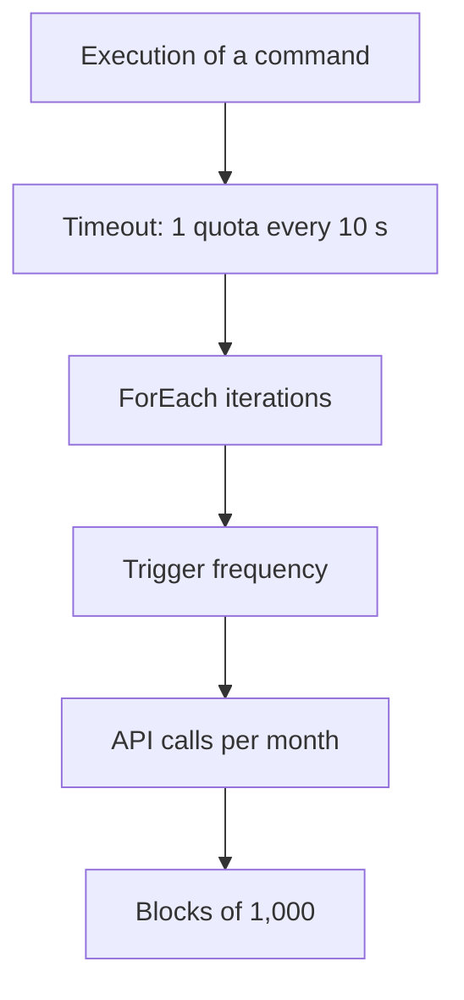

SAP Automation Pilot bills by API Calls, and each execution consumes a number of them that the service calls quota. Anyone sizing an automation needs to know how that consumption is calculated, because it does not depend only on how long the command takes to finish.

This article explains where the quota of an execution is read, which parameters and which commands modify it, and which recommendations help estimate consumption before expanding the scope. The per-command calculations come from SAP documentation. The numerical examples are illustrative and serve to understand the mechanics, not to budget.

## What is a quota in SAP Automation Pilot?

The service metric is "API Calls (in blocks of 1,000)". An API Call is a call between a client application or a backend and a service API to submit a user or system action. The Standard plan bills monthly in blocks of 1,000 API Calls.

Each execution indicates how much quota it has consumed. The consumption of catalog commands with a defined calculation is predictable. That of high-level and custom commands varies depending on the resource they manage and the environment: restarting a small SAP HANA Cloud instance consumes less than restarting a large productive one. It is only known exactly after execution.

## Where is the quota of an execution read?

To see the consumption of a specific execution, simply trigger it from the console itself. With the `HttpRequest` command from the `http` catalog, click **Trigger** and fill in the parameters in the dialog. A `GET` against a public test service is enough.


Further down in the same dialog is the `timeout` parameter, which is set in seconds. It is the value that most influences the consumption of this command, as explained in the following section.


When it finishes, the execution appears in **Executions**. In its detail, the **Additional Information** section includes the **Usage** column with the **Used Quota** field. With `timeout` 10, the execution finished in less than a second and consumed 1 quota.


> **Note:** the executions shown in this article were carried out in a test environment with the Free plan, so their values are for guidance only. The reference calculation is the one SAP publishes in its documentation.

## In HttpRequest, the requested timeout is what counts

According to SAP documentation, `HttpRequest` and `SensitiveHttpRequest` consume **1 quota for every 10 seconds of the requested `timeout`**. It counts the value specified when triggering the command, not the time the response actually takes. The documentation gives these examples: with a `timeout` of 9 s, the execution consumes 1 quota, and with 30 s, 3 quotas. The same rule applies to `ExecuteHanaCloudSqlStatement` and `SendEmail`.

The practical consequence is that a generous `timeout`, set as a precaution, makes each execution more expensive without making it last longer. The parameter accepts values from 1 to 90 seconds.

A case with an MCP server shows the same order of magnitude. An execution launched from an MCP client, with `timeout` 9, finished in 1 s and consumed 1 quota.


## Which commands multiply consumption?

Not all commands calculate quota the same way. This table summarizes the rules from SAP's documentation:

| Command | Quota calculation |
|---|---|
| `HttpRequest`, `SensitiveHttpRequest` | 1 for every 10 s of the requested `timeout` |
| Scripts from the `scripts-sapcp` catalog | Approximately 1 for every 5 s of execution |
| `ForEach v2`, `SensitiveForEach v2` | Does not consume on its own; it multiplies consumption by the number of iterations |
| `ParallelForEach` | Per batch: 1 to trigger, 1 for each polling cycle and 1 to collect the outputs |
| `AwaitExecution` | 1 initially and 1 for each polling attempt |
| `GetExecutionStatus`, `Void`, `TriggerExecution`, `ScheduleExecution`, among others | 1 |

Three details from the table are worth keeping in mind:

- **`ForEach` is a multiplier.** If 10 `HttpRequest` commands run inside a `ForEach`, the corresponding consumption is multiplied by 10.
- **Polling costs.** In `ParallelForEach`, the longer the batch executions take, the more polling cycles are charged. In `AwaitExecution`, each attempt adds 1.
- **Executions triggered by a batch consume separately.** The batch quota does not include that of the executions it triggers.

## Consumptions that go unnoticed

Besides commands, there are other sources of consumption:

- **Queries to the Executions API.** Each query is itself an API Call.
- **Events.** Each event that triggers a command consumes that command's quota, so the volume of events determines the cost.
- **MCP servers.** Asynchronous mode adds polling calls. **Synchronous** mode with **Wait Time** makes the server wait for the result within the call itself and reduces that consumption. If the command does not finish within the Wait Time, the server returns an execution identifier and the agent queries the result with the `get_execution` tool.

## Calculation examples

The following examples are illustrative. They use the rules from the previous table and serve to show how the factors combine, not to budget. Each one states its assumptions.

**Effect of the timeout.** An `HttpRequest` call whose response arrives in half a second:

```text
timeout 9 s   ->  1 quota
timeout 90 s  ->  90 / 10 = 9 quotas
```

The response and the actual duration are the same, and consumption is nine times higher.

**Effect of ForEach.** A `ForEach` with 10 iterations, each with an `HttpRequest` with a `timeout` of 9 s:

```text
10 iteraciones x 1 quota = 10 quotas por ejecución
```

**Effect of frequency.** A 1-quota command scheduled every 10 minutes:

```text
6 ejecuciones por hora x 24 horas = 144 por día
144 x 30 días = 4.320 quotas al mes
4.320 / 1.000 = 4,32 bloques de 1.000 API Calls
```

**All at once.** The same command scheduled every 10 minutes, with a `timeout` of 90 s instead of 9 s:

```text
9 quotas x 144 ejecuciones por día x 30 días = 38.880 quotas al mes
38.880 / 1.000 = 38,88 bloques de 1.000 API Calls
```

The plan is the same, the frequency is the same, and the actual duration of the call has not changed. Only the `timeout` has changed.

## Free plan and Standard plan limits

Cost is not the only sizing factor. Plan limits matter as much as the bill. These are the ones published by SAP:

| Feature | Free | Standard |
|---|---:|---:|
| API Calls per minute | 120 | 300 |
| Catalogs | 5 | 50 |
| Commands | 50 | 1,000 |
| Inputs | 50 | 1,000 |
| Execution history | 50 | 5,000 |
| Concurrent executions | 5 | 100 |
| Concurrently running scripts | 1 | 5 |
| Scheduled Executions | 5 | 100 |
| Log retention after completion | 24 h | 72 h |
| Service Accounts | 2 | 10 |
| MCP Servers | 5 | 50 |
| AI Requests per month | Not available | 50 |

The Free plan does not include an SLA and only offers community support, so productive use requires the Standard plan. Scripts also have their own limits: 5 parallel executions per tenant, 32 KB of standard output, 5 minutes of runtime and 1000 MiB of data in execution. If the maximum number of executions is exceeded, the service handles archiving or suspension. If a total limit is exceeded during an execution, the execution is suspended and cannot continue.

## Recommendations before scaling

1. **Measure before estimating.** The **Used Quota** value from a real run is the most reliable starting point, especially for custom and high-level commands. The Free plan lets you do this at no cost.
2. **Adjust the `timeout`.** It is best to set it to the reasonable duration of the call rather than the maximum allowed, because it is the factor that makes each `HttpRequest` run most expensive.
3. **Watch what multiplies.** The iterations of a `ForEach`, polling cycles and the frequency of scheduled or event-driven runs determine monthly consumption.
4. **Count indirect consumption.** Queries to the Executions API add API Calls, and the Synchronous mode of MCP servers reduces polling.
5. **Start with a limited scope and expand with data.** Measuring consumption for one or two months before deciding on expansion avoids sizing based on assumptions.
6. **Review the plan limits.** API Calls per minute, concurrent executions and Scheduled Executions can shape the design before cost does.

The diagram summarizes which factors combine to produce monthly consumption:



## Conclusion

The SAP Automation Pilot quota follows specific rules that depend on the command. In `HttpRequest`, the requested `timeout` weighs more than the actual time, and `ForEach`, polling and frequency multiply the result. Knowing these rules allows you to design automations with reasonable consumption from the start and to estimate the cost with real data before expanding their use.

The official documentation for the service is available on the [SAP Help Portal](https://help.sap.com/docs/AUTOMATION_PILOT).
