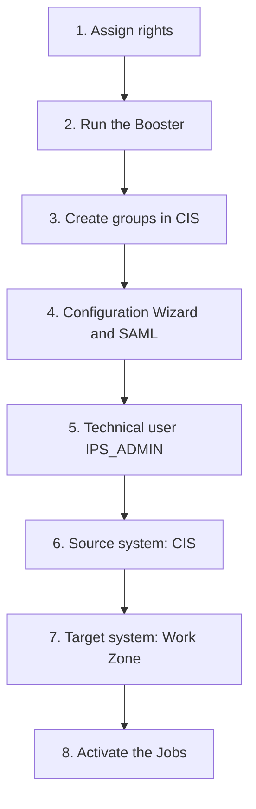

SAP Build Work Zone, advanced edition offers a single, personalized entry point to applications, content and business processes. Its rollout in SAP BTP does not start with the service, but with identity: without synchronized users and groups, no one can log in or administer Work Zone.

This article walks through the end-to-end configuration in a `Development` subaccount with the Cloud Foundry environment, with **SAP Cloud Identity Services (CIS)** as the identity provider and **Identity Provisioning (IPS)** to provision users and groups to Work Zone. The concepts of subscription, instance, entitlements and role collections are explained in more detail in the articles on [subscriptions and instances in SAP BTP](/en/blog/btp-admin-subscriptions-instancias/), [entitlements and quotas](/en/blog/btp-admin-entitlements-cuotas/) and [role collections and shadow users](/en/blog/btp-admin-roles-usuarios/).

## Objective and scope

The desired outcome is an operational Work Zone, with centralized authentication (SAML 2.0) and automatic provisioning, so that the administrator can log in, administer and start building sites.

**Included in this configuration**

- Entitlement assignment (`Advanced` and `Advanced (Application)` plans).
- Execution of the Work Zone advanced Booster.
- Creation of user groups in CIS and validation of role collections.
- Configuration Wizard and SAML 2.0 application in CIS, with Global User ID as the identifier.
- Technical user `IPS_ADMIN` with certificate and secret.
- Source system (CIS) and target system (Work Zone) in IPS, with their transformations.
- Activation and validation of the read and simulation Jobs.

**Out of scope**

- Migration from SAP Jam and use of SAP SuccessFactors Work Zone.
- Custom domain: the default `ondemand.com` is used.
- Optional add-ons: SAP Business Application Studio and SAP Build Process Automation.
- Site design, content and themes.

## Prerequisites

- Global account and subaccount with the **Cloud Foundry** environment enabled.
- Subscription to **SAP Cloud Identity Services**, with the trust relationship validated.
- Global account and subaccount administrator available to run the Booster.
- An administrator user of type **employee** in CIS.

## Process overview

| # | Activity | Deliverable |
|---|---|---|
| 1 | Validate prerequisites and assign entitlements | Plans visible in Entitlements |
| 2 | Run the Booster | Subscription and instance in Instances and Subscriptions |
| 3 | Create groups and validate role collections | Administrator with access to Work Zone |
| 4 | Complete the Configuration Wizard and create the application in CIS | SAML application with metadata uploaded |
| 5 | Create the technical user `IPS_ADMIN` | Certificate, Client ID and secret |
| 6 | Configure the source system (CIS) | Properties and transformation saved |
| 7 | Configure the target system (Work Zone) | Properties and transformation saved |
| 8 | Activate the provisioning Jobs | Successful jobs in Job Logs |

## Entitlements and Booster

First, the entitlements for the `Advanced` and `Advanced (Application)` plans are assigned to the subaccount. With these visible in **Entitlements**, the administrator of the global account and the subaccount runs the Work Zone advanced Booster.

The Booster leaves the service subscription and instance created. This is verified in **Instances and Subscriptions** of the BTP Cockpit.

## Role groups and collections

Work Zone advanced includes standard role collections in the subaccount. You can filter by `WorkZone` in **Role Collections**, and each one links to the user groups that grant access.

In CIS, the corresponding user groups are created (for example `Workzone_Admin`, `Workzone_Area_Admin` or `Workzone_End_User`). When you assign the administrator to them, they gain access to Work Zone with administration and development permissions.

## Configuration Wizard and SAML application

With administrator access, the next step is to complete the Work Zone **Configuration Wizard** and create the SAML 2.0 application in CIS, with the metadata uploaded. The **Global User ID** is used as the identifier.

## Technical user IPS_ADMIN

IPS needs a technical user, `IPS_ADMIN`, to read from CIS and write to Work Zone. Creating it delivers three elements: the certificate, the Client ID and the Client Secret.

Two points deserve attention from this step:

- The Client Secret cannot be retrieved after it is created. It must be saved in a password manager and, if lost, a new one must be generated.
- Every time the certificate of the source system is regenerated, it must be uploaded again in `IPS_ADMIN`.

## Source and target systems in IPS

In **Identity Provisioning**, two systems are configured, each with its own properties and transformation:

1. **Source system (CIS)**, from which users and groups are read.
2. **Target system (Work Zone)**, to which they are provisioned.

If the administrator is left without a role in Work Zone, the solution is to use their Global User ID (`userUuid`) in the target transformation.

## Provisioning jobs

With both systems saved, the jobs are activated. The configuration is correct when the `READ` and `SIMULATION` jobs finish successfully in **Provisioning Logs**, **Job Logs** tab.

## Acceptance criteria

- The Work Zone advanced plans appear in the subaccount and the instance is created.
- The administrator user accesses the service with administration and development permissions.
- The `READ` and `SIMULATION` jobs complete successfully.
- The service onboarding is completed in the Configuration Wizard.

## Risks and how to mitigate them

| Risk | Mitigation |
|---|---|
| Loss of the `IPS_ADMIN` Client Secret | Store it in a password manager; generate a new one if it is lost |
| 401 error in the read Job when the source certificate is regenerated | Re-upload the certificate in `IPS_ADMIN` after every regeneration |
| Properties with spaces or errors in the IPS systems | Review the values before saving and validate in Job Logs |
| Administrator without a role in Work Zone | Use the administrator's Global User ID (`userUuid`) in the target transformation |

## Conclusion

The key to Work Zone advanced lies in the identity foundation: entitlements, groups, the SAML application and provisioning with IPS. With the `READ` and `SIMULATION` jobs in green, the service is ready for the administrator to build sites. If your organization needs support with the SAP BTP rollout, take a look at our [consulting services](/consulting/).
