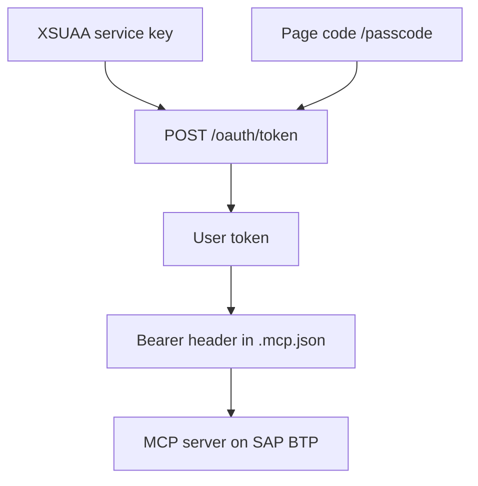

The [third part of this series](/en/blog/sap-cap-mcp-authentication-roles/) separated reading and writing by role with `@requires` and `@restrict`, but with simulated users whose passwords were in the `package.json` itself. This fourth part deploys the same SAP CAP service to a trial SAP BTP account and replaces simulated authentication with XSUAA. IAS was not tested: the article covers XSUAA only.

With XSUAA, authentication in SAP BTP no longer depended on the passwords stored in the project; what remains in it is the token, in the MCP client configuration. The `@cap-js/mcp` plugin applied the same rules from part 3 without changing the model or the handler. The tests also revealed three effects worth knowing about:

1. **`modifiedBy` records the user's email.** The real identity reaches the database.
2. **Removing a role does not revoke the token.** A token issued with the `Almacen` role kept writing after that role was removed from the user.
3. **The MCP client does not log in on its own.** The token is obtained outside the client and remains written in its configuration until it expires.

All tests were run on 2026-10-28, in a trial SAP BTP account (Cloud Foundry, US10 region), with invented data and with the author's own user.

## Test environment

The versions of the parts from the previous sections (Node.js 24.19.0 locally, `@sap/cds-dk` 10.1.2, `@sap/cds` 10.1.1, `@cap-js/mcp` 1.5.0, `@cap-js/sqlite` 3.1.1 and Claude Code 2.1.276), plus:

| Component | Version |
|---|---|
| `@sap/xssec` | 4.15.0 |
| cf CLI | 8.19.0 |
| `nodejs_buildpack` | 1.9.6 |
| Cloud Foundry stack | `cflinuxfs4` |

In Cloud Foundry, the buildpack installed Node.js 24.22.1.

The traces and durations come from Claude Code runs from the command line with the `claude-sonnet-5` model. The screenshots are from a second run with the same questions in the Claude Code extension for Visual Studio Code, with the Opus 5.5 model ("Medium" effort) and the "Manual" permission mode, against the application deployed on SAP BTP. The plugin's official documentation is the [Model Context Protocol Adapter](https://cap.cloud.sap/docs/guides/ai/cap-mcp) guide.

## From the local project to XSUAA

### cds add xsuaa

`cds add xsuaa` made three changes to the project:

- it generated `xs-security.json` with the roles `Lector` and `Almacen`, taken from `@requires` and `@restrict` in the model;
- it added the `@sap/xssec` dependency;
- it configured `xsuaa` authentication in the `production` profile.

In this test, the command was run with `--dry`, expecting a preview, and it applied the changes anyway.

### xs-security.json

`xsappname`, `tenant-mode` and two role collections were added to what was generated. This is the final version:

```json
{
  "xsappname": "cap-mcp-demo",
  "tenant-mode": "dedicated",
  "scopes": [
    { "name": "$XSAPPNAME.Almacen", "description": "Almacen" },
    { "name": "$XSAPPNAME.Lector", "description": "Lector" }
  ],
  "attributes": [],
  "role-templates": [
    { "name": "Almacen", "description": "generated", "scope-references": ["$XSAPPNAME.Almacen"], "attribute-references": [] },
    { "name": "Lector", "description": "generated", "scope-references": ["$XSAPPNAME.Lector"], "attribute-references": [] }
  ],
  "role-collections": [
    { "name": "CapMcpDemo_Lector", "description": "Lectura del catálogo", "role-template-references": ["$XSAPPNAME.Lector"] },
    { "name": "CapMcpDemo_Almacen", "description": "Registro de entradas", "role-template-references": ["$XSAPPNAME.Almacen"] }
  ]
}
```

The file contains the roles, not users or passwords. The relationship between the annotation role, the role template and the scope that travels in the token is explained in [Authorization in CAP with XSUAA](/en/blog/cap-auth-xsuaa/).

### package.json

- `@cap-js/sqlite` moves from `devDependencies` to `dependencies`, because development dependencies are not installed in Cloud Foundry.
- `"engines": { "node": "^24" }` is added.
- The `production` profile uses XSUAA and in-memory SQLite:

```json
"[production]": {
  "auth": { "kind": "xsuaa" },
  "db": { "kind": "sqlite", "credentials": { "url": ":memory:" } }
}
```

The mock users from part 3 remain in `package.json` for the development profile, locally. In the `production` profile, authentication is `xsuaa`.

The database remains in-memory SQLite in SAP BTP as well: the application startup log shows the loading of the CSV files and "successfully deployed to in-memory database". The data is lost on restart.

### manifest.yml and .cfignore

```yaml
applications:
  - name: cap-mcp-demo
    path: .
    memory: 256M
    buildpacks:
      - nodejs_buildpack
    env:
      NODE_ENV: production
    services:
      - cap-mcp-demo-xsuaa
```

`.cfignore` excludes `node_modules/`, the evidence, the screenshots, the project snapshots, the `.md` and `.log` files, `.vscode/` and `.mcp.json`.

## Deployment on SAP BTP

```bash
cf login -a https://api.cf.us10-001.hana.ondemand.com --sso
cf create-service xsuaa application cap-mcp-demo-xsuaa -c xs-security.json
cf push
```

- The `application` plan of XSUAA is free in the trial account.
- `cf push` finished with the application in `running` status.
- The startup log on SAP BTP shows `using auth strategy { kind: 'xsuaa' }`, the service at `/odata/v4/catalog` and `/mcp/catalog`, and "server v10.1.1 launched in 1179 ms".
- The role collections `CapMcpDemo_Lector` and `CapMcpDemo_Almacen` were created with the XSUAA instance and assigned to the user in the BTP cockpit: subaccount, **Security**, **Users**, **Assign Role Collection**.

It is a minimal deployment, with `cf push`, `manifest.yml` and in-memory SQLite. The full CAP deployment, with SAP HANA Cloud and `mta.yaml`, is covered in [Deploying CAP on BTP](/en/blog/cap-despliegue-btp/).

### How the user token was obtained

1. A service key for the XSUAA instance (`cf create-service-key`), with the client ID and secret.
2. A temporary code from the `/passcode` page of the subaccount's authentication service (`https://<subdominio>.authentication.us10.hana.ondemand.com/passcode`), with the user's session open in the browser.
3. `POST /oauth/token` with `grant_type=password` and `passcode=<código>`, authenticated with the client from the service key.



The resulting token belongs to the user (`origin: sap.default`), carries the roles of the assigned collections as scopes, in addition to `openid`, and in this test it was valid for 12 hours. The user's password is not used in any step.

On the client, the `.mcp.json` file carries the `Authorization: Bearer` header with the token instead of the Basic header from part 3:

```json
{
  "mcpServers": {
    "almacen": {
      "type": "http",
      "url": "https://cap-mcp-demo.cfapps.us10-001.hana.ondemand.com/mcp/catalog",
      "headers": {
        "Authorization": "Bearer <TOKEN_XSUAA>"
      }
    }
  }
}
```

## The same rules, now with XSUAA

Direct tests against the deployed application, via MCP and via OData:

| Test | Result |
|---|---|
| MCP `initialize` without a token | 401, "Authorization error (401): Not authorized to access CatalogService.", without a `WWW-Authenticate` header |
| OData `GET Productos` without a token | 401 |
| OData with the mock user `ana` (Basic) | 401 |
| Token with a tampered signature | Rejected: "Unauthorized" |
| Token with the `Almacen` role: `tools/list` | `describe`, `query` and `call` |
| Token with the `Almacen` role: `describe` | `Productos`, `Categorias` and the `registrarEntrada` action |
| Token with the `Almacen` role: `call` (USB-C dock, 10 units) | Successful: stock 10 and `modifiedBy` with the user's email |
| Token with the `Lector` role: `tools/list` | `describe` and `query` |
| Token with the `Lector` role: `query` | Reads `Productos` |
| Token with the `Lector` role: `call` | "Tool call not found" |
| Token with the `Lector` role: action via OData | 403 Forbidden |

The first token was requested with the `CapMcpDemo_Almacen` collection assigned, without `Lector`. The second, after removing `CapMcpDemo_Almacen` and assigning `CapMcpDemo_Lector`.

The mock users in `package.json` receive 401 on SAP BTP: the identity and roles come from the token. The plugin filtered tools, entities and actions just as it did with mock authentication, with no changes to the CDS or the handler.

`modifiedBy` goes from `anonymous` (part 2) and the mock names (part 3) to the real identity: the user's email, personal data that is stored in the database.

## Removing the role does not revoke the token

After removing the `CapMcpDemo_Almacen` collection from the user in the cockpit, the token requested earlier with that role:

- still received `describe`, `query` and `call` in `tools/list`;
- logged an entry of 2 units in the Mechanical keyboard, with `modifiedBy` equal to the user's email.

Roles travel inside the token: in this test, removing the collection did not affect the already issued token, which had a validity of 12 hours.

## The agent with each token

From the command line, the same command as in part 3 was used, with an MCP configuration file per token. Before each question, the application was restarted with `cf restart` to return to the CSV data, with the USB-C Base at stock 0.

### Token with the Reader role

"The USB-C Base has received 10 units. Update its stock to 10."

The agent used `describe`, `query` and `describe` again. It looked for a tool for `registrarEntrada` and did not find one. It replied: "There is no available tool to run `registrarEntrada` (the action that adds received units); I only have `describe` and `query` (SELECT only), read-only." It confirmed the stock (0) and did not write. It took 17.0 s.

In the Visual Studio Code run, the agent only used `query` and offered three options: publish the action on the MCP server, register the entry with an OData `POST` call to `registrarEntrada`, or, "if you authorize me, I will call that action over HTTP against the local CAP service, without going through MCP."


**The second option does not work with the `Lector` role:** the OData action returned 403. Moreover, the service was not local, but the one deployed on SAP BTP. The agent did not identify that it was a permissions issue.

### Token with the Warehouse role

The same request. The agent used `describe`, `query` and `call`, with 10 units, and replied: "Done. The USB-C Base had stock 0, an entry of 10 units was registered and its stock is now 10." `modifiedBy` recorded the user's email. It took 13.6 s. This run also used the token issued before removing the `CapMcpDemo_Almacen` collection: the token was issued at 10:24 UTC and the test is from 10:31 UTC, when the user already had only `CapMcpDemo_Lector` assigned.

In the Visual Studio Code run, the result was the same, and a later query confirmed stock 10.


**This token was issued before removing the `CapMcpDemo_Almacen` collection from the user.** When the screenshot was taken, the user had only `CapMcpDemo_Lector` assigned in the cockpit. The screenshot therefore shows the effect of the previous section: the removed role still allowed writing.

### Without a token

"Which products have stock below the minimum?"

Claude Code marked the `almacen` server as failed. The agent replied that the server had failed to connect, with a "dynamic client registration error (HTTP 404, "Cannot POST /register")". It took 4.7 s.

Without a token, Claude Code attempted OAuth dynamic client registration at `/register`, which does not exist in the application. In this application, the four endpoints that an MCP client uses to sign in on its own returned 404: `/.well-known/oauth-protected-resource`, `/.well-known/oauth-protected-resource/mcp/catalog`, `/.well-known/oauth-authorization-server` and `/register`. The token had to be obtained outside the client and written into its configuration, where it remains as a credential in a file until it expires.

## Limits of this fourth part

- **XSUAA only.** IAS was not tested.
- **No approuter or interface.** The browser login flow was not tested.
- **In-memory database.** SAP HANA Cloud was not used: the data reverts to the CSV files on every restart.
- **No instance-level restrictions.** `@restrict` with `where` was not tested.
- **A single user.** The tests were run with a single user, changing their role collections.

## Conclusions

With XSUAA, authentication in SAP BTP no longer depended on passwords stored in the project: the simulated users in `package.json`, which are still there for the development profile, receive 401, and identity and roles arrive in the token. What remains in the project is the token, in the MCP client configuration. `xs-security.json` contains roles, not users or passwords. The same model from part 3 applied the same rules via MCP and via OData without changing the CDS or the handler.

What XSUAA did not resolve in this test:

1. `modifiedBy` stores the user's email, a piece of personal data, in the database.
2. A token issued with a role kept writing after that role was removed, until its expiry.
3. The MCP client could not log in on its own: the token was obtained manually and ended up written in the client configuration.

The complete CAP training is in the [Logali Tech SAP CAP course](/courses/sap-cap-cloud-application-programming-model/).
