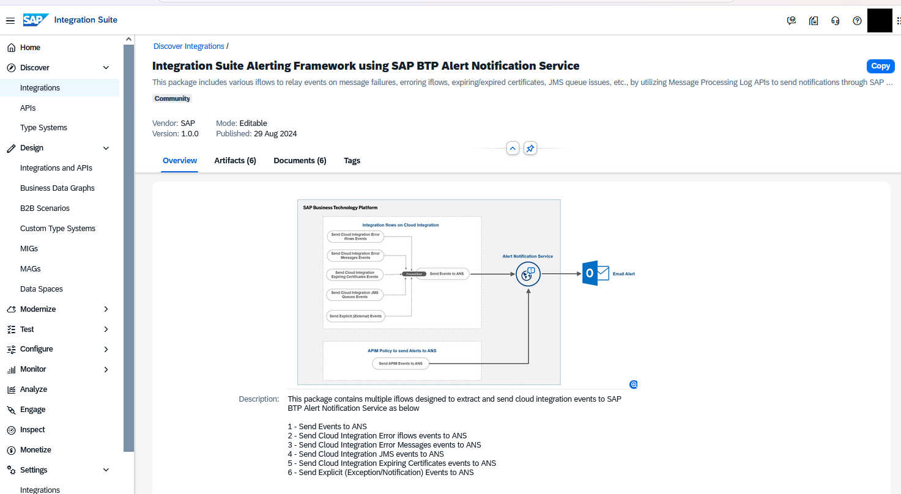
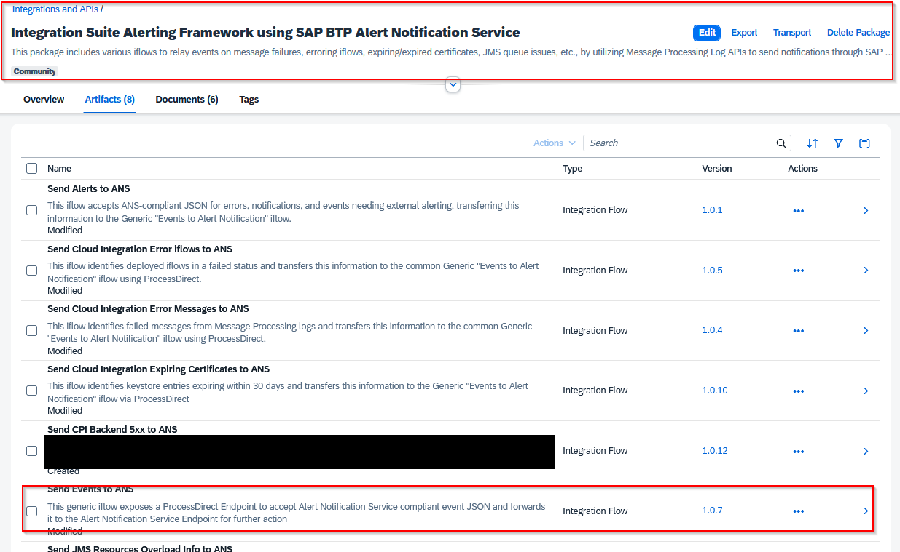
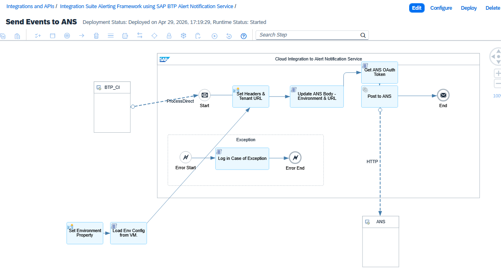
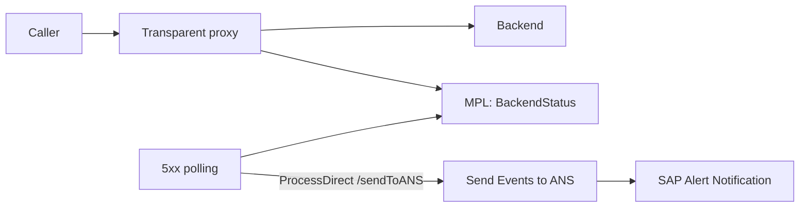

A transparent proxy in Cloud Integration receives a call, forwards it to the backend and returns the response as is. If the backend replies with an HTTP 500, the proxy returns it to the caller and the message ends without an exception in the message processing log (MPL). To the monitor, that execution has not failed, and no alert based on failed messages becomes aware of the error.

In this article I explain how I solved it with a package from the SAP community, the **Integration Suite Alerting Framework using SAP BTP Alert Notification Service**: what these packages are, what flows this one brings, how it fits with SAP Alert Notification Service (ANS) and the iFlow I added to detect the backend 5xx errors. It is the fifth part of the series, after [from Outlook to OneDrive with adapters](/en/blog/sap-integration-suite-outlook-onedrive-adapters/).

## What a community package is

The content catalog of SAP Integration Suite (**Discover**, powered by SAP Business Accelerator Hub) does not only contain packages published by SAP. Some carry the **Community** label: they are community contributions that SAP publishes in the same catalog and that are copied to the tenant just like the rest.

In Discover, the package card shows:

| Field | Value |
|---|---|
| Label | Community |
| Vendor | SAP |
| Version | 1.0.0 |
| Published | 29-08-2024 |
| Mode | Editable |
| Content | 6 iFlows and 6 documents |



The **Mode** field makes the practical difference. The Microsoft Outlook adapter package from the previous article is in *Configure-only* mode: it is only configured and deployed. This one is in **Editable** mode: with **Copy** it moves to **Design**, where it shows **Edit**, **Export**, **Transport** and **Delete Package**. It is a starting point that you copy, adapt and extend with your own iFlows. In my copy, most of its artifacts appear as **Modified**, with versions later than those in Discover, and mine appears as **Created**.

Before using one, keep two things in mind:

- Support and evolution depend on who publishes each package: it is worth reviewing its card and the **Documents** tab before taking it to production.
- A package copied from Discover and modified no longer receives updates automatically: you have to compare each new version and reintegrate your own changes.

## The package's flows

The diagram in the tab summarizes the architecture: several iFlows detect incidents and deliver an event via ProcessDirect to the generic iFlow **Send Events to ANS**, which is the only one that talks to Alert Notification Service, and ANS turns it into an email. The diagram also includes an API Management policy that sends events to ANS from the API proxies.

| iFlow (name in Discover) | What it does |
|---|---|
| Send Events to ANS | Generic iFlow: receives the event via ProcessDirect and sends it to ANS |
| Send Cloud Integration Error iflows to ANS | Detects iFlows deployed in error status |
| Send Cloud Integration Error Messages to ANS | Detects failed messages in the processing log |
| Send Cloud Integration Expiring Certificates to ANS | Detects keystore entries expiring in the next 30 days |
| Send JMS Resources Overload Info to ANS | Detects critical JMS resources (over 80% usage) or exhausted ones |
| Send Explicit Exceptions-Notifications-Events to ANS | Receives JSON in ANS format for errors, notifications or events and forwards it to the generic iFlow |

In my copy, the last one is called **Send Alerts to ANS**, and I have added **Send CPI Backend 5xx to ANS**, which detects backend 5xx errors without an exception in the iFlow.



### The generic iFlow: Send Events to ANS



The path is short:

1. **ProcessDirect** inbound: any iFlow in the tenant passes it an event already in ANS format.
2. **Set Headers & Tenant URL**: adds the headers and the tenant URL.
3. **Update ANS Body - Environment & URL**: completes the event body with the environment and the URL. The environment is loaded in a local process (**Set Environment Property** and **Load Env Config from VM**) from a value mapping.
4. **Get ANS OAuth Token**: obtains the ANS token.
5. **Post to ANS**: sends the event via HTTP to the ANS endpoint.

An exception subprocess (**Log in Case of Exception**) logs any failure of the send itself.

The advantage of this design is that the connection to ANS (credentials, token and format) is in a single place. To cover a new case, all you need is an iFlow that detects the incident and calls the ProcessDirect.

## Why the package alone was not enough

The iFlow **Send Cloud Integration Error Messages to ANS** queries failed messages in the processing log. A 500 that goes through a transparent proxy does not leave a failed message: the backend fails, but the iFlow finishes without a Camel exception. The standard alert never sees it.

## Our case: Send CPI Backend 5xx to ANS

The solution has two parts:

1. **The proxy leaves a trace in the MPL.** Each proxy writes the backend status code into a custom header property of the processing log, `BackendStatus`.
2. **A polling iFlow queries it.** **Send CPI Backend 5xx to ANS** periodically queries the processing log, filters the executions whose `BackendStatus` is 5xx and, for each one, generates an event that it delivers to **Send Events to ANS** via ProcessDirect, at the address `/sendToANS`.



The poll runs **every 5 minutes**. In addition to the status code, the event carries in its tags the data that whoever receives the alert later needs: the backend service, the start of the log entry in the MPL, the MessageGuid, the number of alerts in the window and a direct link to the MPL in Integration Suite.

## The Alert Notification Service part

In the subaccount there is an Alert Notification Service instance with the **free** plan and a service key. The key provides four pieces of data: the ANS API URL, the OAuth token URL (with `grant_type=client_credentials`), the `client_id` and the `client_secret`. These are what **Send Events to ANS** uses to request the token and send the event.

ANS separates three concepts:

- **Event**: what arrives from Cloud Integration, with severity, type, resource and tags.
- **Subscription**: decides which events are of interest. I have three: backend 5xx errors, keystore certificates, and failed messages or iFlows in error.
- **Action**: what is done with the event. In my case, an **email** common to all three subscriptions.

The subject and body of the email are built with templates that read the event fields:

```text
Asunto:
[{tags.EnvLabel}] {severity}: Backend {tags.BackendStatus} on {resource.resourceName}

Cuerpo:
Environment:       {tags.EnvLabel}
Severity:          {severity}
Event:             {eventType}

CPI Proxy:         {resource.resourceName}
S/4 Service:       {tags.BackendService}
Backend HTTP:      {tags.BackendStatus}
MPL LogStart:      {tags.MPLLogStart}
MessageGuid:       {tags.MessageGuid}
Alerts in window:  {tags.AlertCountInWindow}

Detail:
{body}

Open MPL in Integration Suite:
{tags.MPLDeepLink}
```

With this, the email says at a glance in which environment, on which proxy and with which code the backend has failed, and the link takes you directly to the message log.

## Limits

- **It is not real time.** The notification arrives in the next polling cycle, up to 5 minutes after the error.
- **It depends on each proxy.** A proxy that does not write `BackendStatus` is left out of the coverage.
- **It is modified community content.** Package updates must be reviewed manually before incorporating them.

## Conclusion

The community Alerting Framework solves the expensive part of alerting from Cloud Integration: the connection to Alert Notification Service sits in a single iFlow, and each new incident is a small iFlow that only detects and delivers. Backend errors in transparent proxies are not covered out of the box, but they fit the same pattern with a custom property in the MPL and polling.
