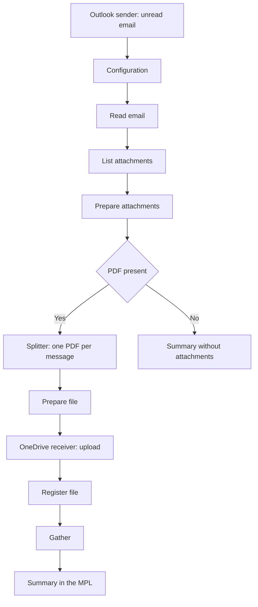

In June I had to read a Microsoft 365 mailbox unattended from SAP Integration Suite: download the PDF attachments from incoming emails and save them to OneDrive. I solved it with a Groovy script that called Microsoft Graph directly, with its own OAuth2 token and its own retries. It worked, but it was a lot of code for something that standard adapters cover today.

In this article I redo the same case with the **Microsoft Outlook and Microsoft OneDrive adapters** in SAP Integration Suite: what needs to be prepared in Microsoft Entra ID, what the iFlow looks like and what stumbling blocks I ran into when configuring it. This is the fourth part of the series, after [the TLS ciphers](/en/blog/sap-api-management-tls-ciphers-changing/), [enabling the API Management runtime](/en/blog/sap-integration-suite-enabling-api-management-runtime/) and [XSUAA key rotation](/en/blog/sap-api-management-xsuaa-signing-key-rotation/).

## The previous approach: Microsoft Graph from Groovy

The Cloud Integration Mail adapter supports IMAP with OAuth2 for Microsoft 365, but in my analysis only with the Authorization Code flow. That requires a real user to authenticate at least once and the refresh token to be renewed, which does not fit a mailbox that is read without human intervention. That is why I opted for Microsoft Graph with **OAuth2 Client Credentials**, called from Groovy with `HttpURLConnection`:

```text
Timer (cada 10 min) → Content Modifier → SCR_ProcessEmail.groovy → End
```

The script, about 230 lines long, did everything:

- it obtained the token from Entra ID and renewed it every 50 minutes;
- it listed the emails without the `Procesado-CPI` category, from oldest to newest;
- it downloaded the allowed attachments and uploaded them to OneDrive in folders by year and month;
- it marked each email as processed with a PATCH request;
- it left metrics in headers of the processing log.

The end-to-end test on June 18 uploaded **12 PDFs** to OneDrive. The cost was in the maintenance: authentication, retries and marking emails were custom code.

## Microsoft adapters in Integration Suite

In the **Adapter Type** list of my test tenant, six Microsoft adapters appear: Microsoft OneDrive, Microsoft OneNote, Microsoft SharePoint, MicrosoftDynamicsCRM, MicrosoftOutlook and MicrosoftTeams. For this case I use two.

### Microsoft Outlook

The adapter is distributed as a package on the SAP Business Accelerator Hub. Its official change log lists these versions:

| Version | Date | Change |
|---|---|---|
| 1.0.0 | 05-02-2026 | First version |
| 1.1.0 | 22-05-2026 | Event resource and Advanced configuration on the receiver |
| 1.2.0 | 15-07-2026 | The sender reads with a run scheduler |

According to the [official guide for version 1.2.0](https://api.sap.com/odata/1.0/catalog.svc/Files('bd612bd6678b4857a226010238b2276f')/$value):

- It works on Microsoft Graph with mail, folders, attachments, calendars and events.
- It supports **OAuth2 Client Credentials** (application permissions) and OAuth2 Authorization Code (delegated permissions).
- The **sender** reads all emails, only unread ones or those matching a filter, and then marks them as read, deletes them or archives them.
- The **receiver** offers predefined operations (Basic mode) or any Graph call with method and relative path (Advanced mode).
- It is included in the Standard license of SAP Integration Suite, but it is not deployed: its package is copied from **Discover** and deployed in the tenant.

### Microsoft OneDrive

In my tenant the adapter appears with version 1.0.2 and manufacturer SAP. Its operations are organized with the same concepts as Graph: *drives*, *drive items*, permissions and batches. In the flow I use it as the receiver to upload each PDF.

## Requirements in Microsoft Entra ID

Both pieces share a single app registration:

1. In **Entra ID**, **App registrations**, click **New registration**, with **Single tenant only** and no redirect URI.
2. Note the **Application (client) ID** and the **Directory (tenant) ID**.
3. In **Certificates & secrets**, create a client secret and copy its **Value** right away: it is not shown again.
4. In **API permissions**, **Add a permission**, **Microsoft Graph**, **Application permissions**:

| Permission | What it is for |
|---|---|
| `Mail.ReadWrite` | Read the mailbox and mark or archive processed email |
| `Files.ReadWrite.All` | Create folders and upload the PDFs to OneDrive |

5. Click **Grant admin consent**. Without consent, the permission shows as "Not granted" and calls fail even if the token is obtained.

With application-type permissions, the app can read **any mailbox** and write to **any OneDrive** in the tenant. For email, an Exchange Online **Application Access Policy** limits it to the mailboxes of a group:

```powershell
New-ApplicationAccessPolicy -AppId <ClientID> -PolicyScopeGroupId <grupo> -AccessRight RestrictAccess -Description "Solo buzon de pruebas"
Test-ApplicationAccessPolicy -Identity <buzon> -AppId <ClientID>
```

The policy only affects Exchange: `Files.ReadWrite.All` still reaches every OneDrive.

### Two stumbling blocks in the portal

**Enterprise application is not app registration.** My first attempt was from **Enterprise applications**, **Create your own application**, with the option "Integrate any other application you don't find in the gallery". That creates an enterprise application intended for single sign-on, not the registration with a secret and Graph permissions that Integration Suite needs. The **Permissions** screen of an enterprise application only shows and grants what has already been requested; new permissions are added in **App registrations**, **API permissions**.

**Consent comes before permissions.** When granting consent without having added the Graph permissions yet, the "Permissions requested" screen only asked for **"Sign in and read user profile"**, that is, the delegated `User.Read` that Entra ID adds by default. If "Read and write mail in all mailboxes" and "Read and write files in all site collections" do not appear on that screen, the consent is no good for this flow: you have to cancel it and add the application permissions first.

## The Security Material

In **Monitor**, **Integrations and APIs**, **Security Material**, create an **OAuth2 Client Credentials** artifact. The same artifact serves all the channels in the flow:

| Field | Value |
|---|---|
| Token Service URL | `https://login.microsoftonline.com/<tenantID>/oauth2/v2.0/token` |
| Client ID and Client Secret | Those of the application |
| Client Authentication | Send as Body Parameter |
| Scope | `https://graph.microsoft.com/.default` |
| Content Type | `application/x-www-form-urlencoded` |

SAP's guide for the Outlook adapter states that the Content Type must be `application/x-www-form-urlencoded` to use application permissions.

## The flow: saving a mailbox's PDFs to OneDrive

The iFlow reads unread emails, queries their attachments, uploads each PDF to a OneDrive folder organized by year and month, and ends with a summary in the processing log. It does not send any email.



### Externalized parameters

All operational values are filled in under **Configure**, without touching the iFlow:

| Parameter | Example value |
|---|---|
| `Outlook_UserId` | Mailbox being read |
| `Outlook_Credential` | Name of the Security Material |
| `Outlook_FolderName` | `Pruebas-CPI` |
| `Outlook_MaxMessages` | `1` |
| `Outlook_ArchiveFolder` | `Procesado-CPI` |
| `Adjuntos_Extensiones` | `pdf` |
| `OneDrive_UserId` | User who owns the OneDrive |
| `OneDrive_Credential` | Name of the Security Material |
| `OneDrive_Carpeta` | `Adjuntos-Outlook` |
| `OneDrive_SubcarpetaPorMes` | `true` |

To test with a real mailbox, it is best not to read the inbox: the sender would mark all unread emails as read and archive them. A dedicated folder, such as `Pruebas-CPI`, and an Outlook rule that moves emails with a marker in the subject into it isolate the test. According to the adapter guide, the folder name only works for top-level folders: for a subfolder you have to use its ID.

### Outlook sender channel

| Tab | Field | Value |
|---|---|---|
| Connection | Authentication | Application (OAuth2 Client Credentials) |
| Connection | Credential Name | `{{Outlook_Credential}}` |
| Processing | User ID | `{{Outlook_UserId}}` |
| Processing | Folder Name | `{{Outlook_FolderName}}` |
| Processing | Selection | Only Unread |
| Processing | Post-Processing | Archive and Mark as Read |
| Processing | Archive Folder Name | `{{Outlook_ArchiveFolder}}` |
| Processing | Response Type | Application/JSON |
| Scheduler | Recurrence | Every 10 minutes |

When you add the channel, the adapter proposes **delegated** authentication and a one-time scheduler. For a mailbox that is read without intervention, both need to be changed. The archive folder must already exist in the mailbox.

### Reading the email

The first script saves the email ID, the sender and the subject in properties. It also attaches to the processing log the JSON delivered by the adapter, which is useful in the first test:

```groovy
def json = new JsonSlurper().parseText(body)
def correos = (json instanceof Map && json.value instanceof List) ? json.value : [json]
def mail = correos[0]

message.setProperty('MessageId', mail.id)
message.setProperty('Remitente', mail.from?.emailAddress?.address ?: '')
message.setProperty('Asunto', mail.subject ?: '(sin asunto)')
```

### Listing the attachments

A Request Reply queries the email attachments with an **HTTP** channel using GET against Graph, with the same credential:

```text
https://graph.microsoft.com/v1.0/users/{{Outlook_UserId}}/messages/${property.MessageId}/attachments
```

The Outlook adapter receiver offers the **List message attachments** operation for the same purpose; the HTTP channel makes the call explicit and does not depend on the adapter version.

If the iFlow is generated or edited outside the editor, the internal value of the HTTP channel authentication is `OAuth2 Client Credentials`, with spaces. With `OAuth2ClientCredentials` the editor shows a red cross and validation fails with this message:

```text
Error Type: java.lang.IllegalArgumentException
Authenticationmethod not supported: OAuth2ClientCredentials.
```

The second script keeps the PDFs that are not embedded images and calculates the target folder:

```groovy
def validos = adjuntos.findAll { a ->
    String nombre = (a.name ?: '').toString().toLowerCase()
    !a.isInline && a.contentBytes && extensiones.any { ext -> nombre.endsWith('.' + ext) }
}

String carpeta = p.get('CarpetaOneDrive').toString()
if (p.get('SubcarpetaPorMes').toString().toBoolean()) {
    def hoy = LocalDate.now(ZoneId.of('Europe/Madrid'))
    carpeta = carpeta + '/' + hoy.year + '/' + String.format('%02d', hoy.monthValue)
}
message.setProperty('RutaCarpeta', carpeta)
message.setProperty('HayAdjuntos', validos ? 'true' : 'false')
```

Valid PDFs go into an XML with one node per attachment. A **Router** separates emails without PDFs and a **General Splitter** over `/Adjuntos/Adjunto` processes each file separately.

### Uploading each PDF to OneDrive

Before the upload, a script puts the file in binary form in the body and its name in a property:

```groovy
def adjunto = new XmlSlurper().parseText(message.getBody(String))
String limpio = adjunto.Nombre.text().replaceAll('["*:<>?/\\\\|]', '_').trim()

message.setProperty('NombreArchivo', limpio)
message.setHeader('Content-Type', adjunto.Tipo.text())
message.setBody(adjunto.Contenido.text().decodeBase64())
```

The **Microsoft OneDrive** receiver connects to the Request Reply "Save to OneDrive", not to an end event: this way its response returns to the flow to log each file. In the channel, select the **Drive Items** operation group with the upload operation, the folder `${property.RutaCarpeta}`, the name `${property.NombreArchivo}` and rename if a file with the same name already exists. When you add it, the channel proposes a drive metadata query operation by default, which uploads nothing.

### The final summary

A **Gather** collects the results and the last script leaves a summary in the message body, in a header of the processing log and in an attachment `03_Resumen`:

```text
Informacion extraida del correo "<asunto>" de <remitente>: 2 archivo(s)
guardado(s) en OneDrive, carpeta Adjuntos-Outlook/2026/11: a.pdf, b.pdf.
```

If the email does not contain a PDF, the Router sends the message to a summary stating so and nothing is written to OneDrive.

## What changes compared with the June script

| Task | June, Groovy | Now |
|---|---|---|
| OAuth2 token and renewal | Custom code | Security Material |
| Read the mailbox | Custom code | Outlook sender |
| Mark or archive the email | PATCH from the script | Sender post-processing |
| Upload to OneDrive | Custom code | OneDrive receiver |
| Filter attachments and name folders | Custom code | Short scripts |

What remains is business logic: which attachments are saved, where and under what name.

## Practical application

This pattern works for any mailbox that receives documents for a process: supplier invoices, customer orders or delivery notes. The PDFs are sorted by year and month in OneDrive, the processed email is archived and the processing log shows what has been saved from each email. On this basis, other adapters from the same family can be added, such as saving to a SharePoint library instead of OneDrive or sending a notification to a Teams channel.

## Conclusion

If you have a flow that reads Outlook and writes to OneDrive with Groovy against Microsoft Graph, check whether the Microsoft adapters cover your case: authentication, reading, archiving and uploading become configuration. Entra ID permissions are still the delicate part: create an app registration, not an enterprise application, add the application permissions before granting consent, and limit the application to the mailboxes it uses.
