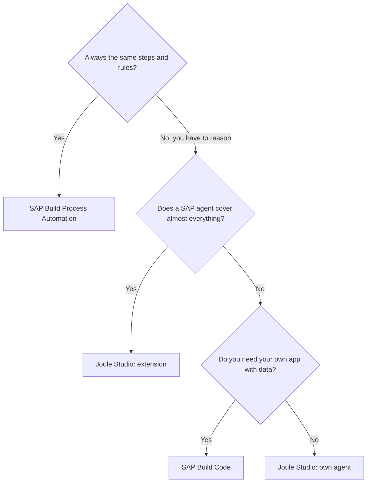

SAP does not understand enterprise AI as the use of a generic language model, but as AI that knows the company's processes and data. **Joule Studio** is the environment where that idea becomes custom solutions: it allows you to create, extend and run AI agents, as well as workflows and intelligent applications, with the business knowledge and control that an enterprise requires. This guide answers five questions: what is it?, what can be built?, how is it developed?, how is it governed? and how is it run?

## Where does Joule Studio fit in SAP Business AI Platform?

The **SAP Business AI Platform** brings together the foundation of enterprise AI in three pillars:

| Pillar | What it is for | Components |
|---|---|---|
| **Creation** | Building and extending AI-powered solutions. | Joule Studio and SAP Integration Suite. |
| **Context and analysis** | Giving AI data with business meaning. | Business Data Fabric, supported by SAP Datasphere. |
| **Governance** | Keeping control of the AI lifecycle. | SAP AI Core and SAP AI Launchpad. |

**Joule** is SAP's AI brand, and under that name live pieces with different roles:

| Piece | Who uses it | Role |
|---|---|---|
| **Joule Work** | Business users | Requesting and executing tasks in natural language. |
| **Joule Assistants** | Business users | Coordinating agents according to context and role. |
| **Joule Agents** | Business processes | Handling specialized multi-step tasks. |
| **Joule Studio** | Developers and business experts | Creating custom agents and extending SAP's. |

There are also two names that are often confused with Joule Studio: **Joule Studio, classic edition**, the previous edition integrated into SAP Build with *Joule Skill* and *Joule Agent* project types, and **Joule in SAP Build Code**, the coding assistant in SAP Business Application Studio that generates CAP and Fiori code.

## What can you build with Joule Studio?

| Type | When to choose it |
|---|---|
| **Custom agent** | The challenge is not covered by any agent that SAP delivers. |
| **Extension of an SAP agent** | A standard agent exists that covers almost everything and you only need to add your own rules, tools or logic. |
| **n8n workflow** | You need to automate several steps between SAP and third-party systems, with a low-code canvas. |
| **Application** | A full interface is needed to query and manage data (CAP server and React client). |

The rule of thumb is to start with the lightest option: first an extension, then your own agent.

## Intent-based development

Joule Studio does not start with code, but with describing the business problem. From that description, it proposes the path to a deployed solution, in six phases.

<figure>
  
  <figcaption>The six phases of intent-based development.</figcaption>
</figure>

- **Intent and requirements:** this is where the business contributes the most. The better the challenge is described, the better the requirements document (PRD), which remains as a reference of what was requested.
- **Specification and solution:** the tool turns the PRD into a technical blueprint and generates the code. The team reviews what was generated: it is not a black box.
- **Testing and deployment:** behavior is validated before publishing and the solution moves to an environment managed by SAP.

There are two working modes: **Quick Create**, which skips the clarification questions when the requirement is already clear, and **guided mode**, which asks questions to refine the intent when the scenario is complex.

In addition, there are two build paths that produce the same deployable artifact, automatically registered in Joule:

| Aspect | Low-code (browser) | Pro-code (command line) |
|---|---|---|
| **Environment** | Joule Studio web interface. | `jl` tool on the machine, with an AI coding assistant. |
| **Profile** | Analysts, citizen developers, professionals looking for speed. | Professional developers who want programmatic control. |

In both, the code is versioned with Git, and automation flows are drawn with n8n, a low-code tool integrated into Joule Studio.

## Extending an SAP agent without touching its code

SAP delivers ready-to-use agents for finance, supply chain, human resources, procurement and customer experience. An **extension** adapts one of them without modifying its code, in line with the *clean core* principle.

<figure>
  
  <figcaption>Extension points of a standard SAP agent.</figcaption>
</figure>

| Extension point | What it enables | Example |
|---|---|---|
| **Instructions** | Add business rules and limits on action. | The company's purchase order approval policies. |
| **Tools (MCP)** | Connect external systems or services. | Query a system that is not part of the standard. |
| **Hooks** | Run logic before or after the agent. | Notify a team when an invoice is flagged. |

The path is always the same: choose **Extension** when creating the solution, select the agent in the catalog, describe the intent and go through the phases until you deploy from the **Manage** tab. Not all agents support the three extension points, and the catalog indicates which ones each one supports.

## How is it governed?

A powerful language model is not enough for a critical process. SAP proposes three principles that serve as a checklist:

| Principle | Question you must be able to answer |
|---|---|
| **Context** | Does the agent know the company's data, processes and rules? |
| **Openness and quality** | Is it integrated with the current architecture, and was it tested with edge cases? |
| **Governance** | Can you tell who uses it, what it decided and how much it costs? |

The things that are controlled include identity and access, traceability of the agent's decisions and actions, the lifecycle of deployments, monitoring of usage, cost and value delivered, and approval to production according to risk. **SAP AI Agent Hub** brings together the discovery and management of agents, models and MCP servers.

Criteria we recommend at Logali Tech before moving to production:

1. **One owner per agent**, with a name and an area.
2. **Least privilege:** destinations and credentials grant access only to what the agent needs.
3. **A person decides on what matters:** agents recommend, and a person confirms the approval of orders, payments or master data changes.
4. **Test environment first:** validate with test data before connecting real systems.
5. **Review on update:** when SAP changes a standard agent, test the extensions again.

## How is it executed?

| Element | Function |
|---|---|
| **Managed runtime environment** | Platform on SAP BTP where the solution is deployed. SAP takes care of the infrastructure and scaling. |
| **Agent Gateway** | Single governed access point between the agents and the SAP systems. |
| **MCP** (*Model Context Protocol*) | The way the agent uses the APIs: each one is exposed as a tool. |
| **SAP BTP destination** | Secure connection to a system, configured once and reusable. |
| **A2A** | Communication between agents for collaboration. |

Once deployed, the solution is operated with performance monitoring, traces, metrics and logs. Administrators see the status of the deployments and can retire or replace an extension.

## Joule Studio, SAP Build Code or SAP Build Process Automation

SAP Build Code and SAP Build Process Automation are part of SAP Build. Joule Studio, in its current edition, is presented as the AI development environment of the SAP Business AI Platform, and only the classic edition is integrated into SAP Build. All three solve different problems: Joule Studio reasons and chooses tools, SAP Build Code executes what is programmed, and SAP Build Process Automation follows defined steps and rules. The diagram is my own criterion, not an official SAP definition.

The tools combine: a Joule Studio agent can rely on an action or a process from SAP Build Process Automation, and a SAP Build Code application can provide the data that the agent queries.

## Construction best practices

1. **Write the intent well:** the problem, who suffers from it, the expected outcome and the rules that cannot be broken. A vague intent produces a vague PRD.
2. **Review the PRD as if it were a contract:** it is the last point where the business can correct things at no cost.
3. **Prefer extension to a new agent:** less custom code and less maintenance.
4. **Start with read-only:** first give tools that query and, once the behavior is reliable, the ones that modify.
5. **Test the edge cases:** empty data, extreme amounts, inactive suppliers and ambiguous requests.
6. **Review the generated code:** even if the AI writes it, the team is accountable for it.
7. **Version with Git** and keep the PRD alongside the code.
8. **Reuse destinations** in SAP BTP instead of repeating credentials for each solution.
9. **Measure the value:** define from the intent what you want to improve (time, errors, cost) and verify it afterwards.

