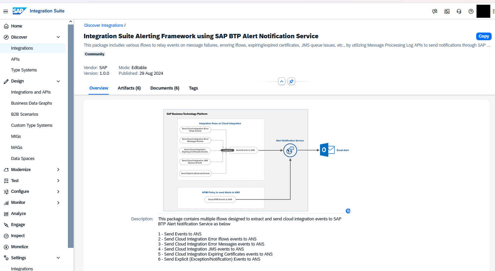
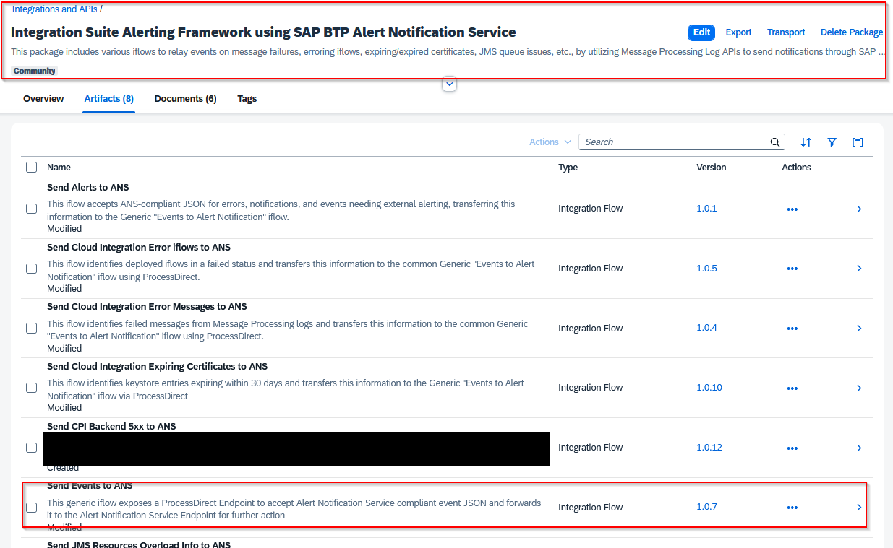
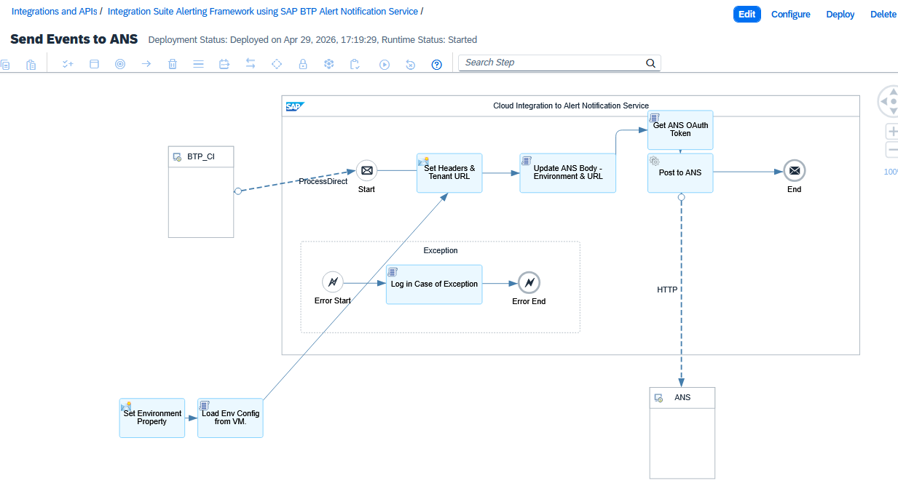
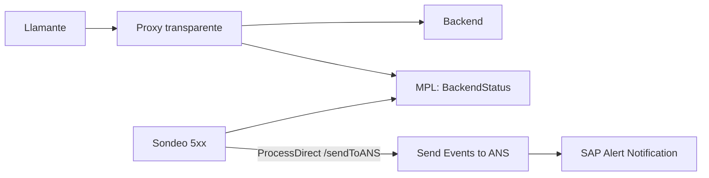

Un proxy transparente en Cloud Integration recibe una llamada, la reenvía al backend y devuelve la respuesta tal cual. Si el backend contesta con un HTTP 500, el proxy lo devuelve al llamante y el mensaje termina sin excepción en el registro de procesamiento (MPL). Para el monitor, esa ejecución no ha fallado, y ninguna alerta basada en mensajes fallidos se entera del error.

En este artículo explico cómo lo resolví con un paquete de la comunidad de SAP, el **Integration Suite Alerting Framework using SAP BTP Alert Notification Service**: qué son estos paquetes, qué flujos trae este, cómo encaja con SAP Alert Notification Service (ANS) y el iFlow que añadí para detectar los 5xx del backend. Es la quinta parte de la serie, después de [de Outlook a OneDrive con adaptadores](/blog/outlook-onedrive-integration-suite/).

## Qué es un paquete de la comunidad

El catálogo de contenido de SAP Integration Suite (**Discover**, alimentado por el SAP Business Accelerator Hub) no solo contiene paquetes publicados por SAP. Algunos llevan la etiqueta **Community**: son aportaciones de la comunidad que SAP publica en el mismo catálogo y que se copian al tenant igual que el resto.

En Discover, la ficha de este paquete indica:

| Campo | Valor |
|---|---|
| Etiqueta | Community |
| Fabricante | SAP |
| Versión | 1.0.0 |
| Publicado | 29-08-2024 |
| Modo | Editable |
| Contenido | 6 iFlows y 6 documentos |



El campo **Modo** marca la diferencia práctica. El paquete del adaptador Microsoft Outlook, del artículo anterior, está en modo *Configure-only*: solo se configura y se despliega. Este está en modo **Editable**: con **Copy** pasa a **Design**, donde muestra **Edit**, **Export**, **Transport** y **Delete Package**. Es un punto de partida que se copia, se adapta y se amplía con iFlows propios. En mi copia, la mayoría de sus artefactos aparecen como **Modified**, con versiones posteriores a las de Discover, y el mío como **Created**.

Antes de usar uno conviene tener en cuenta dos cosas:

- El soporte y la evolución dependen de quién publique cada paquete: conviene revisarlo en su ficha y en la pestaña **Documents** antes de llevarlo a producción.
- Un paquete copiado de Discover y modificado deja de recibir las actualizaciones de forma automática: hay que comparar cada versión nueva y reincorporar los cambios propios.

## Los flujos del paquete

El diagrama de la ficha resume la arquitectura: varios iFlows detectan incidencias y entregan un evento por ProcessDirect al iFlow genérico **Send Events to ANS**, que es el único que habla con Alert Notification Service, y ANS lo convierte en un correo. El diagrama incluye además una política de API Management que envía eventos a ANS desde los API proxies.

| iFlow (nombre en Discover) | Qué hace |
|---|---|
| Send Events to ANS | iFlow genérico: recibe el evento por ProcessDirect y lo envía a ANS |
| Send Cloud Integration Error iflows to ANS | Detecta iFlows desplegados en estado de error |
| Send Cloud Integration Error Messages to ANS | Detecta mensajes fallidos en el registro de procesamiento |
| Send Cloud Integration Expiring Certificates to ANS | Detecta entradas del keystore que caducan en los próximos 30 días |
| Send JMS Resources Overload Info to ANS | Detecta recursos JMS críticos (más del 80 % de uso) o agotados |
| Send Explicit Exceptions-Notifications-Events to ANS | Recibe JSON con formato de ANS para errores, notificaciones o eventos y lo reenvía al iFlow genérico |

En mi copia, el último se llama **Send Alerts to ANS**, y he añadido **Send CPI Backend 5xx to ANS**, que detecta los errores 5xx del backend sin excepción en el iFlow.



### El iFlow genérico: Send Events to ANS



El recorrido es corto:

1. **ProcessDirect** de entrada: cualquier iFlow del tenant le pasa un evento ya con el formato de ANS.
2. **Set Headers & Tenant URL**: añade las cabeceras y la URL del tenant.
3. **Update ANS Body - Environment & URL**: completa el cuerpo del evento con el entorno y la URL. El entorno se carga en un proceso local (**Set Environment Property** y **Load Env Config from VM**) desde un value mapping.
4. **Get ANS OAuth Token**: obtiene el token de ANS.
5. **Post to ANS**: envía el evento por HTTP al endpoint de ANS.

Un subproceso de excepción (**Log in Case of Exception**) deja registrado cualquier fallo del propio envío.

La ventaja de este diseño es que la conexión con ANS (credenciales, token y formato) está en un solo sitio. Para cubrir un caso nuevo basta con un iFlow que detecte la incidencia y llame al ProcessDirect.

## Por qué no bastaba con el paquete

El iFlow **Send Cloud Integration Error Messages to ANS** consulta los mensajes fallidos en el registro de procesamiento. Un 500 que atraviesa un proxy transparente no deja un mensaje fallido: el backend falla, pero el iFlow termina sin excepción de Camel. La alerta estándar nunca lo ve.

## Nuestro caso: Send CPI Backend 5xx to ANS

La solución tiene dos piezas:

1. **El proxy deja rastro en el MPL.** Cada proxy escribe el código de estado del backend en una propiedad de cabecera personalizada del registro de procesamiento, `BackendStatus`.
2. **Un iFlow de sondeo lo consulta.** **Send CPI Backend 5xx to ANS** consulta periódicamente el registro de procesamiento, filtra las ejecuciones cuyo `BackendStatus` es 5xx y, por cada una, genera un evento que entrega a **Send Events to ANS** por ProcessDirect, en la dirección `/sendToANS`.



El sondeo se ejecuta **cada 5 minutos**. Además del código de estado, el evento lleva en sus etiquetas (*tags*) los datos que luego necesita quien recibe la alerta: el servicio del backend, el inicio del registro en el MPL, el MessageGuid, el número de alertas de la ventana y un enlace directo al MPL en Integration Suite.

## La parte de Alert Notification Service

En el subaccount hay una instancia de Alert Notification Service con el plan **free** y una clave de servicio. La clave entrega cuatro datos: la URL de la API de ANS, la URL del token OAuth (con `grant_type=client_credentials`), el `client_id` y el `client_secret`. Son los que usa **Send Events to ANS** para pedir el token y enviar el evento.

ANS separa tres conceptos:

- **Evento**: lo que llega desde Cloud Integration, con severidad, tipo, recurso y etiquetas.
- **Suscripción**: decide qué eventos interesan. Tengo tres: errores 5xx del backend, certificados del keystore, y mensajes fallidos o iFlows en error.
- **Acción**: qué se hace con el evento. En mi caso, un **correo electrónico** común a las tres suscripciones.

El asunto y el cuerpo del correo se construyen con plantillas que leen los campos del evento:

```text
Asunto:
[{tags.EnvLabel}] {severity}: Backend {tags.BackendStatus} on {resource.resourceName}

Cuerpo:
Environment:       {tags.EnvLabel}
Severity:          {severity}
Event:             {eventType}

CPI Proxy:         {resource.resourceName}
S/4 Service:       {tags.BackendService}
Backend HTTP:      {tags.BackendStatus}
MPL LogStart:      {tags.MPLLogStart}
MessageGuid:       {tags.MessageGuid}
Alerts in window:  {tags.AlertCountInWindow}

Detail:
{body}

Open MPL in Integration Suite:
{tags.MPLDeepLink}
```

Con esto, el correo dice de un vistazo en qué entorno, en qué proxy y con qué código ha fallado el backend, y el enlace lleva directamente al registro del mensaje.

## Límites

- **No es tiempo real.** El aviso llega en el siguiente ciclo de sondeo, hasta 5 minutos después del error.
- **Depende de cada proxy.** Un proxy que no escriba `BackendStatus` queda fuera de la cobertura.
- **Es contenido de la comunidad modificado.** Las actualizaciones del paquete hay que revisarlas a mano antes de incorporarlas.

## Conclusión

El Alerting Framework de la comunidad resuelve la parte costosa de alertar desde Cloud Integration: la conexión con Alert Notification Service queda en un único iFlow y cada incidencia nueva es un iFlow pequeño que solo detecta y entrega. Los errores del backend en proxies transparentes no los cubre de serie, pero encajan en el mismo patrón con una propiedad personalizada en el MPL y un sondeo.
