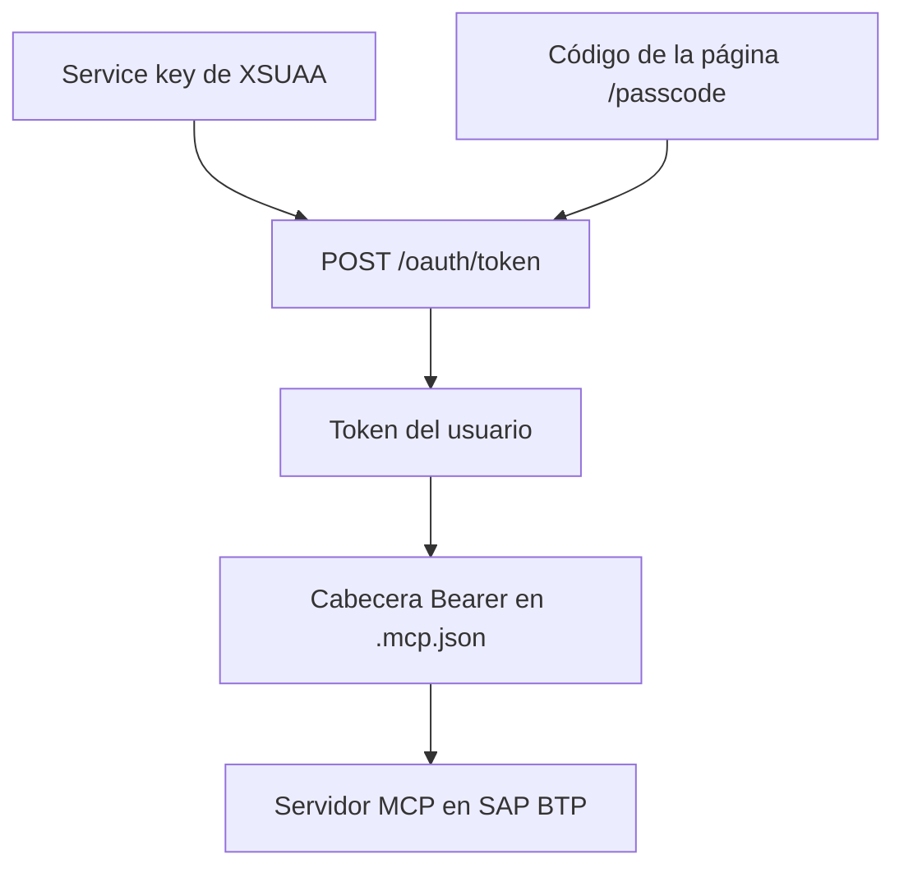

La [tercera parte de esta serie](/blog/cap-mcp-autenticacion-roles/) separó lectura y escritura por rol con `@requires` y `@restrict`, pero con usuarios simulados cuyas contraseñas estaban en el propio `package.json`. Esta cuarta parte despliega el mismo servicio SAP CAP en una cuenta trial de SAP BTP y sustituye la autenticación simulada por XSUAA. IAS no se probó: el artículo trata solo de XSUAA.

Con XSUAA, la autenticación en SAP BTP dejó de depender de las contraseñas guardadas en el proyecto; lo que queda en él es el token, en la configuración del cliente MCP. El plugin `@cap-js/mcp` aplicó las mismas reglas de la parte 3 sin cambiar el modelo ni el handler. Las pruebas también mostraron tres efectos que conviene conocer:

1. **`modifiedBy` registra el correo del usuario.** La identidad real llega a la base de datos.
2. **Quitar un rol no revoca el token.** Un token emitido con el rol `Almacen` siguió escribiendo después de quitar ese rol al usuario.
3. **El cliente MCP no inicia sesión por su cuenta.** El token se obtiene fuera del cliente y queda escrito en su configuración hasta que caduca.

Todas las pruebas se hicieron el 28-10-2026, en una cuenta trial de SAP BTP (Cloud Foundry, región US10), con datos inventados y con el usuario del propio autor.

## Entorno de la prueba

Las versiones de las partes anteriores (Node.js 24.19.0 en local, `@sap/cds-dk` 10.1.2, `@sap/cds` 10.1.1, `@cap-js/mcp` 1.5.0, `@cap-js/sqlite` 3.1.1 y Claude Code 2.1.276), más:

| Componente | Versión |
|---|---|
| `@sap/xssec` | 4.15.0 |
| cf CLI | 8.19.0 |
| `nodejs_buildpack` | 1.9.6 |
| Stack de Cloud Foundry | `cflinuxfs4` |

En Cloud Foundry, el buildpack instaló Node.js 24.22.1.

Las trazas y las duraciones proceden de ejecuciones de Claude Code desde la línea de comandos con el modelo `claude-sonnet-5`. Las capturas son de una segunda ejecución con las mismas preguntas en la extensión de Claude Code para Visual Studio Code, con el modelo Opus 5.5 (esfuerzo «Medium») y el modo de permisos «Manual», contra la aplicación desplegada en SAP BTP. La documentación oficial del plugin es la guía [Model Context Protocol Adapter](https://cap.cloud.sap/docs/guides/ai/cap-mcp).

## Del proyecto local a XSUAA

### cds add xsuaa

`cds add xsuaa` hizo tres cambios en el proyecto:

- generó `xs-security.json` con los roles `Lector` y `Almacen`, tomados de `@requires` y `@restrict` del modelo;
- añadió la dependencia `@sap/xssec`;
- configuró la autenticación `xsuaa` en el perfil `production`.

En esta prueba, el comando se ejecutó con `--dry`, esperando una vista previa, y aplicó los cambios igualmente.

### xs-security.json

A lo generado se añadieron `xsappname`, `tenant-mode` y dos colecciones de roles. Es la versión final:

```json
{
  "xsappname": "cap-mcp-demo",
  "tenant-mode": "dedicated",
  "scopes": [
    { "name": "$XSAPPNAME.Almacen", "description": "Almacen" },
    { "name": "$XSAPPNAME.Lector", "description": "Lector" }
  ],
  "attributes": [],
  "role-templates": [
    { "name": "Almacen", "description": "generated", "scope-references": ["$XSAPPNAME.Almacen"], "attribute-references": [] },
    { "name": "Lector", "description": "generated", "scope-references": ["$XSAPPNAME.Lector"], "attribute-references": [] }
  ],
  "role-collections": [
    { "name": "CapMcpDemo_Lector", "description": "Lectura del catálogo", "role-template-references": ["$XSAPPNAME.Lector"] },
    { "name": "CapMcpDemo_Almacen", "description": "Registro de entradas", "role-template-references": ["$XSAPPNAME.Almacen"] }
  ]
}
```

El fichero contiene los roles, no usuarios ni contraseñas. La relación entre el rol de la anotación, la plantilla de rol y el scope que viaja en el token se explica en [Autorización en CAP con XSUAA](/blog/cap-auth-xsuaa/).

### package.json

- `@cap-js/sqlite` pasa de `devDependencies` a `dependencies`, porque en Cloud Foundry no se instalan las dependencias de desarrollo.
- Se añade `"engines": { "node": "^24" }`.
- El perfil `production` usa XSUAA y SQLite en memoria:

```json
"[production]": {
  "auth": { "kind": "xsuaa" },
  "db": { "kind": "sqlite", "credentials": { "url": ":memory:" } }
}
```

Los usuarios simulados de la parte 3 siguen en `package.json` para el perfil de desarrollo, en local. En el perfil `production`, la autenticación es `xsuaa`.

La base de datos sigue siendo SQLite en memoria también en SAP BTP: el log de arranque de la aplicación muestra la carga de los CSV y «successfully deployed to in-memory database». Los datos se pierden al reiniciar.

### manifest.yml y .cfignore

```yaml
applications:
  - name: cap-mcp-demo
    path: .
    memory: 256M
    buildpacks:
      - nodejs_buildpack
    env:
      NODE_ENV: production
    services:
      - cap-mcp-demo-xsuaa
```

`.cfignore` excluye `node_modules/`, las evidencias, las capturas, las instantáneas del proyecto, los ficheros `.md` y `.log`, `.vscode/` y `.mcp.json`.

## Despliegue en SAP BTP

```bash
cf login -a https://api.cf.us10-001.hana.ondemand.com --sso
cf create-service xsuaa application cap-mcp-demo-xsuaa -c xs-security.json
cf push
```

- El plan `application` de XSUAA es gratuito en la cuenta trial.
- `cf push` terminó con la aplicación en estado `running`.
- El log de arranque en SAP BTP muestra `using auth strategy { kind: 'xsuaa' }`, el servicio en `/odata/v4/catalog` y `/mcp/catalog`, y «server v10.1.1 launched in 1179 ms».
- Las colecciones de roles `CapMcpDemo_Lector` y `CapMcpDemo_Almacen` se crearon con la instancia de XSUAA y se asignaron al usuario en el BTP cockpit: subaccount, **Security**, **Users**, **Assign Role Collection**.

Es un despliegue mínimo, con `cf push`, `manifest.yml` y SQLite en memoria. El despliegue completo de CAP, con SAP HANA Cloud y `mta.yaml`, se trata en [Desplegar CAP en BTP](/blog/cap-despliegue-btp/).

### Cómo se obtuvo el token del usuario

1. Un service key de la instancia de XSUAA (`cf create-service-key`), con el identificador y el secreto del cliente.
2. Un código temporal de la página `/passcode` del servicio de autenticación del subaccount (`https://<subdominio>.authentication.us10.hana.ondemand.com/passcode`), con la sesión del usuario abierta en el navegador.
3. `POST /oauth/token` con `grant_type=password` y `passcode=<código>`, autenticado con el cliente del service key.



El token resultante es del usuario (`origin: sap.default`), lleva como scopes los roles de sus colecciones asignadas, además de `openid`, y en esta prueba fue válido 12 horas. La contraseña del usuario no se usa en ningún paso.

En el cliente, el fichero `.mcp.json` lleva la cabecera `Authorization: Bearer` con el token en lugar de la cabecera Basic de la parte 3:

```json
{
  "mcpServers": {
    "almacen": {
      "type": "http",
      "url": "https://cap-mcp-demo.cfapps.us10-001.hana.ondemand.com/mcp/catalog",
      "headers": {
        "Authorization": "Bearer <TOKEN_XSUAA>"
      }
    }
  }
}
```

## Las mismas reglas, ahora con XSUAA

Pruebas directas contra la aplicación desplegada, por MCP y por OData:

| Prueba | Resultado |
|---|---|
| MCP `initialize` sin token | 401, «Authorization error (401): Not authorized to access CatalogService.», sin cabecera `WWW-Authenticate` |
| OData `GET Productos` sin token | 401 |
| OData con el usuario simulado `ana` (Basic) | 401 |
| Token con la firma alterada | Rechazado: «Unauthorized» |
| Token con rol `Almacen`: `tools/list` | `describe`, `query` y `call` |
| Token con rol `Almacen`: `describe` | `Productos`, `Categorias` y la acción `registrarEntrada` |
| Token con rol `Almacen`: `call` (Base USB-C, 10 unidades) | Correcto: stock 10 y `modifiedBy` con el correo del usuario |
| Token con rol `Lector`: `tools/list` | `describe` y `query` |
| Token con rol `Lector`: `query` | Lee `Productos` |
| Token con rol `Lector`: `call` | «Tool call not found» |
| Token con rol `Lector`: acción por OData | 403 Forbidden |

El primer token se pidió con la colección `CapMcpDemo_Almacen` asignada, sin `Lector`. El segundo, después de quitar `CapMcpDemo_Almacen` y asignar `CapMcpDemo_Lector`.

Los usuarios simulados de `package.json` reciben 401 en SAP BTP: la identidad y los roles vienen del token. El plugin filtró herramientas, entidades y acciones igual que con la autenticación simulada, sin cambios en el CDS ni en el handler.

`modifiedBy` pasa de `anonymous` (parte 2) y de los nombres simulados (parte 3) a la identidad real: el correo del usuario, un dato personal que queda guardado en la base de datos.

## Quitar el rol no revoca el token

Después de quitar la colección `CapMcpDemo_Almacen` al usuario en el cockpit, el token pedido antes con ese rol:

- seguía recibiendo `describe`, `query` y `call` en `tools/list`;
- registró una entrada de 2 unidades en el Teclado mecánico, con `modifiedBy` igual al correo del usuario.

Los roles viajan dentro del token: en esta prueba, quitar la colección no afectó al token ya emitido, que tenía una validez de 12 horas.

## El agente con cada token

Desde la línea de comandos se usó el mismo comando que en la parte 3, con un fichero de configuración MCP por token. Antes de cada pregunta se reinició la aplicación con `cf restart` para volver a los datos de los CSV, con la Base USB-C en stock 0.

### Token con rol Lector

«La Base USB-C ha recibido 10 unidades. Actualiza su stock a 10.»

El agente usó `describe`, `query` y otra vez `describe`. Buscó una herramienta para `registrarEntrada` y no la encontró. Respondió: «No hay disponible una herramienta para ejecutar `registrarEntrada` (la acción que suma unidades recibidas); solo dispongo de `describe` y `query` (solo SELECT), de solo lectura.» Confirmó el stock (0) y no escribió. Tardó 17,0 s.

En la ejecución de Visual Studio Code, el agente solo usó `query` y ofreció tres opciones: publicar la acción en el servidor MCP, registrar la entrada con una llamada OData `POST` a `registrarEntrada` o, «si me lo autorizas, llamo yo a esa acción por HTTP contra el servicio CAP local, sin pasar por el MCP».


**La segunda opción no funciona con el rol `Lector`:** la acción por OData devolvió 403. Además, el servicio no era local, sino el desplegado en SAP BTP. El agente no identificó que fuera una cuestión de permisos.

### Token con rol Almacen

La misma petición. El agente usó `describe`, `query` y `call`, con 10 unidades, y respondió: «Hecho. La Base USB-C tenía stock 0, se registró una entrada de 10 unidades y ahora su stock es 10.» `modifiedBy` registró el correo del usuario. Tardó 13,6 s. Esta ejecución también usó el token emitido antes de quitar la colección `CapMcpDemo_Almacen`: el token se emitió a las 10:24 UTC y la prueba es de las 10:31 UTC, cuando el usuario ya tenía asignada solo `CapMcpDemo_Lector`.

En la ejecución de Visual Studio Code, el resultado fue el mismo, y una consulta posterior confirmó el stock 10.


**Este token se emitió antes de quitar la colección `CapMcpDemo_Almacen` al usuario.** Cuando se hizo la captura, el usuario solo tenía asignada `CapMcpDemo_Lector` en el cockpit. La captura muestra, por tanto, el efecto de la sección anterior: el rol retirado seguía permitiendo escribir.

### Sin token

«¿Qué productos tienen el stock por debajo del mínimo?»

Claude Code marcó el servidor `almacen` como fallido. El agente respondió que el servidor había fallado al conectarse, con un «error de registro de cliente dinámico (HTTP 404, "Cannot POST /register")». Tardó 4,7 s.

Sin token, Claude Code intentó el registro dinámico de cliente de OAuth en `/register`, que no existe en la aplicación. En esta aplicación respondieron 404 los cuatro endpoints que un cliente MCP usa para iniciar sesión por su cuenta: `/.well-known/oauth-protected-resource`, `/.well-known/oauth-protected-resource/mcp/catalog`, `/.well-known/oauth-authorization-server` y `/register`. El token hubo que obtenerlo fuera del cliente y escribirlo en su configuración, donde queda como una credencial en un fichero hasta que caduca.

## Límites de esta cuarta parte

- **Solo XSUAA.** IAS no se probó.
- **Sin approuter ni interfaz.** No se probó el flujo de inicio de sesión en el navegador.
- **Base de datos en memoria.** No se usó SAP HANA Cloud: los datos vuelven a los CSV en cada reinicio.
- **Sin restricciones por instancia.** No se probó `@restrict` con `where`.
- **Un solo usuario.** Las pruebas se hicieron con un único usuario, cambiando sus colecciones de roles.

## Conclusiones

Con XSUAA, la autenticación en SAP BTP dejó de depender de las contraseñas guardadas en el proyecto: los usuarios simulados de `package.json`, que siguen ahí para el perfil de desarrollo, reciben 401, y la identidad y los roles llegan en el token. Lo que queda en el proyecto es el token, en la configuración del cliente MCP. `xs-security.json` contiene roles, no usuarios ni contraseñas. El mismo modelo de la parte 3 aplicó las mismas reglas por MCP y por OData sin cambiar el CDS ni el handler.

Lo que XSUAA no resolvió en esta prueba:

1. `modifiedBy` guarda el correo del usuario, un dato personal, en la base de datos.
2. Un token emitido con un rol siguió escribiendo después de quitar ese rol, hasta su caducidad.
3. El cliente MCP no pudo iniciar sesión por su cuenta: el token se obtuvo a mano y quedó escrito en la configuración del cliente.

La formación completa de CAP está en el [curso de SAP CAP de Logali Tech](/courses/sap-cap-cloud-application-programming-model/).
