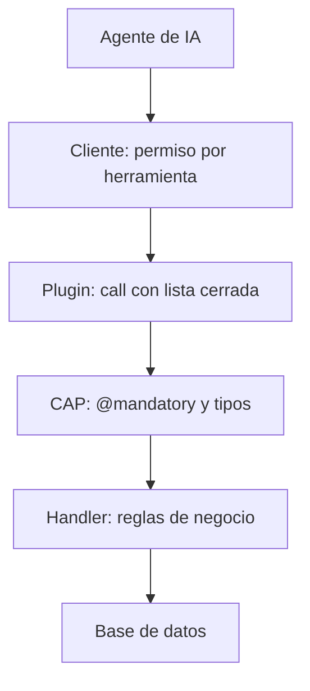

La [primera parte de esta serie](/blog/cap-mcp-servidor-agentes-ia/) terminó con una petición que el agente no pudo cumplir: «La Base USB-C ha recibido 10 unidades. Actualiza su stock a 10.» El servicio SAP CAP estaba publicado por MCP solo para lectura, y el agente se negó a escribir. Esta segunda parte cumple lo anunciado: se expone una acción CDS en el servicio y el agente modifica el stock con la herramienta `call` del plugin `@cap-js/mcp`, de forma controlada.

Lo evidente sería abrir las entidades a escritura y dejar que el agente actualice lo que necesite. Una acción es más restrictiva: el agente solo puede hacer lo que la acción permite, con los parámetros que declara y las validaciones de su handler. Las pruebas confirmaron que funciona, y también mostraron tres fallos que conviene conocer antes de usarlo:

1. **Sin `@mandatory`, una llamada incompleta parece correcta.** Una llamada sin el ID del producto no dio error, devolvió un producto cualquiera y no cambió nada.
2. **Los errores de validación de CAP llegan al agente sin texto.** El agente recibe «Error calling registrarEntrada: undefined», y el motivo solo queda en el log del servidor.
3. **El permiso del cliente depende de su configuración.** Claude Code pidió confirmación antes de cada `call`, pero en una ejecución con el modo de permisos «Auto» (y el modelo Opus 5.5) ejecutó la acción sin preguntar.

Todas las pruebas se hicieron en local, el 14-10-2026, sobre el mismo proyecto de la parte 1 y con datos inventados.

## Entorno de la prueba

| Componente | Versión |
|---|---|
| Node.js | 24.19.0 |
| `@sap/cds-dk` (global) | 10.1.2 |
| `@sap/cds` | 10.1.1 |
| `@cap-js/mcp` | 1.5.0 |
| `@cap-js/sqlite` | 3.1.1 |
| Claude Code (cliente MCP) | 2.1.276, modelo `claude-sonnet-5` |

Las trazas y las duraciones proceden de ejecuciones de Claude Code desde la línea de comandos con el modelo `claude-sonnet-5`. Las capturas son de una segunda ejecución con las mismas preguntas en la extensión de Claude Code para Visual Studio Code, con el modelo Sonnet 5.5. La documentación oficial del plugin es la guía [Model Context Protocol Adapter](https://cap.cloud.sap/docs/guides/ai/cap-mcp).

El modelo de datos, los datos de prueba, `package.json` y `.mcp.json` son los de la parte 1. Solo cambia la capa de servicio.

## De solo lectura a una acción CDS

### La acción en el servicio

```cds
using { demo.almacen as db } from '../db/schema';

@protocol: ['odata', 'mcp']
service CatalogService {
  @readonly entity Productos  as projection on db.Productos;
  @readonly entity Categorias as projection on db.Categorias;

  @description: 'Registra una entrada de mercancía: suma unidades recibidas al stock de un producto. No fija el stock a un valor ni resta unidades.'
  action registrarEntrada(
    @mandatory @description: 'ID del producto (campo ID de Productos)'
    producto : UUID,
    @mandatory @description: 'Unidades recibidas: número entero entre 1 y 1000'
    unidades : Integer
  ) returns Productos;
}

annotate CatalogService with @mcp.instructions: 'Catálogo de productos de un almacén de demostración. Usa describe para conocer las entidades y query para consultar productos, categorías y niveles de stock. Un producto tiene stock bajo cuando stock < stockMinimo. La única forma de modificar el stock es la acción registrarEntrada, que suma unidades recibidas.';
```

Tres decisiones de diseño:

- **Las entidades siguen siendo `@readonly`.** La acción es la única vía de escritura. Un `PATCH` por OData a `stock: 999` sigue devolviendo `405 Method Not Allowed`.
- **La acción expresa una operación de negocio, no un cambio de campo.** `registrarEntrada` suma unidades recibidas: no permite fijar el stock a un valor ni restar.
- **Las descripciones son para el agente.** Como en la parte 1, `@description` es lo que el agente lee en `describe` para saber qué hace la acción y qué espera cada parámetro.

La acción es *unbound*, es decir, no está ligada a una entidad. La descripción de la herramienta `call` dice expresamente que sirve para acciones y funciones *unbound*.

### El handler

Las validaciones que el modelo no puede expresar van en un handler, `srv/catalog-service.js`:

```javascript
const cds = require('@sap/cds')

module.exports = class CatalogService extends cds.ApplicationService {
  init() {
    const { Productos } = cds.entities('demo.almacen')

    this.on('registrarEntrada', async (req) => {
      const { producto, unidades } = req.data

      if (!Number.isInteger(unidades) || unidades < 1 || unidades > 1000)
        return req.error(400, 'Las unidades deben ser un número entero entre 1 y 1000')

      const existe = await SELECT.one.from(Productos, producto).columns('ID')
      if (!existe) return req.error(404, `No existe ningún producto con ID ${producto}`)

      await UPDATE(Productos, producto).with({ stock: { '+=': unidades } })

      return SELECT.one.from(this.entities.Productos, producto)
    })

    return super.init()
  }
}
```

Es el caso típico de [handler en CAP](/blog/cap-servicios-handlers/): lógica de negocio que el modelo CDS no puede expresar por sí solo. Al arrancar, `cds watch` muestra `impl: 'srv\\catalog-service.js'` en lugar del servicio genérico de la parte 1.

## La herramienta call

Con la acción declarada, `tools/list` devuelve una tercera herramienta sin código adicional:

| Herramienta | Anotaciones MCP |
|---|---|
| `describe` | `readOnlyHint: true`, `destructiveHint: false` |
| `query` | `readOnlyHint: true` |
| `call` | `readOnlyHint: false`, `destructiveHint: true`, `idempotentHint: false` |

`call` se anuncia al cliente como herramienta destructiva. Su esquema de entrada limita el nombre de la acción a una lista cerrada, que aquí tiene un solo valor, `registrarEntrada`. Los parámetros no tienen esquema propio en `call`: el agente los descubre con `describe`:

```text
actions:
  registrarEntrada:
    kind: action
    description: "Registra una entrada de mercancía: suma unidades recibidas al stock de un producto. No fija el stock a un valor ni resta unidades."
    parameters[2:]{type,notNull,description}:
      producto: UUID,true,ID del producto (campo ID de Productos)
      unidades: Integer,true,"Unidades recibidas: número entero entre 1 y 1000"
```

El `notNull: true` de cada parámetro sale de `@mandatory`. Su importancia se ve en la sección siguiente.

## Pruebas directas con curl

Antes de usar el agente, la acción se probó por el protocolo MCP, con la base de datos recién cargada y la Base USB-C con stock 0:

| Llamada a `call` | Resultado |
|---|---|
| Base USB-C, 10 unidades | Correcto: devuelve el producto con stock 10 |
| Unidades = -5 | «Las unidades deben ser un número entero entre 1 y 1000» |
| Unidades = 5000 | El mismo error |
| Producto inexistente | «No existe ningún producto con ID ...» |
| Acción `borrarProducto` | Rechazada por el esquema de `call`, antes de llegar a CAP |
| Unidades = "diez" | «Error calling registrarEntrada: undefined» |
| Sin producto | «Error calling registrarEntrada: undefined» |
| Sin unidades | «Error calling registrarEntrada: undefined» |

Al final, el stock de la Base USB-C era 10: solo cambió la llamada válida.

### Primer fallo: parámetros sin @mandatory

La primera versión de la acción no tenía `@mandatory`. Con ella, una llamada sin `producto` no dio error: devolvió como resultado el primer producto de la tabla, el Portátil 14 pulgadas, y no modificó ningún stock. El estado de todos los productos antes y después de la llamada era idéntico.

Para un agente, esa respuesta es un éxito aparente: la llamada no falla y devuelve un producto. Con `@mandatory` en los dos parámetros, CAP rechaza la llamada antes de ejecutar el handler, y `describe` marca los parámetros como obligatorios.

### Segundo fallo: errores sin texto

Los errores que lanza el handler con `req.error(código, 'texto')` llegan al agente con su texto. Los errores de validación de CAP, no: con un parámetro obligatorio que falta o un tipo incorrecto, el agente recibe «Error calling registrarEntrada: undefined». El motivo solo aparece en el log del servidor:

```text
code: 'ASSERT_MANDATORY',
target: 'producto'
```

La causa está en el código del plugin (`lib/utils/tools-shared.js`, función `formatError`): devuelve el campo `message` del error, que estos errores de validación no traen en ese punto. Conviene tenerlo en cuenta al diseñar la acción: las reglas propias del handler, como el rango de unidades o la existencia del producto, llegan al agente con su texto si se lanzan con `req.error`; los rechazos de `@mandatory` y de tipo llegan sin texto. Lo que el agente debe saber antes de llamar a la acción va en `@description`.

## Tres peticiones al agente

Las preguntas se hicieron en español a Claude Code, con la base de datos recargada antes de cada una. Desde la línea de comandos, cada herramienta MCP se autorizó de forma explícita con `--allowedTools`.

### Pregunta 1: la petición que falló en la parte 1

«La Base USB-C ha recibido 10 unidades. Actualiza su stock a 10.»

El agente consultó el stock antes de escribir, porque la acción suma y no fija el valor:

```sql
SELECT ID, nombre, stock, stockMinimo FROM Productos WHERE nombre LIKE '%USB-C%'
```

Con stock 0, llamó a `registrarEntrada` con 10 unidades y respondió: «Stock de "Base USB-C" actualizado: de 0 a 10 unidades (por encima del mínimo de 6).» Respuesta correcta, en 11,3 s.

Con `call` sin autorizar, la ejecución se detiene antes de escribir. El agente calcula la llamada, Claude Code la bloquea y pide permiso, y el servidor no recibe nada. En Visual Studio Code, el diálogo ofrece aprobar una vez, aprobar la herramienta para todos los proyectos o rechazarla:


En una ejecución con el modo de permisos «Auto» de la extensión (y el modelo Opus 5.5), el agente ejecutó `call` sin pedir confirmación. El permiso del cliente es una protección útil, pero depende de cómo lo tenga configurado cada usuario: no sustituye a las validaciones del servicio.

En otra ejecución, la base de datos no se había recargado y la Base USB-C ya tenía stock 10. El agente consultó el stock y no escribió: explicó que registrar 10 unidades más dejaría el stock en 20, no en 10.

### Pregunta 2: una operación que la acción no permite

«Retira 5 unidades del ratón inalámbrico, que se han vendido.»

El agente localizó el producto (stock 45) y no llamó a `call`. En la ejecución de Visual Studio Code lo explicó así: «Pasarle un número negativo para forzar la resta sería saltarse una restricción del servicio, así que no lo he intentado.» Tardó 9,4 s en la ejecución desde la línea de comandos.


Si el agente hubiera pasado unidades negativas, el handler lo habría rechazado: es la prueba de -5 de la tabla anterior. La descripción de la acción evitó el intento, y la validación cubre el caso de que la descripción no baste.

### Pregunta 3: varias escrituras en una petición

«Repón todos los productos con stock bajo hasta el mínimo.»

El agente buscó los productos bajo mínimos con una consulta e hizo una llamada a `call` por producto, con la diferencia entre el mínimo y el stock:

| Producto | Stock antes | Entrada | Stock después |
|---|---:|---:|---:|
| Portátil 16 pulgadas | 3 | +1 | 4 |
| Teclado mecánico | 8 | +2 | 10 |
| Base USB-C | 0 | +6 | 6 |

Respuesta correcta, en 11,7 s. Una consulta independiente después de la pregunta confirmó esos valores y que el resto de productos no había cambiado.

En Visual Studio Code, el agente lanzó las tres llamadas a la vez, con un permiso para cada una, y avisó de que no había verificado el resultado: «No hice una consulta final de comprobación. El stock actual sale de lo que devolvió cada llamada.»


### Lo que muestran las tres preguntas

- En todas las ejecuciones con escritura, el agente consultó el stock con `query` antes de llamar a `call`.
- La descripción de la acción bastó para que el agente calculara la diferencia, rechazara la venta y no duplicara una entrada.
- En la pregunta 3, una consulta independiente posterior confirmó las cifras de la respuesta.

## Quién controla cada escritura

El control de una escritura no depende de una sola pieza, sino de tres capas distintas:



| Capa | Qué controla | Comprobado en |
|---|---|---|
| Cliente (Claude Code) | Pide permiso antes de cada `call`; en una ejecución con el modo «Auto», no lo pidió | Pregunta 1 |
| Plugin `@cap-js/mcp` | Solo acepta las acciones declaradas en el servicio | Llamada a `borrarProducto` |
| CAP y handler | Parámetros obligatorios, tipos, rango de unidades y existencia del producto | Pruebas con curl |

Las capas del plugin y de CAP las define quien desarrolla el servicio y se aplican a cualquier cliente MCP; la del cliente depende de cada usuario. Por eso las reglas que importan van en el modelo y en el handler.

## Límites de esta segunda parte

- **Escrituras anónimas.** Todas las llamadas quedaron registradas con `modifiedBy: anonymous`: `.mcp.json` no envía credenciales y en local CAP usa la autenticación simulada. Cualquier cliente que llegue al puerto puede llamar a la acción.
- **Base de datos en memoria.** Los cambios se pierden al reiniciar. Con `cds watch`, además, el servidor se reinicia al escribir un fichero `.json` dentro del proyecto, y los datos vuelven a los de los CSV.
- **Fuera de alcance.** No se probaron las acciones *bound* ni la opción `per_action_tool` del plugin, que publica una herramienta por acción en lugar de `call`.

## Conclusiones

Una acción CDS basta para que un agente escriba en un servicio SAP CAP por MCP: el plugin añade la herramienta `call` sin código adicional, y las entidades pueden seguir siendo de solo lectura. Lo que requiere atención es el diseño de la acción:

1. Declarar la operación de negocio, no un cambio de campo, y describirla con `@description` para que el agente sepa qué hace y qué no.
2. Marcar con `@mandatory` todos los parámetros que la acción necesita.
3. Validar las reglas de negocio en el handler con `req.error`, cuyo texto llega al agente, y explicar en `@description` lo que el agente debe saber antes de llamar, porque los rechazos de `@mandatory` y de tipo llegan sin texto.
4. No delegar el control en el permiso del cliente: depende de su configuración.

Para repasar los fundamentos de CAP que usa este artículo, el blog trata cómo se separan [el modelo CDS y los servicios](/blog/cap-modelo-cds/). La formación completa de CAP está en el [curso de SAP CAP de Logali Tech](/courses/sap-cap-cloud-application-programming-model/).

**En la parte 3:** autenticación y roles. A partir de las escrituras anónimas de esta parte, se restringe quién puede consultar y quién puede llamar a la acción con `@requires` y `@restrict`.
