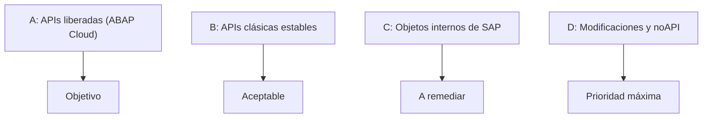
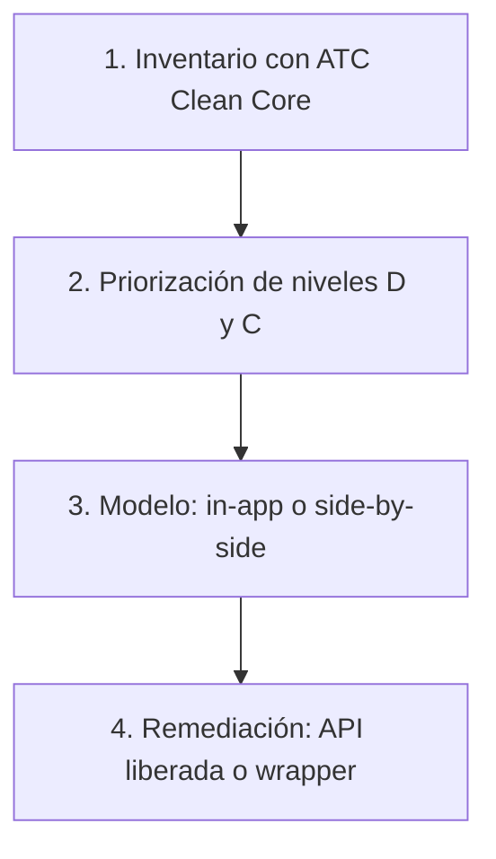

Años de modificaciones, user exits y enhancements implícitos tienen un efecto conocido: cada upgrade de SAP S/4HANA se vuelve lento, caro y arriesgado. La necesidad de fondo es poder seguir adaptando SAP al negocio sin perder la capacidad de actualizarlo.

Clean Core responde a esa necesidad: mantener el núcleo estándar libre de modificaciones y concentrar las adaptaciones en extensiones que usan solo interfaces estables. Este artículo propone un método para llegar a ese punto desde un sistema con código a medida existente: clasificarlo por niveles, priorizar y remediar. Para el concepto general, consulta [Clean Core sin humo](/blog/clean-core-sin-humo/).

## Los cuatro niveles Clean Core

El primer paso es ordenar el punto de partida. El código a medida se clasifica según el tipo de interfaz de SAP que utiliza:

| Nivel | Qué significa | Ejemplo |
|---|---|---|
| **A** | Solo APIs liberadas, con contrato de estabilidad | Extensión con ABAP Cloud |
| **B** | APIs clásicas, estables pero no liberadas; se consideran Clean Core | IDoc o ALV Grid |
| **C** | Objetos internos de SAP: ni liberados ni prohibidos, y SAP puede cambiarlos o eliminarlos | Lectura directa de una tabla estándar |
| **D** | Modificaciones del estándar y objetos noAPI, que no son Clean Core | Modificación de código estándar |

La lectura es sencilla: el nivel A es el destino, el B es tolerable, y los niveles C y D son los que ponen en riesgo el upgrade. Este concepto de niveles sustituye al modelo anterior de tres capas (3-tier) y se apoya en la clasificación de objetos del Cloudification Repository de SAP, que ATC utiliza al analizar el código.

## El método en cuatro pasos

### 1. Inventario y clasificación

Se ejecutan las comprobaciones ATC de Clean Core sobre el código a medida y se agrupan los hallazgos por nivel. Así se sabe qué porcentaje del código vive en cada nivel antes de tocar nada. Para configurar las variantes de comprobación, ver [ATC y la preparación para ABAP Cloud](/blog/atc-readiness-abap-cloud/).

### 2. Priorización

Se empieza por los niveles C y D, los de mayor riesgo para los upgrades, y se deja para después lo que ya es estable. Clasificar antes de migrar evita trabajar sobre lo que no importa.

### 3. Elección del modelo de extensibilidad

Para cada necesidad de negocio se decide entre dos caminos:

- **Extensión dentro de S/4HANA** (ABAP Cloud, in-app), cuando la lógica vive junto a los datos del core.
- **Aplicación side-by-side en SAP BTP**, cuando conviene desacoplarla.

Elegir bien aquí ahorra rehacer trabajo. Los criterios de decisión se detallan en [los tres niveles de extensibilidad en ABAP Cloud](/blog/abap-cloud-tres-niveles-extensibilidad/).

### 4. Remediación

Se sustituyen los accesos no liberados por APIs liberadas. Cuando no existe alternativa, se encapsula el objeto en un wrapper para aislar el riesgo en un único punto. El patrón se explica en [wrappers para código legacy](/blog/abap-cloud-wrappers-legacy/).

## Lecciones del método

- Clasificar antes de migrar evita trabajar sobre lo que no importa.
- No todo se resuelve igual: elegir bien entre in-app y side-by-side ahorra rehacer trabajo.
- Un wrapper bien diseñado es una salida pragmática cuando no hay API liberada.

## Mantener el núcleo limpio

La clasificación no es un ejercicio de una sola vez. Un control periódico con ATC mantiene el núcleo limpio y permite que cada nueva extensión nazca ya en el nivel adecuado. Si tu organización necesita apoyo para clasificar su código y planificar la remediación, consulta nuestros [servicios de consultoría](/consulting/).
