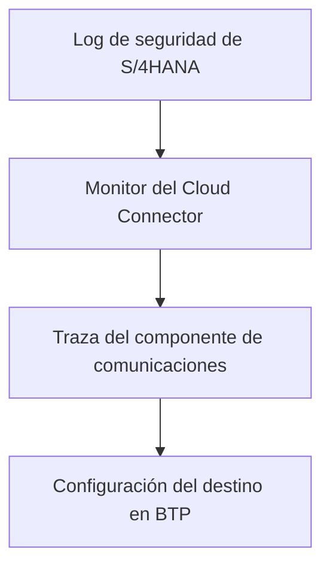

Cuando una aplicación de SAP BTP debe leer y ejecutar acciones en SAP S/4HANA con la identidad del propio usuario, y no con un usuario técnico, el Cloud Connector deja de ser solo un túnel. Es el punto donde se decide si la identidad viaja hasta el sistema o se pierde por el camino.

Este artículo recoge la configuración del lado del Cloud Connector tal como se dejó en un entorno productivo, y los fallos que aparecieron al validar la propagación de identidad en un entorno de calidad. Para repasar qué es el túnel y cómo se tipa un destino, conviene leer antes [Destinations y Cloud Connector: conectar BTP sin abrir el firewall](/blog/btp-admin-destinations-conectividad/).

## Función del Cloud Connector en la propagación de identidad

La propagación de identidad (*principal propagation*) funciona con un certificado X.509 que el Cloud Connector genera para el usuario y reenvía a S/4HANA. El sistema debe aceptar ese certificado y traducirlo a un usuario SAP. Cada pieza tiene su lado:

| Lado | Qué se configura |
|---|---|
| SAP BTP | Un destino con proxy OnPremise y autenticación PrincipalPropagation |
| Cloud Connector | Subcuenta, mapeo con HTTPS y principal X.509, recursos y confianza |
| S/4HANA | Importación del certificado de sistema, regla de mapeo por correo y parámetros de perfil |

Este artículo cubre las dos primeras filas. El lado de S/4HANA aparece solo en los fallos, porque es donde se manifiestan casi todos.

## Paso 1: añadir la subcuenta sin tocar las existentes

Un Cloud Connector productivo suele dar servicio a otras integraciones en funcionamiento. Añadir una subcuenta nueva solo suma: no hay que modificar ni eliminar las que ya están conectadas, y conviene hacerlo dentro de una ventana de intervención acordada.

En la pantalla **Connector**, el botón **Add Subaccount** abre el asistente. En un conector todavía sin subcuentas, como el de la captura, la pantalla se llama **Define Subaccount** y el botón está en el mismo lugar.

Los pasos del asistente son:

1. Seleccionar **Configure using authentication data**.
2. Dejar sin marcar la casilla **Managed**.
3. Cargar el archivo `authentication.data` de la subcuenta, que se descarga desde el cockpit de SAP BTP y es de un solo uso.

Antes de pulsar **Finish**, el asistente muestra los datos leídos del archivo. Dos campos merecen atención:

- **Location ID.** Si el Cloud Connector ya da servicio a otras subcuentas, el identificador de ubicación que se use debe indicarse también en el destino de SAP BTP. Se deja vacío solo si no se ha acordado ninguno.
- **Auto Renewal.** Con la renovación automática en OFF, el certificado de la subcuenta caduca sin aviso. Hay que anotar su fecha de caducidad y quién se encarga de renovarlo.

La captura siguiente muestra ese último paso del asistente con el Location ID informado y Auto Renewal en OFF.

## Paso 2: mapeo con HTTPS y principal X.509

El mapeo traduce el host virtual que ve SAP BTP en el host interno de S/4HANA. Se crea en **Cloud to On-Premises**, pestaña **Access Control**, con estos valores:

| Campo | Valor |
|---|---|
| Back-end Type | ABAP System |
| Protocol | HTTPS |
| Principal Type | X.509 Certificate |
| Host interno y virtual | Los acordados con el equipo de red, con el puerto HTTPS del sistema |

Dos de estos valores no admiten alternativa:

- **El protocolo debe ser HTTPS.** Con HTTP sin TLS, la propagación de identidad ni siquiera aparece como opción en el desplegable del tipo de principal: solo ofrece ninguno o Kerberos.
- **El tipo de principal debe ser X.509 Certificate**, que es lo que habilita el reenvío de la identidad del usuario hasta S/4HANA.

En la prueba de calidad, el tipo de principal mal fijado se detectó analizando el log del Cloud Connector, tras ver accesos denegados en el manejador de autorización. Comprobar en el desplegable que la opción existe antes de guardar evita ese diagnóstico.

El mapeo correcto aparece con estado verde, el resultado **Reachable**, el protocolo HTTPS y el tipo ABAP System:

## Paso 3: publicar solo las rutas necesarias

El recurso indica qué rutas de S/4HANA se alcanzan a través del mapeo. Se publican las rutas que la aplicación consume, no el sistema completo:

- **Access Policy:** `Path and All Sub-Paths` para las rutas de servicios OData.
- **Upgrade Allowed:** sin marcar.
- **Description:** conviene indicar el servicio al que corresponde cada ruta.

La captura anterior muestra un recurso provisional con la ruta raíz y la política `Path Only`. Por sí solo no da acceso a ningún servicio. Una vez creados los recursos definitivos, lo recomendable es desactivarlo o eliminarlo, para no dejar más superficie expuesta de la necesaria.

## Sincronización automática de confianza

En **Cloud to On-Premises**, la pestaña **Principal Propagation** tiene el interruptor **Automatic Trust Synchronization**. Debe quedar en ON: si SAP BTP renueva sus claves de firma JWT, el Cloud Connector las incorpora sin intervención manual.

La comprobación es doble: el aviso superior indica la fecha de la última actualización de la confianza y la tabla **Trust Configuration** lista las claves de la subcuenta con el estado Trusted.

## El destino en SAP BTP

El destino se crea en el cockpit, en **Connectivity > Destinations**, no en el Cloud Connector. Es el nombre con el que la aplicación llama a S/4HANA a través del mapeo:

| Campo | Valor |
|---|---|
| Type | HTTP |
| Proxy Type | OnPremise |
| Authentication | PrincipalPropagation |
| URL | El host virtual y el puerto del mapeo, no el host interno |
| Location ID | Vacío, salvo que se acordara uno al añadir la subcuenta |

Dos detalles evitan confusiones. El destino lleva el host virtual, no el interno. Y el protocolo `http` de la URL es el del tramo hasta el Cloud Connector: el cifrado hacia S/4HANA lo aporta el mapeo HTTPS.

En **Additional Properties** se añaden las propiedades del destino: `sap-client`, `WebIDEUsage`, `product.name` y `HTML5.DynamicDestination`.

## Lo que Check Connection no demuestra

Tras guardar el destino, **Check Connection** devuelve que el backend es alcanzable desde el Cloud Connector. Lo mismo indica el resultado Reachable del mapeo. Ambas comprobaciones confirman la red y el túnel, y nada más. **No prueban la autenticación.**

La confirmación de la configuración también se hace desde el cockpit, en **Connectivity > Cloud Connectors** de la subcuenta: la conexión activa, la alta disponibilidad con su instancia sombra conectada y, en los sistemas expuestos, los recursos en estado Available. Tampoco esto valida la identidad: la autenticación se comprueba con una llamada real, ejecutada con usuarios distintos.

La captura muestra la vista de **Cloud Connectors** en el cockpit, con el conector conectado y los detalles de la instancia maestra.

## Dos fallos silenciosos al validar la propagación

Durante la validación en calidad, el túnel y el destino daban resultados correctos y la identidad no llegaba. Dos causas distintas, ninguna con un mensaje de error en la aplicación. A ellas se suma el mapeo sin HTTPS o con el tipo de principal mal fijado, descrito en el paso 2:

1. **Correo duplicado entre usuarios.** La regla de certificado de S/4HANA resuelve el usuario por correo. Con dos usuarios SAP con el mismo correo, el sistema rechaza el acceso por seguridad en lugar de elegir uno. El síntoma es una pantalla en blanco o la caída a un inicio de sesión manual, aunque la traza del componente de comunicaciones muestra el certificado aceptado y reenviado. Solo el log de seguridad lo revela (motivo 35 en `SM20`: asignación ambigua del certificado X.509 a cuentas SAP). Se previene con una consulta al maestro de usuarios que detecte correos repetidos entre los usuarios del alcance.
2. **SAML por delante del certificado.** En un nodo de servicio, la lista de procedimientos de inicio de sesión tenía SAML antes que el certificado: el sistema intentaba SAML con el certificado ya aceptado y el proveedor de identidad externo bloqueaba la carga. Se resolvió restableciendo el procedimiento estándar en ese nodo, que no era el primero que se revisó.

## Orden de diagnóstico cuando la identidad no llega

El orden eficiente es el que empieza por donde suele estar la respuesta, y que en la validación en calidad era el último sitio donde se miraba:

1. **Log de seguridad de S/4HANA** (`SM20`): accesos fallidos con método de certificado en la ventana de tiempo del intento. Da la respuesta directa en la mayoría de los casos.
2. **Monitor del Cloud Connector:** confirma que la petición llegó, con qué usuario y con qué resultado.
3. **Traza del componente de comunicaciones:** confirma que el certificado se acepta y se reenvía.
4. **Configuración del destino en BTP:** solo si los tres anteriores están limpios.

Un aviso sobre las trazas: en la prueba de calidad se capturaron cuatro sin recoger nada útil, porque la ventana de captura no coincidía con el momento real del intento. Se había asumido un desfase horario entre el servidor y quien hacía la prueba que no existía. Antes de analizar una traza, conviene confirmar la diferencia horaria.

## Alcance y límites

- La validación de la propagación de identidad con usuarios reales se hizo en un entorno de calidad. En el entorno productivo, la configuración del Cloud Connector, la propagación de identidad y el destino están hechos, y el papel del Cloud Connector termina ahí.
- La parte de S/4HANA (importación del certificado de sistema, regla `CERTRULE` por correo, parámetros de perfil y reinicio del ICM) se menciona aquí solo como contexto de los fallos.
- Los pasos corresponden a la consola de administración del Cloud Connector y al cockpit de SAP BTP tal como se usaron en el proyecto. Las etiquetas pueden variar entre versiones.
