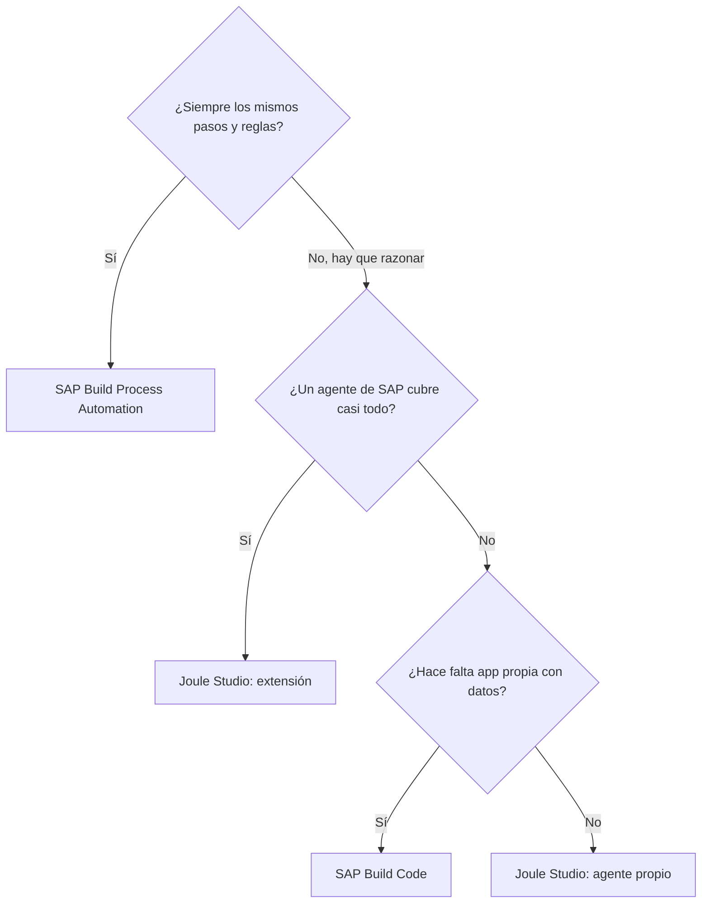

SAP no entiende la IA empresarial como el uso de un modelo de lenguaje genérico, sino como una IA que conoce los procesos y los datos de la compañía. **Joule Studio** es el entorno donde esa idea se convierte en soluciones propias: permite crear, ampliar y ejecutar agentes de IA, además de flujos de trabajo y aplicaciones inteligentes, con el conocimiento de negocio y el control que exige una empresa. Esta guía responde a cinco preguntas: ¿qué es?, ¿qué se puede construir?, ¿cómo se desarrolla?, ¿cómo se gobierna? y ¿cómo se ejecuta?

## ¿Dónde encaja Joule Studio en SAP Business AI Platform?

La **SAP Business AI Platform** agrupa la base de la IA empresarial en tres pilares:

| Pilar | Para qué sirve | Componentes |
|---|---|---|
| **Creación** | Construir y ampliar soluciones con IA. | Joule Studio y SAP Integration Suite. |
| **Contexto y análisis** | Dar a la IA datos con significado de negocio. | Business Data Fabric, apoyado en SAP Datasphere. |
| **Gobierno** | Mantener el control del ciclo de vida de la IA. | SAP AI Core y SAP AI Launchpad. |

**Joule** es la marca de IA de SAP, y bajo ese nombre conviven piezas con papeles distintos:

| Pieza | Quién la usa | Papel |
|---|---|---|
| **Joule Work** | Personas de negocio | Pedir y ejecutar tareas en lenguaje natural. |
| **Joule Assistants** | Personas de negocio | Coordinar a los agentes según el contexto y el rol. |
| **Joule Agents** | Procesos de negocio | Resolver tareas especializadas de varios pasos. |
| **Joule Studio** | Desarrolladores y expertos de negocio | Crear agentes propios y ampliar los de SAP. |

Hay además dos nombres que se confunden con Joule Studio: **Joule Studio, classic edition**, la edición anterior integrada en SAP Build con proyectos de tipo *Joule Skill* y *Joule Agent*, y **Joule en SAP Build Code**, el asistente de programación de SAP Business Application Studio que genera código CAP y Fiori.

## ¿Qué se puede construir con Joule Studio?

| Tipo | Cuándo elegirlo |
|---|---|
| **Agente personalizado** | El reto no está cubierto por ningún agente que entregue SAP. |
| **Extensión de un agente de SAP** | Existe un agente estándar que cubre casi todo y solo falta añadir reglas, herramientas o lógica propias. |
| **Flujo de trabajo n8n** | Hay que automatizar varios pasos entre sistemas SAP y de terceros, con un lienzo de bajo código. |
| **Aplicación** | Hace falta una interfaz completa para consultar y gestionar datos (servidor CAP y cliente React). |

La regla práctica es empezar por la opción más ligera: primero una extensión, después un agente propio.

## Desarrollo basado en intención

Joule Studio no empieza por el código, sino por describir el problema de negocio. A partir de esa descripción propone el camino hasta una solución desplegada, en seis fases.

<figure>
  
  <figcaption>Las seis fases del desarrollo basado en intención.</figcaption>
</figure>

- **Intención y requisitos:** es donde más aporta el negocio. Cuanto mejor se describa el reto, mejor será el documento de requisitos (PRD), que queda como referencia de lo que se pidió.
- **Especificación y solución:** la herramienta convierte el PRD en un plano técnico y genera el código. El equipo revisa lo generado: no es una caja negra.
- **Pruebas y despliegue:** se valida el comportamiento antes de publicar y la solución pasa a un entorno gestionado por SAP.

Existen dos modos de trabajo: **Quick Create**, que omite las preguntas de aclaración cuando el requisito ya está claro, y el **modo guiado**, que pregunta para afinar la intención cuando el escenario es complejo.

Además, hay dos caminos de construcción que producen el mismo artefacto desplegable, registrado automáticamente en Joule:

| Aspecto | Low-code (navegador) | Pro-code (línea de comandos) |
|---|---|---|
| **Entorno** | Interfaz web de Joule Studio. | Herramienta `jl` en el equipo, con un asistente de código con IA. |
| **Perfil** | Analistas, desarrolladores ciudadanos, profesionales que buscan rapidez. | Desarrolladores profesionales que quieren control programático. |

En ambos el código se versiona con Git, y los flujos de automatización se dibujan con n8n, una herramienta de bajo código integrada en Joule Studio.

## Extender un agente de SAP sin tocar su código

SAP entrega agentes listos para usar en finanzas, cadena de suministro, recursos humanos, compras y experiencia de cliente. Una **extensión** adapta uno de ellos sin modificar su código, de acuerdo con el principio de *clean core*.

<figure>
  
  <figcaption>Puntos de extensión de un agente estándar de SAP.</figcaption>
</figure>

| Punto de extensión | Qué permite | Ejemplo |
|---|---|---|
| **Instrucciones** | Añadir reglas de negocio y límites de actuación. | Las políticas de aprobación de pedidos de la empresa. |
| **Herramientas (MCP)** | Conectar sistemas o servicios externos. | Consultar un sistema que no forma parte del estándar. |
| **Hooks** | Ejecutar lógica antes o después del agente. | Avisar a un equipo cuando se marca una factura. |

El recorrido es siempre el mismo: elegir **Extension** al crear la solución, seleccionar el agente en el catálogo, describir la intención y recorrer las fases hasta desplegar desde la pestaña **Manage**. No todos los agentes admiten los tres puntos de extensión, y el catálogo indica cuáles admite cada uno.

## ¿Cómo se gobierna?

Un modelo de lenguaje potente no basta para un proceso crítico. SAP propone tres principios que sirven de lista de comprobación:

| Principio | Pregunta que hay que poder responder |
|---|---|
| **Contexto** | ¿El agente conoce los datos, los procesos y las reglas de la empresa? |
| **Apertura y calidad** | ¿Se integra con la arquitectura actual y se probó con casos límite? |
| **Gobierno** | ¿Se puede saber quién lo usa, qué decidió y cuánto cuesta? |

Entre las cosas que se controlan están la identidad y el acceso, la trazabilidad de las decisiones y acciones del agente, el ciclo de vida de los despliegues, el seguimiento del uso, el coste y el valor aportado, y la aprobación a producción según el riesgo. El **SAP AI Agent Hub** reúne el descubrimiento y la gestión de agentes, modelos y servidores MCP.

Criterios que recomendamos en Logali Tech antes de pasar a producción:

1. **Un responsable por agente**, con nombre y área.
2. **Mínimo privilegio:** los destinos y las credenciales dan acceso solo a lo que el agente necesita.
3. **Una persona decide en lo importante:** los agentes recomiendan, y la aprobación de pedidos, pagos o cambios de datos maestros la confirma una persona.
4. **Entorno de pruebas primero:** se valida con datos de prueba antes de conectar sistemas reales.
5. **Revisión al actualizar:** cuando SAP cambia un agente estándar, se vuelven a probar las extensiones.

## ¿Cómo se ejecuta?

| Elemento | Función |
|---|---|
| **Entorno de ejecución gestionado** | Plataforma en SAP BTP donde se despliega la solución. SAP se ocupa de la infraestructura y el escalado. |
| **Agent Gateway** | Único punto de acceso gobernado entre los agentes y los sistemas SAP. |
| **MCP** (*Model Context Protocol*) | Forma en que el agente usa las API: cada una se expone como una herramienta. |
| **Destino de SAP BTP** | Conexión segura hacia un sistema, configurada una vez y reutilizable. |
| **A2A** | Comunicación entre agentes para colaborar. |

Una vez desplegada, la solución se opera con monitorización del rendimiento, trazas, métricas y registros. Las personas administradoras ven el estado de los despliegues y pueden retirar o reemplazar una extensión.

## Joule Studio, SAP Build Code o SAP Build Process Automation

SAP Build Code y SAP Build Process Automation forman parte de SAP Build. Joule Studio, en su edición actual, se presenta como el entorno de desarrollo de IA de la SAP Business AI Platform, y solo la edición classic está integrada en SAP Build. Los tres resuelven problemas distintos: Joule Studio razona y elige herramientas, SAP Build Code ejecuta lo que se programa y SAP Build Process Automation sigue pasos y reglas definidos. El diagrama es un criterio propio, no una definición oficial de SAP.

Las herramientas se combinan: un agente de Joule Studio puede apoyarse en una acción o en un proceso de SAP Build Process Automation, y una aplicación de SAP Build Code puede ofrecer los datos que el agente consulta.

## Buenas prácticas de construcción

1. **Escribir bien la intención:** el problema, quién lo sufre, el resultado esperado y las reglas que no se pueden romper. Una intención vaga produce un PRD vago.
2. **Revisar el PRD como si fuera un contrato:** es el último punto donde el negocio puede corregir sin coste.
3. **Preferir la extensión al agente nuevo:** menos código propio y menos mantenimiento.
4. **Empezar con solo lectura:** dar primero herramientas que consultan y, cuando el comportamiento sea fiable, las que modifican.
5. **Probar los casos límite:** datos vacíos, importes extremos, proveedores inactivos y peticiones ambiguas.
6. **Revisar el código generado:** aunque lo escriba la IA, el equipo responde por él.
7. **Versionar con Git** y mantener el PRD junto al código.
8. **Reutilizar destinos** de SAP BTP en lugar de repetir credenciales por solución.
9. **Medir el valor:** definir desde la intención qué se quiere mejorar (tiempo, errores, coste) y comprobarlo después.

