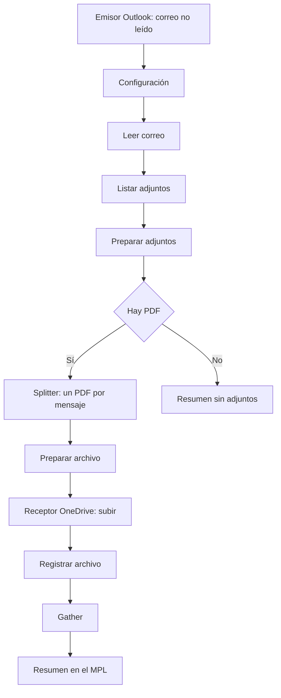

En junio tuve que leer de forma desatendida un buzón de Microsoft 365 desde SAP Integration Suite: descargar los PDF adjuntos de los correos entrantes y guardarlos en OneDrive. Lo resolví con un script Groovy que llamaba directamente a Microsoft Graph, con su propio token OAuth2 y sus propios reintentos. Funcionó, pero era mucho código para algo que hoy cubren adaptadores estándar.

En este artículo rehago el mismo caso con los **adaptadores Microsoft Outlook y Microsoft OneDrive** de SAP Integration Suite: qué hay que preparar en Microsoft Entra ID, cómo queda el iFlow y qué tropiezos encontré al configurarlo. Es la cuarta parte de la serie, después de [los cifrados TLS](/blog/sap-api-management-cifrados-tls/), [activar el runtime de API Management](/blog/activar-api-management-integration-suite/) y [la rotación de claves de XSUAA](/blog/xsuaa-rotacion-claves-api-management/).

## El enfoque anterior: Microsoft Graph desde Groovy

El adaptador Mail de Cloud Integration admite IMAP con OAuth2 para Microsoft 365, pero en mi análisis solo con el flujo Authorization Code. Eso exige que un usuario real se autentique al menos una vez y que el refresh token se renueve, algo que no encaja con un buzón que se lee sin intervención humana. Por eso opté por Microsoft Graph con **OAuth2 Client Credentials**, llamado desde Groovy con `HttpURLConnection`:

```text
Timer (cada 10 min) → Content Modifier → SCR_ProcessEmail.groovy → End
```

El script, de unas 230 líneas, hacía todo:

- obtenía el token de Entra ID y lo renovaba cada 50 minutos;
- listaba los correos sin la categoría `Procesado-CPI`, del más antiguo al más reciente;
- descargaba los adjuntos permitidos y los subía a OneDrive en carpetas por año y mes;
- marcaba cada correo como procesado con una petición PATCH;
- dejaba métricas en cabeceras del registro de procesamiento.

La prueba de extremo a extremo del 18 de junio subió **12 PDF** a OneDrive. El coste estaba en el mantenimiento: autenticación, reintentos y marcado de correos eran código propio.

## Los adaptadores de Microsoft en Integration Suite

En la lista **Adapter Type** de mi tenant de pruebas aparecen seis adaptadores de Microsoft: Microsoft OneDrive, Microsoft OneNote, Microsoft SharePoint, MicrosoftDynamicsCRM, MicrosoftOutlook y MicrosoftTeams. Para este caso uso dos.

### Microsoft Outlook

El adaptador se distribuye como paquete en el SAP Business Accelerator Hub. Su registro de cambios oficial recoge estas versiones:

| Versión | Fecha | Cambio |
|---|---|---|
| 1.0.0 | 05-02-2026 | Primera versión |
| 1.1.0 | 22-05-2026 | Recurso Event y configuración Advanced en el receptor |
| 1.2.0 | 15-07-2026 | El emisor lee con un programador de ejecuciones |

Según la [guía oficial de la versión 1.2.0](https://api.sap.com/odata/1.0/catalog.svc/Files('bd612bd6678b4857a226010238b2276f')/$value):

- Trabaja sobre Microsoft Graph con correo, carpetas, adjuntos, calendarios y eventos.
- Admite **OAuth2 Client Credentials** (permisos de aplicación) y OAuth2 Authorization Code (permisos delegados).
- El **emisor** lee todos los correos, solo los no leídos o los que cumplan un filtro, y después los marca como leídos, los borra o los archiva.
- El **receptor** ofrece operaciones predefinidas (modo Basic) o cualquier llamada a Graph con método y ruta relativa (modo Advanced).
- Está incluido en la licencia Standard de SAP Integration Suite, pero no viene desplegado: se copia su paquete desde **Discover** y se despliega en el tenant.

### Microsoft OneDrive

En mi tenant el adaptador aparece con la versión 1.0.2 y el fabricante SAP. Sus operaciones se organizan con los mismos conceptos que Graph: *drives*, *drive items*, permisos y lotes. En el flujo lo uso como receptor para subir cada PDF.

## Requisitos en Microsoft Entra ID

Las dos piezas comparten un único registro de aplicación:

1. En **Entra ID**, **Registros de aplicaciones**, pulsa **Nuevo registro**, con **Solo inquilino único** y sin URI de redirección.
2. Anota el **Id. de aplicación (cliente)** y el **Id. de directorio (inquilino)**.
3. En **Certificados y secretos**, crea un secreto de cliente y copia su **Valor** al momento: no se vuelve a mostrar.
4. En **Permisos de API**, **Agregar un permiso**, **Microsoft Graph**, **Permisos de aplicación**:

| Permiso | Para qué |
|---|---|
| `Mail.ReadWrite` | Leer el buzón y marcar o archivar el correo procesado |
| `Files.ReadWrite.All` | Crear carpetas y subir los PDF a OneDrive |

5. Pulsa **Conceder consentimiento de administrador**. Sin el consentimiento, el permiso aparece como «No concedido» y las llamadas fallan aunque el token se obtenga.

Con permisos de tipo aplicación, la aplicación puede leer **cualquier buzón** y escribir en **cualquier OneDrive** del tenant. Para el correo, una **Application Access Policy** de Exchange Online la limita a los buzones de un grupo:

```powershell
New-ApplicationAccessPolicy -AppId <ClientID> -PolicyScopeGroupId <grupo> -AccessRight RestrictAccess -Description "Solo buzon de pruebas"
Test-ApplicationAccessPolicy -Identity <buzon> -AppId <ClientID>
```

La política solo afecta a Exchange: `Files.ReadWrite.All` sigue alcanzando todos los OneDrive.

### Dos tropiezos en el portal

**Aplicación empresarial no es registro de aplicación.** Mi primer intento fue desde **Aplicaciones empresariales**, **Cree su propia aplicación**, con la opción «Integrar cualquier otra aplicación que no se encuentre en la galería». Eso crea una aplicación empresarial pensada para inicio de sesión único, no el registro con secreto y permisos de Graph que necesita Integration Suite. La pantalla **Permisos** de una aplicación empresarial solo muestra y concede lo que ya se ha solicitado; los permisos nuevos se añaden en **Registros de aplicaciones**, **Permisos de API**.

**El consentimiento llega antes que los permisos.** Al conceder el consentimiento sin haber añadido todavía los permisos de Graph, la pantalla «Permisos solicitados» solo pedía **«Iniciar sesión y leer el perfil del usuario»**, es decir, el `User.Read` delegado que Entra ID añade por defecto. Si en esa pantalla no aparecen «Leer y escribir el correo en todos los buzones» y «Leer y escribir archivos en todas las colecciones de sitios», el consentimiento no sirve para este flujo: hay que cancelarlo y añadir antes los permisos de aplicación.

## El Security Material

En **Monitor**, **Integrations and APIs**, **Security Material**, crea un artefacto **OAuth2 Client Credentials**. El mismo artefacto sirve para todos los canales del flujo:

| Campo | Valor |
|---|---|
| Token Service URL | `https://login.microsoftonline.com/<tenantID>/oauth2/v2.0/token` |
| Client ID y Client Secret | Los de la aplicación |
| Client Authentication | Send as Body Parameter |
| Scope | `https://graph.microsoft.com/.default` |
| Content Type | `application/x-www-form-urlencoded` |

La guía de SAP del adaptador Outlook indica que el Content Type debe ser `application/x-www-form-urlencoded` para usar permisos de aplicación.

## El flujo: guardar en OneDrive los PDF de un buzón

El iFlow lee los correos no leídos, consulta sus adjuntos, sube cada PDF a una carpeta de OneDrive organizada por año y mes, y termina con un resumen en el registro de procesamiento. No envía ningún correo.



### Parámetros externalizados

Todos los valores operativos se rellenan en **Configure**, sin tocar el iFlow:

| Parámetro | Valor de ejemplo |
|---|---|
| `Outlook_UserId` | Buzón que se lee |
| `Outlook_Credential` | Nombre del Security Material |
| `Outlook_FolderName` | `Pruebas-CPI` |
| `Outlook_MaxMessages` | `1` |
| `Outlook_ArchiveFolder` | `Procesado-CPI` |
| `Adjuntos_Extensiones` | `pdf` |
| `OneDrive_UserId` | Usuario propietario del OneDrive |
| `OneDrive_Credential` | Nombre del Security Material |
| `OneDrive_Carpeta` | `Adjuntos-Outlook` |
| `OneDrive_SubcarpetaPorMes` | `true` |

Para probar con un buzón real conviene no leer la bandeja de entrada: el emisor marcaría como leídos y archivaría todos los correos no leídos. Una carpeta propia, como `Pruebas-CPI`, y una regla de Outlook que mueva a ella los correos con una marca en el asunto aíslan la prueba. Según la guía del adaptador, el nombre de carpeta solo sirve para carpetas de primer nivel: para una subcarpeta hay que usar su ID.

### Canal emisor Outlook

| Pestaña | Campo | Valor |
|---|---|---|
| Connection | Authentication | Application (OAuth2 Client Credentials) |
| Connection | Credential Name | `{{Outlook_Credential}}` |
| Processing | User ID | `{{Outlook_UserId}}` |
| Processing | Folder Name | `{{Outlook_FolderName}}` |
| Processing | Selection | Only Unread |
| Processing | Post-Processing | Archive and Mark as Read |
| Processing | Archive Folder Name | `{{Outlook_ArchiveFolder}}` |
| Processing | Response Type | Application/JSON |
| Scheduler | Recurrencia | Cada 10 minutos |

Al añadir el canal, el adaptador propone la autenticación **delegada** y un programador de una sola ejecución. Para un buzón que se lee sin intervención hay que cambiar las dos cosas. La carpeta de archivo debe existir antes en el buzón.

### Leer el correo

El primer script guarda en propiedades el identificador del correo, el remitente y el asunto. También adjunta al registro de procesamiento el JSON que entrega el adaptador, útil en la primera prueba:

```groovy
def json = new JsonSlurper().parseText(body)
def correos = (json instanceof Map && json.value instanceof List) ? json.value : [json]
def mail = correos[0]

message.setProperty('MessageId', mail.id)
message.setProperty('Remitente', mail.from?.emailAddress?.address ?: '')
message.setProperty('Asunto', mail.subject ?: '(sin asunto)')
```

### Listar los adjuntos

Un Request Reply consulta los adjuntos del correo con un canal **HTTP** en GET contra Graph, con la misma credencial:

```text
https://graph.microsoft.com/v1.0/users/{{Outlook_UserId}}/messages/${property.MessageId}/attachments
```

El receptor del adaptador Outlook ofrece la operación **List message attachments** para lo mismo; el canal HTTP deja la llamada explícita y no depende de la versión del adaptador.

Si el iFlow se genera o se edita fuera del editor, el valor interno de la autenticación del canal HTTP es `OAuth2 Client Credentials`, con espacios. Con `OAuth2ClientCredentials` el editor muestra una cruz roja y la validación falla con este mensaje:

```text
Error Type: java.lang.IllegalArgumentException
Authenticationmethod not supported: OAuth2ClientCredentials.
```

El segundo script se queda con los PDF que no son imágenes incrustadas y calcula la carpeta de destino:

```groovy
def validos = adjuntos.findAll { a ->
    String nombre = (a.name ?: '').toString().toLowerCase()
    !a.isInline && a.contentBytes && extensiones.any { ext -> nombre.endsWith('.' + ext) }
}

String carpeta = p.get('CarpetaOneDrive').toString()
if (p.get('SubcarpetaPorMes').toString().toBoolean()) {
    def hoy = LocalDate.now(ZoneId.of('Europe/Madrid'))
    carpeta = carpeta + '/' + hoy.year + '/' + String.format('%02d', hoy.monthValue)
}
message.setProperty('RutaCarpeta', carpeta)
message.setProperty('HayAdjuntos', validos ? 'true' : 'false')
```

Los PDF válidos pasan a un XML con un nodo por adjunto. Un **Router** separa los correos sin PDF y un **General Splitter** sobre `/Adjuntos/Adjunto` procesa cada fichero por separado.

### Subir cada PDF a OneDrive

Antes de la subida, un script deja el fichero en binario en el cuerpo y su nombre en una propiedad:

```groovy
def adjunto = new XmlSlurper().parseText(message.getBody(String))
String limpio = adjunto.Nombre.text().replaceAll('["*:<>?/\\\\|]', '_').trim()

message.setProperty('NombreArchivo', limpio)
message.setHeader('Content-Type', adjunto.Tipo.text())
message.setBody(adjunto.Contenido.text().decodeBase64())
```

El receptor **Microsoft OneDrive** se conecta al Request Reply «Guardar en OneDrive», no a un evento final: así su respuesta vuelve al flujo para registrar cada fichero. En el canal se elige el grupo de operaciones **Drive Items** con la operación de subida, la carpeta `${property.RutaCarpeta}`, el nombre `${property.NombreArchivo}` y renombrar si ya existe un fichero igual. Al añadirlo, el canal propone por defecto una operación de consulta de metadatos del drive, que no sube nada.

### El resumen final

Un **Gather** junta los resultados y el último script deja un resumen en el cuerpo del mensaje, en una cabecera del registro de procesamiento y en un adjunto `03_Resumen`:

```text
Informacion extraida del correo "<asunto>" de <remitente>: 2 archivo(s)
guardado(s) en OneDrive, carpeta Adjuntos-Outlook/2026/11: a.pdf, b.pdf.
```

Si el correo no trae PDF, el Router lleva el mensaje a un resumen que lo indica y no se escribe nada en OneDrive.

## Qué cambia respecto al script de junio

| Tarea | Junio, Groovy | Ahora |
|---|---|---|
| Token OAuth2 y renovación | Código propio | Security Material |
| Leer el buzón | Código propio | Emisor Outlook |
| Marcar o archivar el correo | PATCH desde el script | Post-Processing del emisor |
| Subir a OneDrive | Código propio | Receptor OneDrive |
| Filtrar adjuntos y nombrar carpetas | Código propio | Scripts cortos |

El código que queda es lógica de negocio: qué adjuntos se guardan, dónde y con qué nombre.

## Aplicación práctica

Este patrón sirve para cualquier buzón que recibe documentos para un proceso: facturas de proveedores, pedidos de clientes o albaranes. Los PDF quedan ordenados por año y mes en OneDrive, el correo procesado se archiva y el registro de procesamiento muestra qué se ha guardado de cada correo. Sobre esta base se pueden añadir otros adaptadores de la misma familia, como guardar en una biblioteca de SharePoint en lugar de OneDrive o avisar en un canal de Teams.

## Conclusión

Si tienes un flujo que lee Outlook y escribe en OneDrive con Groovy contra Microsoft Graph, revisa si los adaptadores de Microsoft cubren tu caso: la autenticación, la lectura, el archivado y la subida pasan a ser configuración. Los permisos de Entra ID siguen siendo la parte delicada: crea un registro de aplicación, no una aplicación empresarial, añade los permisos de aplicación antes de conceder el consentimiento y limita la aplicación a los buzones que usa.
