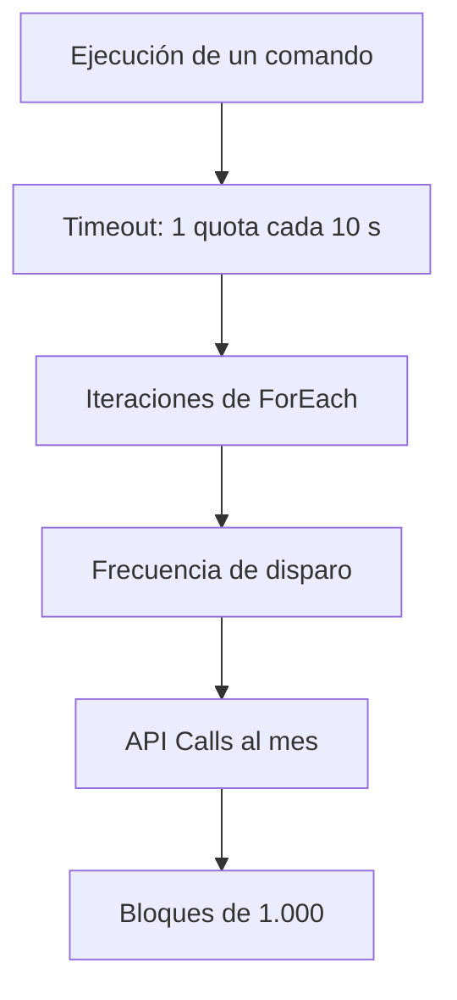

SAP Automation Pilot factura por API Calls, y cada ejecución consume una cantidad de ellas que el servicio llama quota. Quien dimensiona una automatización necesita saber cómo se calcula ese consumo, porque no depende solo de lo que tarda el comando en terminar.

Este artículo explica dónde se lee la quota de una ejecución, qué parámetros y qué comandos la modifican y qué recomendaciones ayudan a estimar el consumo antes de ampliar el alcance. Los cálculos por comando proceden de la documentación de SAP. Los ejemplos numéricos son ilustrativos y sirven para entender la mecánica, no para presupuestar.

## ¿Qué es una quota en SAP Automation Pilot?

La métrica del servicio es «API Calls (in blocks of 1,000)». Una API Call es una llamada entre una aplicación cliente o un backend y una API del servicio para enviar una acción de usuario o de sistema. El plan Standard factura cada mes por bloques de 1.000 API Calls.

Cada ejecución indica cuánta quota ha consumido. El consumo de los comandos de catálogo con un cálculo definido es predecible. El de los comandos de alto nivel y propios varía según el recurso que gestionan y el entorno: reiniciar una instancia pequeña de SAP HANA Cloud consume menos que reiniciar una productiva grande. Solo se conoce con exactitud después de ejecutar.

## ¿Dónde se lee la quota de una ejecución?

Para ver el consumo de una ejecución concreta, basta con dispararla desde la propia consola. Con el comando `HttpRequest` del catálogo `http`, se pulsa **Trigger** y se rellenan los parámetros en el diálogo. Un `GET` contra un servicio público de pruebas es suficiente.


Más abajo en el mismo diálogo está el parámetro `timeout`, que se fija en segundos. Es el valor que más influye en el consumo de este comando, como se explica en la sección siguiente.


Al terminar, la ejecución aparece en **Executions**. En su detalle, el apartado **Additional Information** incluye la columna **Usage** con el campo **Used Quota**. Con `timeout` 10, la ejecución terminó en menos de un segundo y consumió 1 quota.


> **Nota:** las ejecuciones que se muestran en este artículo se realizaron en un entorno de prueba con el plan Free, por lo que sus valores son solo orientativos. El cálculo de referencia es el que publica SAP en su documentación.

## En HttpRequest manda el timeout solicitado

Según la documentación de SAP, `HttpRequest` y `SensitiveHttpRequest` consumen **1 quota por cada 10 segundos del `timeout` solicitado**. Cuenta el valor que se indica al disparar el comando, no el tiempo que tarda realmente la respuesta. La documentación pone estos ejemplos: con un `timeout` de 9 s, la ejecución consume 1 quota, y con 30 s, 3 quotas. La misma regla se aplica a `ExecuteHanaCloudSqlStatement` y a `SendEmail`.

La consecuencia práctica es que un `timeout` generoso, puesto por precaución, encarece cada ejecución sin que esta dure más. El parámetro admite valores de 1 a 90 segundos.

Un caso con un servidor MCP muestra el mismo orden de magnitud. Una ejecución lanzada desde un cliente MCP, con `timeout` 9, terminó en 1 s y consumió 1 quota.


## ¿Qué comandos multiplican el consumo?

No todos los comandos calculan la quota igual. Esta tabla resume las reglas de la documentación de SAP:

| Comando | Cálculo de la quota |
|---|---|
| `HttpRequest`, `SensitiveHttpRequest` | 1 por cada 10 s del `timeout` solicitado |
| Scripts del catálogo `scripts-sapcp` | Aproximadamente 1 por cada 5 s de ejecución |
| `ForEach v2`, `SensitiveForEach v2` | No consume por sí mismo; multiplica el consumo por el número de iteraciones |
| `ParallelForEach` | Por lote: 1 para disparar, 1 por cada ciclo de polling y 1 para recoger las salidas |
| `AwaitExecution` | 1 inicial y 1 por cada intento de polling |
| `GetExecutionStatus`, `Void`, `TriggerExecution`, `ScheduleExecution`, entre otros | 1 |

Tres detalles de la tabla conviene tenerlos presentes:

- **`ForEach` es un multiplicador.** Si dentro de un `ForEach` se ejecutan 10 `HttpRequest`, el consumo correspondiente se multiplica por 10.
- **El polling cuesta.** En `ParallelForEach`, cuanto más tardan las ejecuciones del lote, más ciclos de polling se cobran. En `AwaitExecution`, cada intento suma 1.
- **Las ejecuciones disparadas por un lote consumen aparte.** La quota del lote no incluye la de las ejecuciones que dispara.

## Consumos que pasan desapercibidos

Además de los comandos, hay otras fuentes de consumo:

- **Consultas a la Executions API.** Cada consulta es en sí una API Call.
- **Eventos.** Cada evento que dispara un comando consume la quota de ese comando, de modo que el volumen de eventos determina el coste.
- **Servidores MCP.** El modo asíncrono añade llamadas de polling. El modo **Synchronous** con **Wait Time** hace que el servidor espere el resultado dentro de la propia llamada y reduce ese consumo. Si el comando no termina dentro del Wait Time, el servidor devuelve un identificador de ejecución y el agente consulta el resultado con la herramienta `get_execution`.

## Ejemplos de cálculo

Los ejemplos siguientes son ilustrativos. Usan las reglas de la tabla anterior y sirven para ver cómo se combinan los factores, no para presupuestar. Cada uno indica sus supuestos.

**Efecto del timeout.** Una llamada `HttpRequest` cuya respuesta llega en medio segundo:

```text
timeout 9 s   ->  1 quota
timeout 90 s  ->  90 / 10 = 9 quotas
```

La respuesta y la duración real son las mismas, y el consumo es nueve veces mayor.

**Efecto de ForEach.** Un `ForEach` con 10 iteraciones, cada una con un `HttpRequest` de `timeout` 9 s:

```text
10 iteraciones x 1 quota = 10 quotas por ejecución
```

**Efecto de la frecuencia.** Un comando de 1 quota programado cada 10 minutos:

```text
6 ejecuciones por hora x 24 horas = 144 por día
144 x 30 días = 4.320 quotas al mes
4.320 / 1.000 = 4,32 bloques de 1.000 API Calls
```

**Todo a la vez.** El mismo comando programado cada 10 minutos, con `timeout` 90 s en lugar de 9 s:

```text
9 quotas x 144 ejecuciones por día x 30 días = 38.880 quotas al mes
38.880 / 1.000 = 38,88 bloques de 1.000 API Calls
```

El plan es el mismo, la frecuencia es la misma y la duración real de la llamada no ha cambiado. Solo ha cambiado el `timeout`.

## Límites del plan Free y del plan Standard

El coste no es el único factor de dimensionamiento. Los límites del plan pesan tanto como la factura. Estos son los publicados por SAP:

| Característica | Free | Standard |
|---|---:|---:|
| API Calls por minuto | 120 | 300 |
| Catálogos | 5 | 50 |
| Comandos | 50 | 1.000 |
| Inputs | 50 | 1.000 |
| Historial de ejecuciones | 50 | 5.000 |
| Ejecuciones simultáneas | 5 | 100 |
| Scripts en ejecución simultánea | 1 | 5 |
| Scheduled Executions | 5 | 100 |
| Retención de logs tras finalizar | 24 h | 72 h |
| Service Accounts | 2 | 10 |
| MCP Servers | 5 | 50 |
| AI Requests al mes | No disponible | 50 |

El plan Free no incluye SLA y solo ofrece soporte de la comunidad, por lo que el uso productivo exige el plan Standard. Los scripts tienen además sus propios límites: 5 ejecuciones en paralelo por tenant, 32 KB de salida estándar, 5 minutos de tiempo de ejecución y 1000 Mi de datos en ejecución. Si se supera el número máximo de ejecuciones, el servicio gestiona el archivado o la suspensión. Si durante una ejecución se supera un límite total, la ejecución queda suspendida y no puede continuar.

## Recomendaciones antes de escalar

1. **Medir antes de estimar.** El valor de **Used Quota** de una ejecución real es el punto de partida más fiable, sobre todo en los comandos propios y de alto nivel. El plan Free permite hacerlo sin coste.
2. **Ajustar el `timeout`.** Conviene fijarlo al tiempo razonable de la llamada y no al máximo permitido, porque es el factor que más encarece cada ejecución de `HttpRequest`.
3. **Vigilar lo que multiplica.** Las iteraciones de un `ForEach`, los ciclos de polling y la frecuencia de las ejecuciones programadas o por evento determinan el consumo mensual.
4. **Contar los consumos indirectos.** Las consultas a la Executions API suman API Calls, y el modo Synchronous de los servidores MCP reduce el polling.
5. **Empezar con un ámbito acotado y ampliar con datos.** Medir el consumo durante uno o dos meses antes de decidir la ampliación evita dimensionar sobre supuestos.
6. **Revisar los límites del plan.** Las API Calls por minuto, las ejecuciones simultáneas y las Scheduled Executions pueden condicionar el diseño antes que el coste.

El diagrama resume qué factores se combinan hasta llegar al consumo mensual:



## Conclusión

La quota de SAP Automation Pilot sigue reglas concretas que dependen del comando. En `HttpRequest`, el `timeout` solicitado pesa más que el tiempo real, y `ForEach`, el polling y la frecuencia multiplican el resultado. Conocer esas reglas permite diseñar las automatizaciones con un consumo razonable desde el principio y estimar el coste con datos reales antes de ampliar su uso.

La documentación oficial del servicio está en [SAP Help Portal](https://help.sap.com/docs/AUTOMATION_PILOT).
