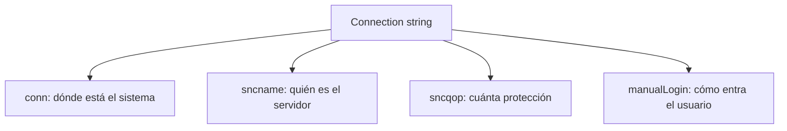
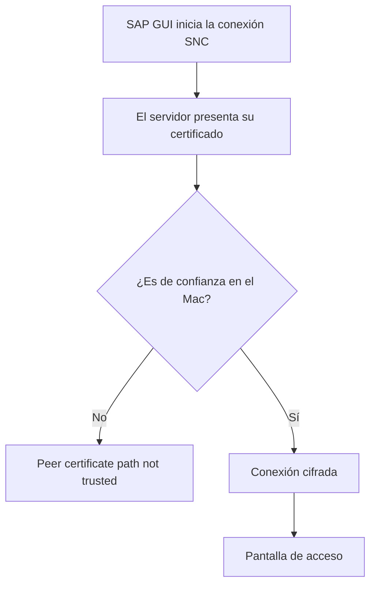

En la [primera parte](/blog/sap-gui-java-macos-instalacion/) de esta serie instalamos SAP GUI for Java en un Mac y nos conectamos a un sistema SAP con solo dos datos: el host del servidor de aplicaciones y el número de instancia. Sin embargo, no en todos los sistemas se puede acceder solo con el host y el número de instancia. Hay sistemas que necesitan que la comunicación vaya cifrada con **SNC** (Secure Network Communications).

En más de una ocasión, la configuración se redacta y se entrega pensando en Windows. En este caso llegó así: dos certificados y la configuración de la conexión en capturas de SAP Logon, el cliente de Windows. Por eso, en este artículo veremos cómo adaptar esa configuración a SAP GUI for Java y cómo añadir los certificados para acceder al sistema desde un Mac.

## Entorno de la prueba

| Elemento | Valor |
|---|---|
| Equipo | El mismo de la primera parte: Mac con procesador Apple Silicon (arm64) |
| Sistema operativo | macOS Tahoe 26.6.2 |
| Cliente | SAP GUI for Java 8.10 rev 14 |
| Red | Conexión por VPN al sistema SAP |
| Fechas | 13 y 15 de octubre de 2026 |

## No hace falta instalar nada más

En la primera parte vimos que SAP GUI for Java trae su propio Java. Con el cifrado ocurre lo mismo: la aplicación incluye su propia librería criptográfica, CommonCryptoLib, en la versión 8.6.4.

```bash
cat "/Applications/SAP Clients/SAPGUI 8.10rev14/SAPGUI 8.10rev14.app/Contents/Resources/bin/CCLVersion.txt"
```

```text
libsapcrypto.dylib: 8.6.4
```

En el Mac de la prueba no estaban definidas las variables de entorno `SNC_LIB`, `SNC_LIB_64` ni `SECUDIR`, ni estaba instalado Secure Login Client. Aun así, la conexión SNC funcionó sin instalar ni configurar nada fuera de SAP GUI.

## Lo que entrega el administrador: una configuración pensada para Windows

El administrador entregó dos certificados de servidor en ficheros `.cer`, uno por sistema, y la configuración de la conexión en capturas de **SAP Logon**. En la pestaña **Connection**, el tipo de conexión es **Custom Application Server**, con los campos **System ID**, **Instance Number** y **Application Server**. En la pestaña **Network** están los ajustes de SNC:

- **Activate Secure Network Communication**, marcado;
- **SNC Name**, con el formato `p:CN=<...>, OU=<...>, O=<...>, C=<...>`;
- nivel de protección **Maximum security settings available**;
- **SNC logon with user/password (no Single Sign-On)**, marcado.


SAP GUI for Java no tiene una pestaña **Network** como esta, así que cada ajuste hay que traducirlo a algo que SAP GUI for Java entienda.

## Primer intento: la casilla global de cifrado SNC

En las opciones de SAP GUI for Java hay una casilla que parece resolverlo todo de una vez: menú **SAPGUI**, **Opciones**, apartado **Web AS ABAP**, **General**, casilla **Activar cifrado SNC sin SSO globalmente**.


Al pulsar **Grabar**, SAP GUI avisa de que hay que reiniciarlo:

```text
Las modificaciones estarán activas después de reiniciar el programa
```

Internamente, la casilla añade esta línea al fichero `~/Library/Preferences/SAP/settings`:

```text
@SAPSNCEncryption = "true"
```

Tras cerrar SAP GUI con Cmd+Q y volver a abrirlo, se creó una conexión nueva como en la primera parte, con la forma simple `/H/<host>/S/32NN`. Al pulsar **Conectar**, el sistema respondió:

```text
Este sistema rechaza una comunicación no codificada
```

El servidor responde, así que la red funciona. Lo que no acepta es una comunicación sin cifrar, y la casilla, por sí sola, no la cifra: le falta el dato principal, el nombre SNC del servidor, que es propio de cada sistema. La casilla se mantuvo activada durante el resto de la prueba, de modo que no se comprobó si la conexión final funciona sin ella.

## Paso 1. Traducir la configuración al connection string

Cada ajuste de SAP Logon corresponde a un parámetro del connection string, según la documentación de SAP sobre los [parámetros de conexión de SAP GUI for Java](https://help.sap.com/docs/sap_gui_for_java/e665f2b67dbd4328ab6bd9e029b84581/f2a7a69515114ac59531dc96758a094e.html?locale=en-US):

| Ajuste en SAP Logon (Windows) | Parámetro en SAP GUI for Java |
|---|---|
| Application Server e Instance Number | `conn=/H/<host>/S/32NN` |
| SNC Name | `sncname=p:CN=<...>,OU=<...>,O=<...>,C=<...>` |
| Maximum security settings available | `sncqop=9` |
| SNC logon with user/password (no Single Sign-On) | `manualLogin=true` |

Con esa tabla, la conexión se crea así:

1. En la ventana inicial, pulsar el botón de nueva conexión, junto a **Conectar**, y escribir una **Descripción**.
2. Abrir la pestaña **Ampliada** y marcar **Modo de experto**.
3. Escribir el connection string completo:

   ```text
   conn=/H/<host>/S/32NN&sncqop=9&sncname=p:CN=<SID>,OU=<dominio>,O=<empresa>,C=<país>&manualLogin=true
   ```

4. Comprobar que el cuadro inferior muestra **Todos los parámetros válidos**.
5. Pulsar **Grabar**.

En la lista de conexiones, la nueva aparece con un icono con una llave, distinto del de las conexiones sin cifrar.

## Qué significa cada parte del connection string

El string parece largo, pero se lee por partes. Los parámetros se separan con `&`, cada uno tiene la forma `clave=valor`, y `conn` va siempre el primero:



| Parámetro | Qué indica |
|---|---|
| `conn=/H/<host>/S/32NN` | La dirección del sistema: host del servidor de aplicaciones y puerto, la forma simple de la primera parte |
| `sncqop=9` | La calidad de la protección: 1 es autenticación, 2 integridad, 3 cifrado y 9 el máximo disponible |
| `sncname=p:CN=...` | El nombre SNC con el que se identifica el servidor |
| `manualLogin=true` | Que no se use el inicio de sesión automático de SNC: se entra con usuario y clave de acceso |

El nombre SNC merece una explicación aparte. Es el valor del parámetro `snc/identity/as` del servidor y, en este caso, coincide con el sujeto (*subject*) de su certificado, precedido de `p:`. Cada campo es un atributo de ese nombre:

| Atributo | Significado | En este caso |
|---|---|---|
| `CN` | Common Name, nombre común | El SID del sistema |
| `OU` | Organizational Unit, unidad organizativa | El dominio |
| `O` | Organization, organización | La empresa |
| `C` | Country, país | El país |

La documentación de SAP menciona además el parámetro `sncon=true` para activar SNC en la conexión. El string de la prueba no lo lleva, y SAP GUI intentó la conexión con SNC igualmente: el error del apartado siguiente sale del componente SNC.

## El error que no se resuelve en SAP GUI

Al conectar con el nuevo string, el mensaje cambió:

```text
Connection closed
Error: GSS-API(maj): Miscellaneous failure
GSS-API(min): A2200223:Peer certificate path not trusted
```

Aunque sea otro error, es un avance: demuestra que la red y el connection string funcionaban. El Mac llegó al servidor, recibió su certificado y lo rechazó. *Peer* es el otro extremo de la conexión, el servidor, y *certificate path not trusted* significa que la cadena de su certificado no termina en ningún certificado de confianza.



Esa confianza no se decide en SAP GUI, sino en macOS, con la aplicación **Acceso a Llaveros**. Ahí es donde entran los dos ficheros `.cer`.

## Paso 2. Importar los certificados en Acceso a Llaveros

Los dos certificados eran del propio servidor y autofirmados: no había una autoridad de certificación ni certificados intermedios, porque cada sistema firma su propio certificado. Basta, por tanto, con importar los dos ficheros:

1. Abrir **Acceso a Llaveros**, por ejemplo desde Spotlight.
2. En la barra lateral, seleccionar el llavero **Inicio de sesión**.
3. Menú **Archivo**, **Importar ítems…** (Mayúsculas+Cmd+I), y elegir el fichero `.cer`. Repetir con el segundo.


Los certificados aparecen en la pestaña **Certificados**, con la clase **certificado** y el llavero **Inicio de sesión**. Para comprobarlo desde la Terminal, igual que se comprobó la red con `nc` en la primera parte, se busca el certificado por su nombre, que en este caso es el SID del sistema. La opción `-c` busca por nombre y `-a` devuelve todas las coincidencias, no solo la primera:

```bash
security find-certificate -a -c "<SID>" | grep -E "keychain:|labl"
```

```text
keychain: "/Users/<usuario>/Library/Keychains/login.keychain-db"
    "labl"<blob>="<SID>"
```

La primera línea indica en qué llavero está el certificado, y la segunda, su nombre.

## Importar no basta: el certificado debe ser de confianza

Con los certificados importados, y tras cerrar y volver a abrir SAP GUI, la conexión volvió a fallar con el mismo error. La Terminal muestra el motivo:

```bash
security dump-trust-settings
```

```text
SecTrustSettingsCopyCertificates: No Trust Settings were found.
```

Sin opciones, `dump-trust-settings` muestra los ajustes de confianza del usuario, y no hay ninguno. El certificado está guardado, pero sin confianza.

El detalle del certificado lo confirma: es un **Certificado raíz autofirmado**, y macOS avisa de que **Este certificado no ha sido verificado por otra entidad**. Un certificado autofirmado se avala a sí mismo. Ninguna autoridad que el Mac ya conozca responde por él, así que macOS no lo trata como de confianza hasta que el usuario lo indica.

## Paso 3. Marcar los certificados como de confianza

1. En **Acceso a Llaveros**, pestaña **Certificados**, hacer doble clic en el certificado.
2. Desplegar el apartado **Confiar**.
3. En **Al utilizar este certificado**, cambiar **Usar ajustes por omisión** por **Confiar siempre**.
4. Cerrar la ventana. macOS pide la contraseña o Touch ID para guardar el cambio.


El paso se repite con el segundo certificado. Los dos pasan a mostrar el aviso **Este certificado está marcado como fiable para esta cuenta**, y su icono lleva un signo + azul.


La salida de la Terminal también cambia. Esta es la salida recortada, porque cada certificado tiene nueve ajustes, uno por uso:

```text
$ security dump-trust-settings
Number of trusted certs = 2
Cert 0: <SID-DEV>
   Number of trust settings : 9
   ...
      Result Type           : kSecTrustSettingsResultTrustRoot
   ...
Cert 1: <SID-QAS>
   Number of trust settings : 9
   ...
```

Los dos certificados constan ahora como raíces de confianza para el usuario. Con la opción `-d`, que muestra la confianza definida por el administrador, la respuesta sigue siendo «No Trust Settings were found»: no hizo falta tocar el llavero **Sistema**.

## Paso 4. Conexión correcta

Tras cerrar SAP GUI con Cmd+Q y volver a abrirlo, la conexión funcionó.

La primera vez, SAP GUI pidió clasificar el nivel de confianza del sistema, como en la primera parte, y se mantuvo **Interno**. Guarda la respuesta en el fichero `~/Library/Preferences/SAP/trustClassification`, y por eso en la segunda conexión ya no pregunta. Después aparecieron la pantalla de acceso, con **Mandante**, **Usuarios**, **Clv.acc.** e **Idioma**, y **SAP Easy Access**.

## Resumen

| Síntoma | Causa | Solución |
|---|---|---|
| Este sistema rechaza una comunicación no codificada | El sistema exige SNC | Añadir `sncname`, `sncqop` y `manualLogin` al connection string |
| El rechazo sigue con la casilla global de cifrado SNC | La casilla no aporta el nombre SNC del servidor | Escribirlo en el connection string |
| A2200223: Peer certificate path not trusted | macOS no confía en el certificado del servidor | Importarlo en Acceso a Llaveros |
| El mismo error con el certificado importado | Certificado autofirmado sin ajustes de confianza | Marcarlo con **Confiar siempre** y reiniciar SAP GUI |
