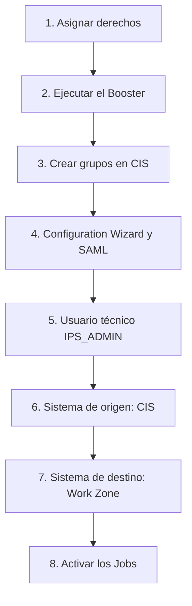

SAP Build Work Zone, advanced edition ofrece un punto de entrada único y personalizado a aplicaciones, contenido y procesos de negocio. Su puesta en marcha en SAP BTP no empieza por el servicio, sino por la identidad: sin usuarios y grupos sincronizados, nadie puede ingresar ni administrar Work Zone.

Este artículo recorre la configuración de extremo a extremo en una subcuenta `Development` con entorno Cloud Foundry, con **SAP Cloud Identity Services (CIS)** como proveedor de identidad y **Identity Provisioning (IPS)** para aprovisionar usuarios y grupos hacia Work Zone. Los conceptos de suscripción, instancia, entitlements y colecciones de roles se explican con más detalle en los artículos sobre [subscriptions e instancias en SAP BTP](/blog/btp-admin-subscriptions-instancias/), [entitlements y cuotas](/blog/btp-admin-entitlements-cuotas/) y [role collections y usuarios sombra](/blog/btp-admin-roles-usuarios/).

## Objetivo y alcance

El resultado buscado es un Work Zone operativo, con autenticación centralizada (SAML 2.0) y aprovisionamiento automático, de modo que el administrador pueda ingresar, administrar y comenzar a construir sitios.

**Incluido en esta configuración**

- Asignación de derechos (planes `Advanced` y `Advanced (Application)`).
- Ejecución del Booster de Work Zone advanced.
- Creación de grupos de usuarios en CIS y validación de colecciones de roles.
- Configuration Wizard y aplicación SAML 2.0 en CIS, con Global User ID como identificador.
- Usuario técnico `IPS_ADMIN` con certificado y secreto.
- Sistema de origen (CIS) y sistema de destino (Work Zone) en IPS, con sus transformaciones.
- Activación y validación de los Jobs de lectura y simulación.

**Fuera de alcance**

- Migración desde SAP Jam y uso de SAP SuccessFactors Work Zone.
- Dominio personalizado: se usa el predeterminado `ondemand.com`.
- Complementos opcionales: SAP Business Application Studio y SAP Build Process Automation.
- Diseño de sitios, contenido y temas.

## Prerrequisitos

- Cuenta global y subcuenta con entorno **Cloud Foundry** habilitado.
- Suscripción a **SAP Cloud Identity Services**, con la relación de confianza validada.
- Administrador de la cuenta global y de la subcuenta disponible para ejecutar el Booster.
- Un usuario administrador de tipo **empleado** en CIS.

## Visión general del proceso

| # | Actividad | Entregable |
|---|---|---|
| 1 | Validar prerrequisitos y asignar derechos | Planes visibles en Entitlements |
| 2 | Ejecutar el Booster | Suscripción e instancia en Instances and Subscriptions |
| 3 | Crear grupos y validar colecciones de roles | Administrador con acceso a Work Zone |
| 4 | Completar el Configuration Wizard y crear la aplicación en CIS | Aplicación SAML con metadatos cargados |
| 5 | Crear el usuario técnico `IPS_ADMIN` | Certificado, Client ID y secreto |
| 6 | Configurar el sistema de origen (CIS) | Propiedades y transformación guardadas |
| 7 | Configurar el sistema de destino (Work Zone) | Propiedades y transformación guardadas |
| 8 | Activar los Jobs de aprovisionamiento | Jobs exitosos en Job Logs |

## Derechos y Booster

Primero se asignan a la subcuenta los derechos de los planes `Advanced` y `Advanced (Application)`. Con ellos visibles en **Entitlements**, el administrador de la cuenta global y de la subcuenta ejecuta el Booster de Work Zone advanced.

El Booster deja creadas la suscripción y la instancia del servicio. Se comprueba en **Instances and Subscriptions** del BTP Cockpit.

## Grupos y colecciones de roles

Work Zone advanced incorpora colecciones de roles estándar en la subcuenta. Se pueden filtrar por `WorkZone` en **Role Collections**, y cada una enlaza con los grupos de usuarios que le dan acceso.

En CIS se crean los grupos de usuarios correspondientes (por ejemplo `Workzone_Admin`, `Workzone_Area_Admin` o `Workzone_End_User`). Al asignar el administrador a ellos, obtiene acceso a Work Zone con permisos de administración y desarrollo.

## Configuration Wizard y aplicación SAML

Con el acceso de administrador, el siguiente paso es completar el **Configuration Wizard** de Work Zone y crear la aplicación SAML 2.0 en CIS, con los metadatos cargados. Como identificador se usa el **Global User ID**.

## Usuario técnico IPS_ADMIN

IPS necesita un usuario técnico, `IPS_ADMIN`, para leer de CIS y escribir en Work Zone. Su alta entrega tres elementos: el certificado, el Client ID y el Client Secret.

Dos puntos merecen atención desde este paso:

- El Client Secret no se puede recuperar después de crearlo. Hay que guardarlo en un gestor de contraseñas y, si se pierde, generar uno nuevo.
- Cada vez que se regenera el certificado del sistema de origen, hay que volver a cargarlo en `IPS_ADMIN`.

## Sistemas de origen y destino en IPS

En **Identity Provisioning** se configuran dos sistemas, cada uno con sus propiedades y su transformación:

1. **Sistema de origen (CIS)**, desde el que se leen usuarios y grupos.
2. **Sistema de destino (Work Zone)**, hacia el que se aprovisionan.

Si el administrador queda sin rol en Work Zone, la solución es usar su Global User ID (`userUuid`) en la transformación del destino.

## Jobs de aprovisionamiento

Con ambos sistemas guardados, se activan los Jobs. La configuración es correcta cuando los Jobs `READ` y `SIMULATION` terminan con éxito en **Provisioning Logs**, pestaña **Job Logs**.

## Criterios de aceptación

- Los planes de Work Zone advanced aparecen en la subcuenta y la instancia está creada.
- El usuario administrador accede al servicio con permisos de administración y desarrollo.
- Los Jobs `READ` y `SIMULATION` terminan con éxito.
- El onboarding del servicio queda finalizado en el Configuration Wizard.

## Riesgos y cómo mitigarlos

| Riesgo | Mitigación |
|---|---|
| Pérdida del Client Secret de `IPS_ADMIN` | Guardarlo en un gestor de contraseñas; generar uno nuevo si se pierde |
| Error 401 en el Job de lectura al regenerarse el certificado del origen | Volver a cargar el certificado en `IPS_ADMIN` tras cada regeneración |
| Propiedades con espacios o errores en los sistemas de IPS | Revisar los valores antes de guardar y validar en Job Logs |
| Administrador sin rol en Work Zone | Usar el Global User ID (`userUuid`) del administrador en la transformación del destino |

## Conclusión

La clave de Work Zone advanced está en la base de identidad: derechos, grupos, aplicación SAML y aprovisionamiento con IPS. Con los Jobs `READ` y `SIMULATION` en verde, el servicio queda listo para que el administrador construya sitios. Si tu organización necesita acompañamiento en la puesta en marcha de SAP BTP, consulta nuestros [servicios de consultoría](/consulting/).
