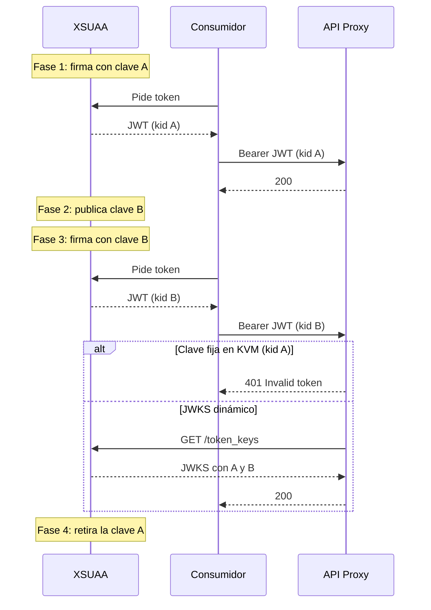
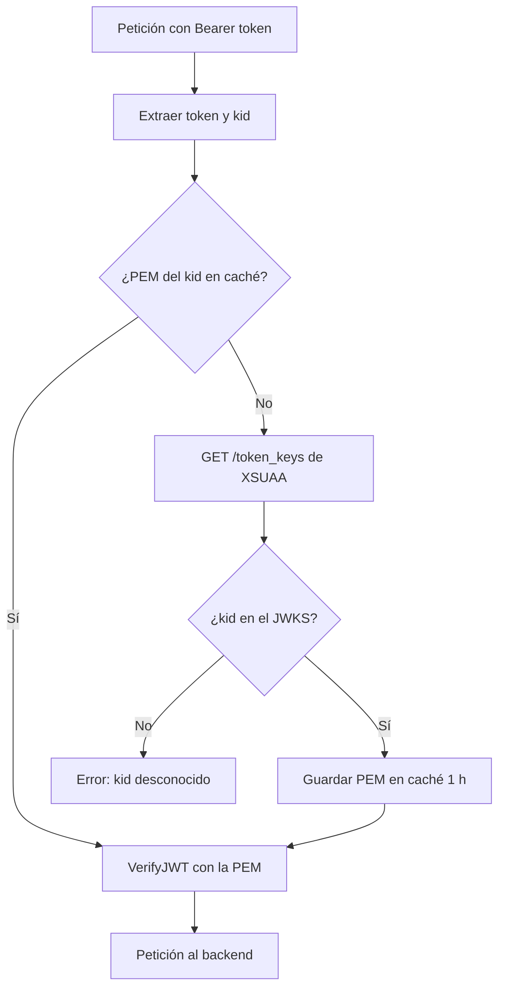

Un día cualquiera, sin que nadie haya desplegado nada, todos tus API Proxies de SAP API Management empiezan a rechazar peticiones con un 401. El token se obtiene sin problema, el certificado del cliente es válido, el scope es el correcto... y aun así:

```json
{
  "fault": {
    "faultstring": "Invalid token: policy(JWT_VerifyToken)",
    "detail": {
      "errorcode": "steps.jwt.InvalidToken"
    }
  }
}
```


Me pasó en un proyecto real con cuatro proxies (SOAP y OData) protegidos con JWT de XSUAA. Los cuatro cayeron a la vez. En este artículo explico qué había detrás, cómo diagnosticarlo en cinco minutos y cómo rediseñar la validación para que la próxima rotación de claves no te afecte. Es la tercera parte de la serie sobre SAP API Management, después de [los cifrados TLS](/blog/sap-api-management-cifrados-tls/) y de [activar el runtime de API Management](/blog/activar-api-management-integration-suite/).

## Antes de empezar: qué es XSUAA

**XSUAA** (Extended Services for User Account and Authentication) es el servidor de autorización OAuth 2.0 de SAP BTP en el entorno Cloud Foundry. En el BTP Cockpit aparece como el servicio **Authorization and Trust Management**.

Su función es emitir y respaldar los tokens con los que se protegen las aplicaciones y APIs de una subcuenta:

- **Emite tokens JWT.** Cuando una aplicación o un sistema externo se autentica (con usuario a través de un Identity Provider, o sin usuario mediante client credentials), XSUAA devuelve un access token en formato JWT.
- **Firma esos tokens** con una clave privada RSA (algoritmo RS256). Quien recibe el token lo valida con la clave pública correspondiente.
- **Define qué puede hacer cada consumidor.** En el descriptor de seguridad (`xs-security.json`) se declaran los scopes, las plantillas de rol y las authorities. El token incluye los scopes concedidos, y la API los comprueba.
- **Entrega las credenciales a cada cliente** mediante service keys: `clientid` y `clientsecret`, o un certificado x509 si se usa mTLS.
- **Publica sus claves públicas** en el endpoint `/token_keys` (un JWKS), para que cualquiera pueda verificar la firma de sus tokens.

Cada subcuenta tiene su propia zona de identidad, con URLs del tipo `https://<subdominio>.authentication.<región>.hana.ondemand.com`. De ahí salen el endpoint de token (`/oauth/token`), el JWKS (`/token_keys`) y el `issuer` que aparece dentro de cada JWT. Si quieres ver XSUAA desde el lado de una aplicación, en [este artículo sobre autenticación en CAP](/blog/cap-auth-xsuaa/) se explica cómo se configura.

En resumen: **XSUAA emite y firma el token, y tu API Proxy tiene que verificar esa firma.** Para verificarla necesita la clave pública correcta, y ahí empieza el problema de este artículo.

## El escenario

El patrón es muy habitual cuando un sistema externo consume APIs publicadas en SAP BTP:

1. El consumidor obtiene un token de **XSUAA** mediante client credentials (en mi caso con certificado x509 y mTLS).
2. Llama al API Proxy de **API Management** con `Authorization: Bearer <token>`.
3. El proxy valida el JWT con la policy **VerifyJWT**: firma, issuer y audience.
4. Si es válido, el proxy reenvía la petición al backend (en mi caso, un iFlow de Cloud Integration).

Todo depende de con qué clave pública valida el proxy la firma del token. En la implementación original, la clave pública se guardaba en un **Key Value Map** y la policy la leía de ahí:

```xml
<!-- KVM_ReadXSUAAConfig -->
<KeyValueMapOperations mapIdentifier="XSUAA_Blog" async="false" continueOnError="false" enabled="true" xmlns="http://www.sap.com/apimgmt">
    <Get assignTo="private.xsuaa.issuer" index="1">
        <Key><Parameter>issuer</Parameter></Key>
    </Get>
    <Get assignTo="private.xsuaa.audience" index="1">
        <Key><Parameter>audience</Parameter></Key>
    </Get>
    <Get assignTo="private.xsuaa.publickey" index="1">
        <Key><Parameter>publickey</Parameter></Key>
    </Get>
    <Scope>environment</Scope>
</KeyValueMapOperations>
```

```xml
<!-- JWT_VerifyToken -->
<VerifyJWT async="false" continueOnError="false" enabled="true" xmlns="http://www.sap.com/apimgmt">
    <Algorithm>RS256</Algorithm>
    <Source>jwt_token</Source>
    <PublicKey>
        <Value ref="private.xsuaa.publickey"/>
    </PublicKey>
    <Issuer ref="private.xsuaa.issuer"/>
    <Audience ref="private.xsuaa.audience"/>
</VerifyJWT>
```

Funciona perfectamente... hasta el día en que XSUAA cambia de clave.

## La causa: XSUAA rota sus claves de firma

XSUAA no firma los tokens siempre con la misma clave. Periódicamente introduce una clave nueva y, durante un tiempo, **las dos claves conviven**: la nueva empieza a usarse y la antigua sigue publicada hasta que caduca. Es una práctica de seguridad correcta y la gestiona SAP: tú no la lanzas ni te avisan.

En mi caso la secuencia fue esta (fechas relativas):

| Momento | Qué pasó |
|---|---|
| Día 0 | XSUAA publica una clave nueva. La anterior sigue vigente unas semanas más |
| Entre el día 0 y el día 21 | En algún momento XSUAA empieza a firmar solo con la clave nueva |
| Día 21 | Los proxies empiezan a devolver 401 a todos los tokens nuevos |

El KVM seguía teniendo la clave **antigua**. Cada token nuevo venía firmado con la clave **nueva**. **VerifyJWT** comparaba la firma con la clave equivocada y la rechazaba. Ningún despliegue ni cambio de configuración por nuestra parte: simplemente el mundo había cambiado debajo del proxy.

Las fechas de validez de las claves que observé encajan con ese patrón: cada clave tenía una vida de unos cuatro meses, con alrededor de un mes de solape con la siguiente. No lo tomes como una regla documentada; tómalo como una señal de que **va a volver a pasar**.

## Cómo es una rotación, fase a fase

La rotación la ejecuta SAP en XSUAA: no encontré ninguna opción en la subcuenta para lanzarla ni para retrasarla. Lo que sí puedes hacer es **observarla** en el endpoint `/token_keys` y saber en qué fase estás. Estas son las cuatro fases que vi, y lo que muestra el JWKS en cada una:

| Fase | Qué hace XSUAA | Qué muestra `/token_keys` | Clave fija en el KVM | JWKS dinámico |
|---|---|---|---|---|
| 1. Estable | Firma con la clave A | Una clave (kid A) | Funciona | Funciona |
| 2. Publicación | Publica la clave B, pero sigue firmando con A | Dos claves (kid A y kid B) | Funciona, pero ya es el aviso | Funciona |
| 3. Cambio de firma | Empieza a firmar con B. A sigue publicada | Dos claves (kid A y kid B) | 401 en todos los tokens nuevos | Descarga el JWKS con el primer token con kid B y lo resuelve solo |
| 4. Retirada | Deja de publicar A | Una clave (kid B) | 401 hasta actualizar el KVM | Funciona. La clave A caduca sola en la caché |



Dos consecuencias prácticas:

- **La fase 2 es tu ventana de aviso.** Si ves dos claves en `/token_keys`, el cambio de firma está cerca. Con clave fija, ese es el momento de actualizar el KVM sin prisas.
- **Los tokens ya emitidos siguen siendo válidos** hasta que caducan (normalmente unas 12 horas), aunque XSUAA ya firme con la clave nueva. Por eso el corte no siempre es instantáneo: los consumidores que reutilizan su token tardan un poco más en fallar.

## Diagnóstico en cinco minutos

### 1. Mira el kid del token

El header de un JWT no está cifrado: es JSON en base64url. Decodifica el primer segmento del token y fíjate en el campo `kid` (key ID):

```json
{
  "alg": "RS256",
  "jku": "https://<subdominio>.authentication.<región>.hana.ondemand.com/token_keys",
  "kid": "default-jwt-key-<nuevo>",
  "typ": "JWT"
}
```

El `kid` te dice con qué clave ha firmado XSUAA ese token, y el campo `jku` te indica dónde consultar las claves. Decodifícalo en local, con un script o en la terminal: no pegues tokens reales en webs de terceros. Un decodificador mínimo en PowerShell:

```text
$token = "<pega aquí el token>"
$h = $token.Split('.')[0].Replace('-', '+').Replace('_', '/')
while ($h.Length % 4) { $h += '=' }
[Text.Encoding]::UTF8.GetString([Convert]::FromBase64String($h))
```

### 2. Consulta el JWKS de XSUAA

El endpoint `/token_keys` es público (no requiere autenticación) y lista todas las claves activas en ese momento:

```bash
curl https://<subdominio>.authentication.<región>.hana.ondemand.com/token_keys
```

Si ves **dos** claves, estás en plena rotación. Comprueba que el `kid` de tu token está en la lista: esa es la clave buena. Mientras preparaba este artículo, el 29 de octubre de 2026, el JWKS de mi subcuenta de prueba mostraba precisamente dos claves:


Un detalle útil: en el JWKS de XSUAA, cada clave trae un campo `value` con la clave pública ya en formato PEM (con sus cabeceras `BEGIN PUBLIC KEY` y `END PUBLIC KEY`). No hace falta reconstruirla a partir del módulo y el exponente.

### 3. Compara con lo que tienes en el KVM

Si la clave pública del KVM no corresponde al `kid` del token, has encontrado el problema.

### La trampa: la verificationkey de la service key

Mi primer instinto fue ir a la service key de XSUAA y copiar el campo `verificationkey`. Error: ese valor **refleja la clave del momento en que se creó la service key** y no se actualiza con las rotaciones. En mi caso seguía mostrando la clave antigua. **La única fuente de verdad es `/token_keys`.**


## Solución rápida: actualizar el KVM, paso a paso

Este es el procedimiento manual completo, para restablecer el servicio en minutos si tus proxies todavía guardan la clave fija.

**Paso 1. Confirma que es una rotación.** Pide un token nuevo, decodifica su header y anota el `kid` (ver el diagnóstico anterior). Si el `kid` no coincide con la clave que tienes guardada, es una rotación. Si coincide, el problema es otro (issuer, audience, token caducado).

**Paso 2. Descarga el JWKS.** Abre `https://<subdominio>.authentication.<región>.hana.ondemand.com/token_keys` en el navegador o con curl. No necesita autenticación.

**Paso 3. Localiza la clave nueva.** Busca en el array `keys` el elemento cuyo `kid` es el del token. Copia su campo `value` completo, desde `-----BEGIN PUBLIC KEY-----` hasta `-----END PUBLIC KEY-----`, sin espacios añadidos al principio ni al final.

**Paso 4. Guarda la clave antigua.** Antes de tocar nada, copia el valor actual de `publickey` del KVM a un fichero local. Es tu vuelta atrás si te equivocas de clave.

**Paso 5. Edita el KVM.** En Integration Suite: **Configure > APIs > Key Value Maps**, abre el KVM (en mi caso `XSUAA_Blog`), edita la entrada `publickey` y pega el PEM nuevo. Si el KVM está cifrado, el valor no se muestra después de guardar: es normal.


**Paso 6. Guarda.** No hace falta volver a desplegar los proxies: la policy **KeyValueMapOperations** lee el valor en tiempo de ejecución en cada petición. Puede tardar unos segundos en propagarse.

**Paso 7. Prueba con un token nuevo.** Pide un token recién emitido (no reutilices el de antes) y llama al proxy. Debe responder 200, o el código que devuelva el backend, pero ya no `steps.jwt.InvalidToken`.

**Paso 8. Prueba todos los proxies.** Si varios proxies comparten el KVM, prueba cada uno. Si alguno sigue fallando, revisa que lea el mismo KVM y la misma entrada.

**Paso 9. Deja constancia.** Anota la fecha, el `kid` antiguo y el nuevo, y la fecha de caducidad de la clave nueva si la conoces. Te servirá para prever la siguiente rotación.

Esto resuelve el incidente, pero es **manual y reactivo**. Dentro de unos meses volverá a pasar, probablemente en el peor momento posible (en mi proyecto, la siguiente caducidad coincidía con una fase de formación a usuarios finales).

## Solución definitiva: resolver la clave dinámicamente desde el JWKS

La idea es sencilla: en lugar de guardar **una** clave fija, el proxy lee el `kid` del token, busca esa clave en el JWKS de XSUAA y la guarda en caché.

> **Nota:** muchos gateways permiten indicar directamente una URL JWKS en la policy de verificación. En el tenant con el que trabajé, **VerifyJWT** solo aceptaba la clave pública por referencia (`Value ref`), así que la resolución dinámica hubo que construirla con policies. Comprueba qué soporta tu versión antes de replicar este diseño.

### El nuevo PreFlow del ProxyEndpoint

| # | Policy | Se ejecuta |
|---|---|---|
| 1 | **KVM_ReadXSUAAConfig** (issuer, audience, jwks_uri) | Siempre |
| 2 | **JS_ExtractToken** (token y kid) | Siempre |
| 3 | **LookupCache_JWKS** (busca la PEM por kid) | Siempre |
| 4 | **ServiceCallout_FetchJWKS** (GET /token_keys) | Solo si no está en caché |
| 5 | **JS_ResolvePublicKey** (elige la clave por kid) | Solo si no está en caché |
| 6 | **PopulateCache_JWKS** (guarda la PEM, TTL 1 h) | Solo si no está en caché |
| 7 | **JWT_VerifyToken** | Siempre |



### 1. KVM: guarda jwks_uri en lugar de la clave

```xml
<KeyValueMapOperations mapIdentifier="XSUAA_Blog" async="false" continueOnError="false" enabled="true" xmlns="http://www.sap.com/apimgmt">
    <Get assignTo="private.xsuaa.issuer" index="1">
        <Key><Parameter>issuer</Parameter></Key>
    </Get>
    <Get assignTo="private.xsuaa.jwks_uri" index="1">
        <Key><Parameter>jwks_uri</Parameter></Key>
    </Get>
    <Get assignTo="private.xsuaa.audience" index="1">
        <Key><Parameter>audience</Parameter></Key>
    </Get>
    <Scope>environment</Scope>
</KeyValueMapOperations>
```

Donde `jwks_uri` vale `https://<subdominio>.authentication.<región>.hana.ondemand.com/token_keys`.

### 2. Extraer el token y el kid

```javascript
// JS_ExtractToken.js
var authHeader = context.getVariable('request.header.authorization');
if (!authHeader || authHeader.indexOf('Bearer ') !== 0) {
    throw new Error('Authorization header ausente o no es Bearer');
}
var token = authHeader.substring(7);
context.setVariable('jwt_token', token);

// El header del JWT es el primer segmento, en base64url
var parts = token.split('.');
if (parts.length < 2) {
    throw new Error('JWT malformado');
}
var headerB64 = parts[0].replace(/-/g, '+').replace(/_/g, '/');
while (headerB64.length % 4) { headerB64 += '='; }
var header = JSON.parse(CryptoJS.enc.Base64.parse(headerB64).toString(CryptoJS.enc.Utf8));
if (!header.kid) {
    throw new Error('JWT sin kid');
}
context.setVariable('jwt_kid', header.kid);
```

### 3. Buscar en caché por kid

```xml
<LookupCache async="false" continueOnError="false" enabled="true" xmlns="http://www.sap.com/apimgmt">
    <CacheKey>
        <Prefix>xsuaa_jwks</Prefix>
        <KeyFragment ref="jwt_kid"/>
    </CacheKey>
    <Scope>Global</Scope>
    <AssignTo>private.xsuaa.publickey.pem</AssignTo>
</LookupCache>
```

> **Ojo con el orden de los elementos.** API Management valida las policies de caché contra un esquema XML estricto: en LookupCache el orden es `CacheKey`, `Scope`, `AssignTo`; en PopulateCache, `CacheKey`, `Scope`, `ExpirySettings`, `Source`. Si los cambias de sitio, la importación falla con **Invalid policy content**. En mi tenant tampoco se admitía `CacheLookupTimeoutInSeconds` ni el scope `Environment`: usa `Global`.

Los tres pasos siguientes llevan esta condición en el flujo:

```text
lookupcache.LookupCache_JWKS.cachehit == false OR lookupcache.LookupCache_JWKS.cachehit == "false"
```

### 4. Descargar el JWKS (solo si no hay caché)

```xml
<ServiceCallout async="false" continueOnError="false" enabled="true" xmlns="http://www.sap.com/apimgmt">
    <Request clearPayload="true" variable="jwks_request">
        <Set>
            <Verb>GET</Verb>
        </Set>
    </Request>
    <Response>jwks_response</Response>
    <HTTPTargetConnection>
        <URL>https://(subdominio).authentication.(región).hana.ondemand.com/token_keys</URL>
    </HTTPTargetConnection>
</ServiceCallout>
```

La URL del ServiceCallout va como texto literal: es la forma que el tenant acepta sin problemas al importar. El `jwks_uri` del KVM queda como referencia de configuración, útil para el checklist de operación.

### 5. Elegir la clave correcta

```javascript
// JS_ResolvePublicKey.js
var content = context.getVariable('jwks_response.content');
if (!content) {
    throw new Error('Respuesta JWKS vacía');
}
var jwks = JSON.parse(content);
var kid = context.getVariable('jwt_kid');
var keys = jwks.keys || [];
var match = null;
for (var i = 0; i < keys.length; i++) {
    if (keys[i].kid === kid) { match = keys[i]; break; }
}
if (!match || !match.value) {
    throw new Error('Clave kid=' + kid + ' no encontrada en el JWKS');
}
// En XSUAA, "value" ya contiene el PEM completo
context.setVariable('private.xsuaa.publickey.pem', match.value);
```

### 6. Guardar en caché

```xml
<PopulateCache async="false" continueOnError="false" enabled="true" xmlns="http://www.sap.com/apimgmt">
    <CacheKey>
        <Prefix>xsuaa_jwks</Prefix>
        <KeyFragment ref="jwt_kid"/>
    </CacheKey>
    <Scope>Global</Scope>
    <ExpirySettings>
        <TimeoutInSec>3600</TimeoutInSec>
    </ExpirySettings>
    <Source>private.xsuaa.publickey.pem</Source>
</PopulateCache>
```

### 7. Verificar el JWT

La policy de verificación apenas cambia: ahora la variable se rellena dinámicamente.

```xml
<VerifyJWT async="false" continueOnError="false" enabled="true" xmlns="http://www.sap.com/apimgmt">
    <Algorithm>RS256</Algorithm>
    <Source>jwt_token</Source>
    <PublicKey>
        <Value ref="private.xsuaa.publickey.pem"/>
    </PublicKey>
    <Issuer ref="private.xsuaa.issuer"/>
    <Audience ref="private.xsuaa.audience"/>
</VerifyJWT>
```

## Por qué funciona

| Situación | Qué hace el proxy | Coste |
|---|---|---|
| Caso normal (la clave del kid ya está en caché) | Verifica directamente | Prácticamente nulo |
| Primera petición o caché caducada | Descarga el JWKS, guarda la clave y verifica | Una llamada HTTP a XSUAA cada hora como máximo |
| XSUAA rota la clave | El primer token con el kid nuevo no está en caché: se descarga el JWKS y se resuelve solo | Transparente para el consumidor |
| Token con un kid inventado | El kid no está en el JWKS: el JavaScript corta la petición | Rechazo inmediato (500, ver nota) |

La prueba más clara: el **mismo token** que el proxy con clave fija rechaza con 401 lo acepta el proxy con JWKS dinámico, sin tocar ninguna configuración.


Algunas decisiones de diseño:

- **La caché va indexada por kid, no por «la clave actual».** Así, durante la rotación conviven las dos claves sin conflicto: cada token usa la suya.
- **Caché y no KVM para la clave.** El KVM es para configuración; la caché está pensada para datos con caducidad y no añade escrituras en cada rotación.
- **Scope Global.** La caché se comparte entre todos los proxies: si tienes varios proxies validando tokens del mismo XSUAA, solo uno paga la descarga del JWKS.
- **La clave vieja en caché no molesta.** Los tokens nuevos llegan con otro kid y no la usan; acaba expirando sola.

## Cómo probarlo

1. **Fallo de caché:** primera petición con un token válido. En el debug del proxy deberías ver `cachehit = false`, el ServiceCallout ejecutado con 200 y **VerifyJWT** sin error.
2. **Acierto de caché:** repite la petición. `cachehit = true` y el ServiceCallout no se ejecuta.
3. **kid manipulado:** construye un token con un kid inexistente. La petición se rechaza: con el código tal como está, el proxy devuelve **500** `steps.javascript.ScriptExecutionFailed` con el mensaje «Clave kid=... no encontrada en el JWKS».


> **Nota:** el token falso nunca llega al backend, pero un 500 no es el código ideal: es un error del cliente (401) y, además, puede disparar alertas de errores 5xx. Para afinarlo, en **JS_ResolvePublicKey** marca una variable en lugar de lanzar la excepción (por ejemplo `jwt.kid_desconocido = true`) y añade una policy **RaiseFault** con status 401 condicionada a esa variable, antes de **PopulateCache_JWKS**.

Mi recomendación: empieza por el proxy con menos tráfico, valídalo y replica el cambio en el resto de uno en uno.

## Qué hacer en la próxima rotación (con el JWKS dinámico)

Con el diseño dinámico no hay que tocar nada cuando XSUAA rota. Aun así, conviene comprobar que la rotación se ha absorbido bien. Este es el checklist que dejé para el equipo de operación:

1. **Revisa `/token_keys` una vez al mes.** Si aparecen dos claves, estás en la fase 2: anota el kid nuevo.
2. **Cuando el kid nuevo empiece a usarse** (fase 3), pide un token y confirma en su header que trae el kid nuevo.
3. **Llama a un proxy con ese token.** Debe responder 200.
4. **Abre el debug del proxy** en esa primera llamada con el kid nuevo. Debes ver `cachehit = false`, el ServiceCallout a `/token_keys` con 200 y **VerifyJWT** sin error. En la siguiente llamada, `cachehit = true`.
5. **Si falla**, comprueba en este orden: que la URL del **ServiceCallout_FetchJWKS** apunta al subdominio correcto, que el proxy llega a XSUAA (el ServiceCallout no debe dar error de conexión) y que el kid del token aparece en el JWKS.
6. **Vuelta atrás de emergencia:** si el ServiceCallout no puede llegar a XSUAA, vuelve temporalmente a la clave fija con el procedimiento manual anterior mientras investigas.

## Lecciones aprendidas

1. **XSUAA rota sus claves de firma sin avisarte.** Es su funcionamiento normal, no un incidente de SAP.
2. **Una clave pública fija en un KVM es una bomba de relojería.** Funciona hasta la siguiente rotación.
3. **La `verificationkey` de la service key no se actualiza.** No la uses para diagnosticar ni para corregir.
4. **`/token_keys` es la fuente de verdad**, y es público.
5. **El kid del token te dice la clave que necesitas.** Decodificar el header es trivial y no requiere validar la firma.
6. **Resolver la clave por kid con caché** convierte un incidente recurrente en un no-evento.

Si tienes proxies validando JWT de XSUAA con la clave guardada a mano, revísalos hoy. El 401 de la próxima rotación ya tiene fecha, aunque todavía no la conozcas.
